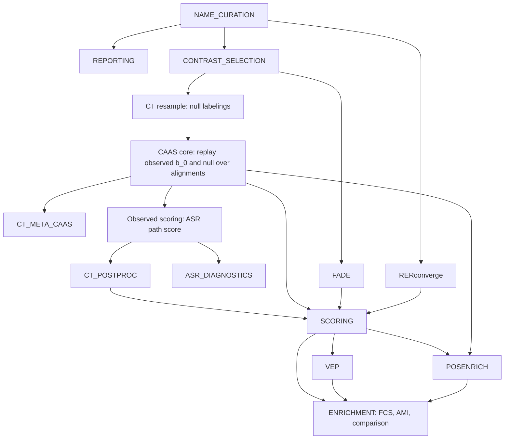

# PhyloPhere

PhyloPhere is a Nextflow (DSL2) pipeline for phylogenetic comparative genome-phenome analysis. Given per-gene protein alignments, a species tree and a phenotype, it asks which genes and which amino acid positions changed differently in the species at the extremes of that phenotype. It combines convergent amino acid substitutions (CAAS), relative evolutionary rate (RERconverge), directional selection (HyPhy FADE), variant annotation, joint scoring tables and enrichment, and it can be run from the command line, from a desktop GUI or with Seqera Platform monitoring.

- Repository: <https://github.com/nozerorma/PhyloPhere>
- License: GNU GPL v3 ([LICENSE](LICENSE))
- Requires: Nextflow 24.04 to 25.x (the environment pins `<26`), and the conda environment in [environment/](environment/phylophere.yml)
- Statistics, formulas and reading guide: [docs/WALKTHROUGH.md](docs/WALKTHROUGH.md)

## Contents

1. [Install](#install)
2. [Quick start](#quick-start)
3. [Workflow](#workflow)
4. [Modules and options](#modules-and-options)
5. [Resources](#resources)
6. [Desktop GUI](#desktop-gui)
7. [Seqera Platform](#seqera-platform)
8. [Outputs](#outputs)
9. [Contributions](#contributions)
10. [Acknowledgements](#acknowledgements)

---

## Install

```bash
# from the repository root; creates the "phylophere" environment (micromamba, mamba or conda)
./environment/install_env.sh environment/phylophere.yml
```

The script also installs the R packages that conda does not provide, including RERconverge at a pinned commit, so it needs network access, `git` and a compiler. `environment/phylophere.yml` is the maintained recipe; `environment/phylophere.lock.yml` is an older export that the installer does not read and that lacks some current dependencies. The script creates the environment or updates an existing one.

```bash
micromamba activate phylophere      # or: conda activate phylophere
nextflow -version
```

The `singularity` and `apptainer` profiles are not operational: the image they expect (`apptainer/miralnso-phylophere-latest.img`, not in the repository) lacks several tools, and `main.nf` warns when either profile is active. Use the conda environment.

## Quick start

Inputs:

| Input | Flag | Format |
|---|---|---|
| Alignments | `--alignment` | Directory with one protein alignment per gene; file name = gene; FASTA headers = species |
| Species tree | `--tree` | Newick |
| Trait table | `--my_traits` | CSV or TSV with a header; species column (`--sp_colname`, default `species`) and phenotype column (`--traitname`) |

Minimal analysis, local machine, one phenotype:

```bash
nextflow run main.nf -profile local \
  --alignment alignments/ --tree species.nwk \
  --my_traits traits.csv --traitname my_phenotype \
  --contrast_selection --ct_tool discovery,resample \
  --scoring --enrichment \
  --outdir results/ -w work/
```

Rules that matter on a first run:

- One invocation analyzes one phenotype. To sweep several, loop over invocations; the GUI generates such a loop or a Slurm array.
- `--vep` is on by default and requires `--scoring`. A run without `--scoring` needs `--vep false`.
- `--ct_tool discovery` needs the labelings that `resample` produces, in the same run or through `--resample_from`.
- `--toy_mode --toy_n 50 --caas_full_perms 100` subsamples the alignments and the null for a smoke test. Its p-values are not interpretable.
- `nextflow run main.nf --help` prints the overview followed by the options of every module that would run with the current flags (CT, disambiguation, post-processing and VEP are on by default; disable modules to shorten it) and exits with status 1. Add module flags to select what is printed (`--help --scoring --fade`).
- Run Nextflow on a Slurm node (`sbatch`), not on a login node: `-profile slurm` submits each task as a job, but the head process itself still needs a node.
- Add `-resume` to continue an interrupted run.

Generate `--tax_id` and `--gene_ensembl_file` before launching, if you want them automatically (the GUI scripts do this for you):

```bash
eval "$(python3 bin/resolve_core_inputs.py --outdir results --tree species.nwk --alignment alignments/ --auto-generate-ensembl)"
```

The script exports `TAX_ID` and `GENE_ENSEMBL_FILE`; add `--tax_id "$TAX_ID" --gene_ensembl_file "$GENE_ENSEMBL_FILE"` to the `nextflow run` command. Without `--auto-generate-ensembl`, `GENE_ENSEMBL_FILE` stays empty.

---

## Workflow



Order of execution, as wired in `main.nf`:

| # | Stage | Flag | Needs |
|---|---|---|---|
| 1 | NAME_CURATION | automatic with `--tree` | tree, traits, alignments |
| 2 | REPORTING | `--reporting` (on) | traits, tree |
| 3 | CONTRAST_SELECTION | `--contrast_selection` | traits, tree |
| 4 | CT: resample, then discovery | `--ct_tool` (on) | contrasts or `--caas_config`, alignments |
| 5 | CT_META_CAAS | follows CT | discovery |
| 6 | Observed scoring and ASR | `--ct_disambiguation` (on) | discovery or `--discovery_from` |
| 7 | CT_POSTPROC and ASR_DIAGNOSTICS | `--ct_postproc` (on) | observed scoring |
| 8 | FADE | `--fade` | contrasts, or `--fade_species_file` |
| 9 | RERconverge | `--rer_tool` | traits, gene trees |
| 10 | SCORING, then the significance report 15 | `--scoring` | CT_POSTPROC; optional FADE, RER |
| 11 | VEP | `--vep` (on) | SCORING |
| 12 | POSENRICH | `--posenrich` | level 1: CT_POSTPROC; the rest: SCORING |
| 13 | ENRICHMENT | `--enrichment` | SCORING |

Any stage after CT can start from a file of an earlier run (see the "standalone" rows in each module table). ENRICHMENT and VEP always need `--scoring` in the same invocation, although SCORING itself may read precomputed inputs. When the run ends, `workflow_map.html` in the output directory shows which stages ran and links to every report.

---

## Modules and options

Options are `--name value` on the command line, or keys of a JSON file passed with `-params-file`. Defaults live in `conf/*.config`. Each table lists every option of the module; "standalone" options let the module start from a previous run.

### Core: `conf/common.config`

Inputs, module switches and metadata shared by all modules.

| Option | Default | Meaning |
|---|---|---|
| `outdir` | `$baseDir/out` | Output directory |
| `my_traits`, `traitname`, `sp_colname` | empty, empty, `species` | Trait table, phenotype column, species column |
| `alignment`, `ali_format` | empty, `fasta` | Alignment directory and format |
| `tree` | empty | Species tree (Newick) |
| `tax_id` | empty | Species-to-NCBI taxid map; blank means exact-name matching in NAME_CURATION unless `bin/resolve_core_inputs.py` built it from the tree before launch |
| `gene_ensembl_file` | empty | Gene-to-Ensembl map; built by BioMart, before launch, only when `resolve_core_inputs.py` runs with `--auto-generate-ensembl` |
| `ali_sp_names` | empty | Optional list of the species in the alignments (faster start) |
| `reporting`, `contrast_selection`, `ct_disambiguation`, `ct_postproc`, `fade`, `vep`, `scoring`, `enrichment` | true, false, true, true, false, true, false, false | Module switches |
| `rer_tool` | empty | RERconverge steps; empty = off |
| `trait_type` | auto | `continuous`, `ordinal`, `auto` |
| `pss_top_pct` | 0.05 | Fraction of continuous candidate pairs kept by the phenotype shift score |
| `pair_center_gate` | none | `median` or `mean`: members of a pair must straddle that trait centre |
| `max_contrasts`, `min_contrasts` | 0, 3 | Cap on selected pairs (0 = no cap); minimum pairs to proceed |
| `n_trait`, `c_trait` | empty | Count traits: sampled individuals and cases (Jeffreys intervals) |
| `secondary_trait`, `branch_trait` | empty | Extra trait shown in reports; trait colouring branches |
| `clade_name`, `taxon_of_interest` | primates, family | Report metadata and taxonomic rank of interest |
| `ref_species_name`, `ref_species_taxid` | Homo_sapiens, 9606 | Reference species for annotations, STRING and BioMart |
| `prune_data`, `prune_list`, `prune_list_secondary` | empty | Manual species pruning |
| `toy_mode`, `toy_n` | false, 1000 | Subsample alignments for smoke tests |
| `seed` | 1998 | Random seed (also fixes Python hashing) |
| `remove_work` | false | Read by the generated run scripts only: they delete the work, run and Nextflow-home directories after a successful run (no `-resume` afterwards); `nextflow run` ignores it |
| `help` | false | Print help and exit |

### REPORTING and CONTRAST_SELECTION

REPORTING renders dataset and phenotype exploration reports (1 to 2) and, with `--prune_data`, the pruning report. CONTRAST_SELECTION optionally prunes the data (`--prune_data` with `--prune_list`), selects foreground and background species pairs with the phenotype shift score and the Dunn criterion, and builds the permulation trait files (reports 3 and 4). When fewer than `min_contrasts` canonical pairs exist, the run ends with exit status 0 and writes `low_contrasts.skip` (trait, pair count, minimum) to the output directory; no later stage runs. The same stop applies to `--fade` and to `--contrast_selection` without `--ct_tool`. Options: `trait_type`, `pss_top_pct`, `pair_center_gate`, `max_contrasts`, `min_contrasts`, `n_trait`, `c_trait` and `prune_*` in the core table. Logic: [walkthrough, section 3](docs/WALKTHROUGH.md#3-contrast-selection).

### CT: `conf/ct.config`

Detects CAAS, columns where foreground and background species carry mostly disjoint residues, and builds the null by replaying simulated labelings through the same code. `resample` harvests the null labelings (it reads no alignments); `discovery` replays the observed labeling (`b_0`) and the null over the alignments.

| Option | Default | Meaning |
|---|---|---|
| `ct_tool` | `discovery,resample` | Stages to run |
| `patterns` | `1,2,3` | Residue patterns accepted (1: one residue per side; 2: one foreground, several background; 3: several foreground, one background; 4: several each) |
| `min_divergent_fraction` | 0.5 | Tolerance to conserved pairs; 1 = strict, lower values allow some species to keep the ancestral residue |
| `min_non_overlapping` | 2 | Species whose residue is absent from the other side, needed to call a CAAS |
| `multi_hypothesis` | true | Test all alternative contrast hypotheses |
| `max_fop` | 100 | Maximum hypotheses (H1 to Hn) per contrast |
| `ct_allow_relaxed_null` | false | Explicitly allow PSS/FOP matching shortfalls and Tier-2 fallback; recorded in provenance |
| `max_bg_gaps_fraction`, `max_fg_gaps_fraction`, `max_gaps_fraction` | 0.0 | Gap tolerance per side and overall |
| `max_bg_miss_fraction`, `max_fg_miss_fraction`, `max_miss_fraction` | 0.0 | Missing-data tolerance per side and overall |
| `miss_pair` | true | Discard a labeling when both sides have gapped species in different pairs; applied only when the foreground and background limits are equal |
| `strict_conservation_output` | true | With tolerance, also write under `strict/` the observed tables and the null restricted to the position-hypothesis rows in which the two sides share no residue type |
| `caas_full_perms` | 1000 | Null cycles harvested and replayed; 0 = observed only |
| `perm_strategy` | auto | Null trait model: `auto` (OU if AIC_OU + 2 < AIC_BM, otherwise BM), `BM`, `OU` |
| `perm_match_pss`, `perm_match_pss_tol` | true, 0.25 | Make null pairs follow the observed pair PSS within that relative tolerance |
| `perm_match_fop` | true | Match the observed hypothesis count; false keeps each null cycle’s available hypotheses up to `max_fop` |
| `perm_match_pss_ci` | false | Permit canonical PSS matching for count traits while retaining CI eligibility |
| `max_tries` | 1000000 | Initial budget of simulation draws; extended automatically up to max(`max_tries`, 50 x `caas_full_perms`) while Tier 1 acceptance is at least 5%, and raised 1.5-fold at most three times below that |
| `chunk_size` | 500 | Labelings per resample file |
| `resample_use_n` | true | Use sample sizes of count traits in null Jeffreys filtering |
| `caas_perms_postproc` | true | Apply the post-processing filters to the null (needs `gene_ensembl_file`) |
| `caas_config` | empty | CAAStools table of the contrasts when `--contrast_selection` is off |
| `ct_core_batch_size` | 20 | Genes per replay task |
| `caas_cycle_block_size` | 500 | Cycles per block; bounds task memory |
| `caas_export_single` | false | Also write the single `caas_perms.rds` export |
| `publish_intermediates` | false | Also publish the resample harvest directory (`resample_*.tab`, manifest, harvest and provenance files) under `resample/` |
| `discovery_from`, `resample_from` | empty | Standalone: `discovery.tab` or resample output of a previous run |

For count traits, PSS matching of the canonical pairs requires both `--perm_match_pss true` and `--perm_match_pss_ci true`; otherwise the null keeps the best Dunn-independent pairs under the Jeffreys CI gate. With `--perm_match_fop false`, each null cycle keeps its available hypotheses up to `--max_fop`, while the number of pairs and the CI gate stay fixed (any trait type). Reusing a harvest generated with `--perm_match_fop false` requires `match_fop_applied=false` in its `permulation_provenance.json`, or `--ct_allow_relaxed_null true`, in which case the run is marked relaxed.

### CT_DISAMBIGUATION and ASR_DIAGNOSTICS: `conf/ct_disambiguation.config`

Reconstructs ancestral states with PAML codeml and scores each position by the posterior support that the shared residue arose on separate lineages (the `asr_path_score`), labeling it `convergent`, `divergent`, `single` or `no_change`. ASR_DIAGNOSTICS renders report 9.

| Option | Default | Meaning |
|---|---|---|
| `ct_disambiguation` | true | Score the observed labeling and the null cycles with the ASR path score; required by CT_POSTPROC and SCORING (core table) |
| `ct_disambig_asr_model` | lg | Substitution model |
| `ct_disambig_asr_cache_dir` | `projectDir/caches/.asr_cache` | ASR cache; genes found there are read, others computed and stored. Entries are matched by gene name only: use one directory per combination of alignment, tree and model |
| `ct_disambig_hypotheses_pairs` | empty | `contrast_hypotheses_pairs.tsv` with domain weights. Read only when observed scoring starts from `--discovery_from`: explicit path, else the file of this run's contrast selection, else (standalone) the file beside the design or in `<outdir>/data_exploration/2.CT/1.Traitfiles/`; without a file, domains weigh equally. A run with a live discovery takes the weights of its own resample |
| `ct_disambig_posterior_threshold` | 0.1 | Residues below this posterior are dropped from a node and charged as worst case |
| `ct_disambig_max_tasks_per_child` | 50 | Tasks a worker process runs before it is replaced |
| `asr_diagnostics` | true | Render report 9 (runs with CT_POSTPROC; standalone from `--disambiguation_dir`) |

Observed scoring checks the design, the discovery keys and the PSS weights before starting workers. A weights file given with `--ct_disambig_hypotheses_pairs` that does not exist is an error, and a weights file next to the design is used before the one in `<outdir>/data_exploration/2.CT/1.Traitfiles/`. A missing alignment, a failed ASR or a scoring failure stops the run. Gene IDs retain embedded dots, and `ali_format` is honored.

ASR reads an existing entry under `ct_disambig_asr_cache_dir/asr_<gene>/` (also `<gene>/asr_<gene>/`) when its RST and tree files parse and cover every alignment column; otherwise the gene is computed in a private directory and then published. Exact gene IDs take priority, and producer reference-species and `.prot` suffixes can match the cache name while internal dots and versions are preserved. Nothing records the model, tree or alignment an entry came from, so changing them does not invalidate the cache. `ct_disambiguation/observed_scoring.json` records completion, source checksums, scoring settings, intentional gene exclusions and position coverage; CT_POSTPROC and report 9 read it.

Standalone observed scoring fingerprints the contents of alignment and design directories for Nextflow resume, including nested files. Editing a file invalidates the task even when its size and timestamp are unchanged.

The strict output means **zero foreground/background residue-type overlap**, independently of the actual identical-pair count. `meta_caas.tsv` preserves `shared_residue_count`. Observed scores and the null carry the score rule `caas_pos_species_pss_v4`. A null or tile stamped with another rule is refused, so the observed and null artifacts must come from the same rule.

### CT_POSTPROC: `conf/ct_postproc.config`

Removes spatial clusters of CAAS and outlier genes, cleans the gene background and renders the characterization report (8).

The cluster and gene filters use all distinct CT candidate positions, including diagnostic `side=none` sites, so ASR scores and categories never select what is filtered. The same cluster rule and gene rule run on every null cycle when `caas_perms_postproc` is true, each cycle within its own pool of genes. CT_POSTPROC reads `observed_scoring.json` beside the master: without it the master is accepted, its model and design provenance is recorded as unknown and report 8 does not certify the candidate universe; an invalid or incomplete record stops the run. Gene length is the number of untrimmed alignment columns from the MAP table when one exists for the gene, otherwise the annotation length (genomic base pairs for generated Ensembl tables); the unit of each gene is in `gene_stats.tsv` (`length_source`), and without MAP tables for every gene the strata mix units. The module needs `--gene_ensembl_file`, and standalone also `--background_input`. Report 8 saves the settings it was rendered with in `postproc/postproc_inputs/`.

| Option | Default | Meaning |
|---|---|---|
| `caas_postproc_mode` | filter | `filter` (single run) or `exploratory` (sweep) |
| `filter_minlen` | 3 | Minimum cluster interval span in alignment columns |
| `filter_min_positions` | null | Minimum candidates per interval. Unset: intervals have no minimum count, but a gene is searched for clusters only if it has at least `filter_minlen` candidates |
| `filter_maxcaas` | 0.7 | Density (candidates per alignment column) at or above which an interval is flagged as a cluster; higher values flag fewer positions |
| `remove_caas_clusters` | true | Discard clusters from the filtered discovery |
| `remove_extreme_genes` | true | Remove the genes whose CAAS count exceeds the far fence of their length stratum (Extreme, any gene). The exploratory report shows both marks whatever the switches say; the production run applies the switches to the observed table and to every cycle of the permulation null |
| `remove_dubious_genes` | true | Remove the genes above the near fence of their stratum that also carry a cluster train (Dubious) |
| `gene_filter_strata` | 10 | Number of gene-length strata of equal size, cut by length within the genes that have at least one candidate; a gene is compared with its stratum |
| `gene_filter_k_far` | 3.0 | Far fence = Q3 + k x scale, where scale is the larger of the IQR of the length stratum and the IQR of all genes in the pool; a gene above it is Extreme. Must not be below `gene_filter_k_near` |
| `gene_filter_k_near` | 1.5 | Near fence, same form with k_near; a gene above it is Dubious only when it also carries a cluster train |
| `strict_remove_extreme_genes`, `strict_remove_dubious_genes`, `strict_gene_filter_strata`, `strict_gene_filter_k_far`, `strict_gene_filter_k_near` | null | Gene-removal settings used when merging the strict null; null takes the value of the ordinary option. The observed filter always reads the ordinary options, and a pass whose observed filter differs from the null it reuses stops, so a strict pass runs with the ordinary options set to the strict values. Cluster parameters have no strict counterpart: they act inside the replay tiles |
| `caas_map_dir` | `vep_map_dir` or empty | Per-gene MAP tables (alignment column to protein residue) from the [Ortholog Characterizator](https://github.com/nozerorma/ortholog_characterizator.git) |
| `minlen_values`, `maxcaas_values` | `2,3,4,10`; `0.6,0.7,0.8` | Sweep values in exploratory mode |
| `disambiguation_input`, `disambiguation_dir`, `background_input` | empty | Standalone inputs |

`gene_stats.tsv` and report 8 mark Extreme and Dubious genes in any mode, whatever the switches say. The switches, fences and strata are applied to the observed table and to every null cycle when the null is merged. To change them after reading report 8, rerun that pass with `-resume`: only the null merges and later steps are recomputed. A later pass that reuses the null with `--caas_null_dir` must use the same settings, otherwise the run stops. Changing `filter_minlen`, `filter_maxcaas`, `filter_min_positions` or `caas_map_dir` recomputes the replay tiles.

### RERconverge: `conf/rerconverge.config`

Correlates relative evolutionary rate of each gene with the trait and calibrates with permulated phenotypes (report 5). `--rer_tool` takes a comma-separated list of `build_trait`, `build_tree`, `build_matrix`, `continuous` and `binary`. The correlation step follows the trait mode, not the step name: listing both `continuous` and `binary` runs only the one that matches the trait.

| Option | Default | Meaning |
|---|---|---|
| `rer_trait_mode` | auto | `auto`: binary if the trait has exactly two distinct values (recoded 0/1), continuous otherwise; `continuous`, `binary`. With a reused `trait_out`, the stored mode is used and a conflicting value stops the run |
| `rer_transform` | ha_logit | Continuous traits only. The default `ha_logit` requires `n_trait` and `c_trait`; set another transform otherwise. `auto` chooses `logit` (proportions), `log10` (Shapiro-Wilk p < 0.05) or `none`, and never `ha_logit`. Also `logit`, `arcsin`, `log10`, `none` |
| `rer_minsp` | 15 | Minimum species for a gene to enter the matrix, and minimum branches with both an RER and a trait value for it to be tested |
| `winsorizeRER`, `winsorizeTrait` | 3, 3 | Number of extreme values per gene replaced at each tail (0 disables); `winsorizeTrait` applies to continuous traits only |
| `rer_perm_batches`, `rer_perms_per_batch` | 10, 100 | Null size is the product; 0 batches skips the null |
| `rer_batch_seed` | 1998 | Batch `i` uses seed + i - 1 |
| `rer_binary_clade` | all | Binary mode: foreground clade marking (`all`, `ancestral`, `terminal`) |
| `rer_min_pos` | 2 | Binary mode: minimum number of foreground branches with data per gene (unweighted test only) |
| `rer_top_n_labels` | 20 | Genes labelled in plots |
| `gene_trees` | `Data/Gene_trees/geneTrees.txt` | Gene trees, one per line (`gene<TAB>newick` or bare Newick); required for `build_tree` |
| `trait_out`, `trees_out`, `matrix_out` | `Data/RER/...` | Objects read when the matching build step is not run; a previous run publishes them under `<outdir>/rerconverge/rer_traits/` and `rer_objects/`, so set the paths explicitly |
| `rer_perms_file`, `rer_continuous_file`, `rer_binary_file`, `rer_universe_file`, `rer_gene_scores` | empty | Standalone: null, results, tested genes and SCORING table of a previous run |

Gene trees with fewer than three trait species are excluded and listed in `<gene_trees>.pruned.txt.audit.tsv`; invalid species, gene or branch-length inputs stop the run. Species names are normalized (whitespace to `_`); gene IDs are kept literally. RER gene identifiers are mapped to the CAAS background identifiers, and the mapping is written to `rer_gene_identifiers.tsv`.

The matrix is estimated with weights, `sqrt` transform and `scale` normalization over the trait species. A reused matrix that carries a provenance stamp must match the supplied trees, paths and trait species, or the run stops; a matrix without a stamp is recomputed from the supplied trees inside the correlation task. One invocation accepts one result source: new inference, one continuous RDS or one binary RDS.

`rerconverge/rer_results/` holds `rerconverge_summary_<trait>.tsv`, `rer_run_metadata.json` and `rer_inputs/`, from which report 5 and the gene lists are regenerated without repeating inference. Null stores are directories (`<trait>.<type>.perms.rds/`) with `blk_*.rds` blocks and `rer_null_manifest.json` (cycle roster, observed-result identity, settings); missing, extra, overlapping or mismatched blocks fail validation, and content checksums are written and checked only when `PHYLOPHERE_VERIFY_CHECKSUMS=1`. Result files without recorded settings and nulls without a manifest are accepted, and `rer_run_metadata.json` marks their inference settings and null coverage as unverified. Calls and the accelerating and decelerating lists use `p.perm < evidence_p_threshold` without correction; the BH q of `p.perm` over all tested genes defines the `evidence_fdr_levels` classes and the q-level lists; the FCS ranking is `sign(Rho) × −log10(P)` with the parametric P. With `rer_perm_batches = 0` no empirical p is computed, so there are no calls and the gene lists are empty.

### FADE: `conf/fade.config`

HyPhy FADE tests directional substitution towards amino acids on the foreground branches and reports Bayes factors per site and gene (report 6).

| Option | Default | Meaning |
|---|---|---|
| `fade_model` | LG | Baseline protein model: `LG`, `WAG`, `JTT`, `JC69`, `mtMet`, `mtVer`, `gcpREV`, `HIVBm`, `HIVWm` or `GTR`; other names, `Dayhoff` included, stop the run |
| `fade_bf_threshold` | 100 | Bayes factor for a significant site and gene |
| `fade_direction` | both | Foreground group: `top`, `bottom`, `both` |
| `fade_background_scope` | all | `all`: every other branch; `opposite`: prune to foreground plus opposite extreme |
| `fade_internal_nodes` | all_descendants | Label internal branches of foreground clades, or `none` |
| `fade_species_file` | empty | Own groups, TSV `species<TAB>group[<TAB>pair]` (1 = top, 0 = bottom, other values rejected; `pair` ignored). Without it FADE uses the candidate-pair members of contrast selection, split at the median (ordinal: highest versus lowest level) |
| `fade_method` | Variational-Bayes | Or `Collapsed-Gibbs`, `Metropolis-Hastings` |
| `fade_grid`, `fade_concentration` | 20, 0.5 | Posterior grid (5 to 50) and Dirichlet prior (0.001 to 1) |
| `fade_chains`, `fade_chain_length`, `fade_burn_in`, `fade_samples` | 5, 2000000, 1000000, 1000 | MCMC settings; validated and passed to HyPhy only for `Collapsed-Gibbs` and `Metropolis-Hastings` |
| `selection_prep_batch_size`, `fade_batch_size` | 500, 200 | Alignments per prep task; genes per FADE task |
| `fade_universe_file`, `fade_tables_dir_top`, `fade_tables_dir_bottom` | empty | Standalone: tested genes; `selection/fade/<direction>` of a previous run |

Alignments (FASTA or PHYLIP) are filtered to tree taxa, and sequences made only of `-`, `?` or `X` are dropped; gene IDs keep internal dots. Malformed files stop the run, and each gene's exclusions are recorded in `selection/prep_audit/`. The top and bottom species groups must be disjoint, and the `pair` column is ignored. Without `--fade_species_file`, FADE runs contrast selection first and the run ends with status 0 when the minimum-contrast gate is not met. The tree must be rooted with a bifurcating root; it is not rerooted automatically.

FADE records every requested gene and direction in `selection/fade/<direction>/fade_audit.tsv`. Genes with no foreground species or fewer than two retained taxa are excluded and listed; any technical failure stops the run, so published tables are complete. `fade_run_metadata.json` and `fade_inputs/` let report 6 be regenerated with the original model, branch settings and cutoff. Tables supplied through `fade_tables_dir_*` without `fade_run_metadata.json` are reported with unknown settings and without a coverage claim. In `fade_site_bf_*.tsv` and `fade_sites_*.csv`, `site` is 1-based and `position` is the 0-based alignment column.

### SCORING: `conf/scoring.config`

Integrates CAAS, FADE and RERconverge into position and gene tables, calibrates CAAS against the null (empirical p, Benjamini-Hochberg q) and renders report 10 and the significance report 15.

| Option | Default | Meaning |
|---|---|---|
| `evidence_p_threshold` | 0.05 | Nominal threshold (p below the value) for the CAAS position and gene flags, the `active_*.tsv` lists and the RER flags |
| `evidence_fdr_levels` | 0.05,0.1,0.15 | Benjamini-Hochberg levels of the `*_bh_class` columns of CAAS positions and genes and of RER genes (comma-separated); gene lists are written per level |
| `gene_stat` | max | Gene statistic; only `max` is supported |
| `caas_evidence_top_n` | 0 | Evidence table for the N best positions; 0 = off |
| `scoring_window_size_bp` | 1000000 | Genomic window for overlap tables |
| `scoring_ami`, `scoring_string` | true, true | AMI report in ENRICHMENT runs when either is true; set both to false to disable it |
| `scoring_compare_fdr`, `scoring_compare_top_n` | 0.15, 20 | Comparison report threshold and number of top genes |
| `auto_generate_ensembl`, `ensembl_dataset` | false, empty | BioMart generation of the Ensembl map and its dataset |
| `scoring_postproc_input`, `scoring_background_input`, `scoring_hypotheses_pairs` | empty | Standalone: filtered discovery, cleaned background, contrast pairs (the pairs only feed the design panel of report 10; the scores already carry the PSS weights) |
| `scoring_fade_summary_top/bottom`, `scoring_fade_site_top/bottom`, `scoring_rer_input` | empty | Standalone FADE and RER tables |
| `scoring_vep_primateai`, `scoring_vep_cosmic`, `scoring_vep_ensembl` | empty | Precomputed VEP tables for the comparison report |
| `caas_null_dir` | empty | `caas_permulation/` of a previous run, used as the null |
| `caas_perm_harvest_file`, `caas_perm_manifest_file`, `caas_evidence_discovery` | empty | Null harvest, design manifest and discovery table for reports |

### VEP: `conf/vep.config`

Annotates scored positions with PrimateAI-3D pathogenicity, COSMIC records and Ensembl VEP consequences of the human single-nucleotide changes that turn a residue of the ancestral set into one of the derived set, or the reverse. Requires `--scoring`; with any source enabled it also needs `--caas_map_dir`, and `--gene_ensembl_file` for Ensembl VEP. `vep` is on by default but does nothing without a source. Annotations are descriptive and do not change scores. PrimateAI-3D and COSMIC tables are license-restricted and must be supplied.

| Option | Default | Meaning |
|---|---|---|
| `vep_primateai_db` | empty | PrimateAI-3D hg38 table |
| `cosmic_db` | empty | COSMIC Mutant Census GRCh38 table |
| `vep_ensembl` | false | Run Ensembl VEP (needs `gene_ensembl_file`) |
| `vep_cache_dir` | empty | Offline cache; blank uses `~/.cache/phylophere/vep/homo_sapiens_GRCh38` |
| `vep_species`, `vep_assembly` | homo_sapiens, GRCh38 | Fixed by the VEP reference contract; any other value stops the run |
| `vep_mode` | auto | `auto` (offline cache when `<cache>/homo_sapiens` exists, otherwise database), `database` (Ensembl MySQL and REST, never cached) or `offline` (standard cache with one indexed FASTA; needs resolved codon bases in the MAP) |
| `vep_db_host`, `vep_db_port` | `ensembldb.ensembl.org`, 3306 | Database mode connection |

### ENRICHMENT: `conf/enrichment.config`

FCS ranks gene sets by Wilcoxon AUC against the CAAS gene-p and RER rankings (report 11); AMI finds DOMINO active modules on STRING networks (12); the comparison report (14) joins the CAAS and RER FCS, the AMI modules and the VEP and position annotations. Requires `--scoring`; the run stops with an error otherwise.

| Option | Default | Meaning |
|---|---|---|
| `fcs_enabled` | true | CAAS and RER FCS reports |
| `gmt_dir` | `subworkflows/ENRICHMENT/dat` | Directory of `.gmt` gene-set files |
| `auto_fetch_gmt` | false | GUI scripts only: add current GO and WikiPathways sets |
| `fcs_min_genes`, `fcs_max_genes` | 10, 0 | Set size limits; 0 = no upper cap |
| `fcs_fdr` | 0.15 | Benjamini-Hochberg threshold on the permulation p |
| `fcs_pperm_thr`, `fcs_analytic_levels` | 0.025, `0.05,0.1,0.15` | Analytic rule of Redlich et al.: raw permulation p cut and BH levels |
| `fcs_cluster_threshold` | 0.2 | Minimum Jaccard similarity of full gene sets inside a term group (complete linkage) |
| `fcs_top_n` | 20 | Sets shown per table |
| `fcs_batch_size`, `fcs_block_batch_genes` | 4, 1000 | GMT files per task; genes per null-calibration task |
| `caas_permulation_enrichment` | true | Run the CAAS null when ENRICHMENT needs it |
| `domino_network_score_thr` | 700 | STRING combined-score cut |
| `domino_slice_thr`, `domino_module_thr` | 0.3, 0.05 | DOMINO slice relevance and module significance |
| `ami_max_blocks`, `ami_block_threshold` | 8, 0.2 | Blocks shown; Jaccard to merge terms into a block |
| `ami_description_fdr` | 0.10 | FDR of the descriptive STRING labels |
| `string_species` | 9606 | STRING taxon of the DOMINO network and of the report 12 labels |
| `string_db_dir`, `string_cache_dir` | empty | Pre-downloaded STRING files; download cache |
| `publish_domino_intermediates` | false | Keep network and module files |

### POSENRICH: `conf/posenrich.config`

Describes how positive positions relate to genes and to sets of positions (Pfam domains and clans, ultraconserved regions, FUBAR and FADE sites, genomic windows, custom lists). Level 1 tests, per gene and direction, whether a gene holds more positive positions than the null cycles (empirical) or than a uniform allocation over the universe (hypergeometric, reference); level 2 tests concentration inside genes; overlaps and proximity are descriptive (report 13). Level 1 needs `--ct_postproc` or `--accumulation_background_input`; the registry, level 2 and report need `--scoring`. See the [walkthrough](docs/WALKTHROUGH.md#12-posenrich) for the statistics and `--posenrich_holdout` for a calibration check.

| Option | Default | Meaning |
|---|---|---|
| `posenrich` | false | Enable |
| `position_characterization` | auto | `auto`: descriptive position annotations (registry and characterization, no statistics) when SCORING and ENRICHMENT run without POSENRICH; `true`: also with SCORING alone; `false`: off. They enter the comparison report (14) and are written to `position_characterization/` |
| `posenrich_domains`, `posenrich_ucr` | true, true | Include Pfam and UCR layers; generated from `--alignment` when their tables are blank |
| `domain_variability_file`, `ucr_positions_file` | empty | Precomputed Pfam and UCR tables (must have a `coordinate_space` column) |
| `domain_ref_species`, `pfam_cache_dir` | Homo_sapiens, `~/.cache/phylophere/pfam` | Species scanned with hmmscan; Pfam-A cache (about 1.5 GB) |
| `fubar_sites_file` | empty | FUBAR site table (not produced by this pipeline) |
| `posenrich_custom_file` | empty | Headerless TSV: gene, zero-based CAAS position, term, optional description |
| `posenrich_collections` | empty | Collections to test; blank = those informative within proteins |
| `posenrich_min_genes` | 2 | Eligible genes (members and non-members of the term in the covered universe) a term needs to be tested |
| `posenrich_radios` | `0,5,10` | Proximity radii in residues |
| `posenrich_holdout` | 0 | Validation: null cycles that play the observed one |
| `position_registry_memory`, `position_module_memory`, `posenrich_within_gene_memory` | derived | Memory of the heavy steps |
| `accumulation_caas_input`, `accumulation_background_input`, `posenrich_background_file` | empty | Standalone: filtered discovery, cleaned background, tested positions |

---

## Resources

`conf/resources.config` sets one request per process label (`process_low`, `process_medium`, `process_reporting`, `process_discovery`, `process_resample` and others) and overrides the heaviest processes by name. A `withName` setting overrides the `withLabel` setting of the same process, so edit the name block when a process has one. Memory and time of most blocks grow linearly with the attempt number, and most blocks retry only on the exit codes of memory, time and Slurm-limit kills; the label `error_retry` retries on any failure.

| Process group | Typical request | Notes |
|---|---|---|
| Reports | 2 to 12 cpus, 4 to 16 GB (RER FCS report 32 GB) | Rendered with R Markdown |
| CAAS core (replay) | 4 cpus, 20 GB | Per gene batch and cycle block |
| RERconverge trees, matrix, correlation | 8 cpus, 32 GB | Whole gene-tree set in memory |
| FADE | 8 to 12 cpus, 16 GB | One task per gene batch |
| SCORING_COMPUTE | 2 cpus, 32 GB | Reads the null |
| POSENRICH | 4 to 64 GB | Registry and characterization sized from the input; universe 8 GB; level 2 16 GB (`--posenrich_within_gene_memory`) |

Ceilings and executor behaviour:

| Setting | Default | Where |
|---|---|---|
| `max_cpus`, `max_memory`, `max_time` | Set by the profile; no ceiling applies without a profile | `nextflow.config` |
| Profile `local` | 32 cpus, 64 GB, 5 days | `nextflow.config` |
| Profile `slurm` | 128 cpus, 128 GB, 960 h | `nextflow.config` |
| `slurm_queue`, `slurm_queue_size`, `slurm_submit_rate_limit`, `slurm_exit_read_timeout` | empty, 8, 30/1min, 4h | `nextflow.config` |

The GUI Resources tab edits these ceilings and the Slurm executor settings. Use `execution_trace.txt` and `execution_report.html` in `<outdir>/pipeline_info/` to compare requests with measured peaks before raising limits.

---

## Desktop GUI

The GUI builds a project (a JSON file), validates it and generates the launch scripts. It does not run the pipeline itself.

```bash
./run_gui.sh                   # starts the GUI inside the phylophere environment
./install_gui_launcher.sh      # optional: adds a desktop entry
```

Tabs, left to right:

| Tab | Content |
|---|---|
| General | Project name, repository directory, plugin directory, seed, remote host |
| Runtime | Local or Slurm, work and results directories, input files, Seqera token, toy mode, cleanup |
| CAAS, Disambiguation, RERconverge, FADE, VEP, Scoring, Enrichment, POSENRICH | One tab per module, with an enable switch and one field per option of its `conf/*.config` |
| Precomputed Run | Standalone inputs that replace upstream modules |
| Resources | CPU, memory and time ceilings and Slurm executor settings |
| About | Version, credits, links to this README and the walkthrough |

Reading a module tab:

- Required fields have a red label with an asterisk; fields with a scientific effect show a "recommended default" tooltip; all others are optional.
- Under each field a grey line states what the option does and what to enter. The same text appears as a tooltip.
- "Advanced parameters" is collapsed by default and holds the options most runs leave unchanged.
- A disabled module shows what the downstream modules need instead, and where to supply it (Precomputed Run).
- The box at the bottom of each tab accepts raw Nextflow flags that are appended verbatim.

File menu: New, Open, Save Project As, Load Template (example projects in `gui/templates/`: cancer prevalence, diet, longevity quotient and the PEPC tier-1 and marine-mammal tier-2 validation fixtures; they contain the paths of the developers' machines, so replace the paths in General and Runtime before use), Validate Paths, **Generate Scripts** and Regenerate HTML Reports. Generate Scripts writes, for the chosen runtime, either a local loop or a Slurm array script plus a single-phenotype script; with the post-processing options enabled it also writes exploratory, complete and strict passes. Scripts write a `params.json`, resolve the taxid and Ensembl maps and call `nextflow run main.nf -params-file params.json`. Fill the phenotype table of the Runtime tab with one row per phenotype.

Typical session: load a template or start a project, set the three inputs and the work and results directories in Runtime, enable modules, run Validate Paths, Generate Scripts, copy the scripts to the machine that will run them and launch them there (with `sbatch` on a cluster).

---

## Seqera Platform

[Seqera Platform](https://cloud.seqera.io) shows a live dashboard of a run: tasks, status, requested and used resources, logs and timeline. PhyloPhere does not need a Seqera account to run.

1. Create an access token in Seqera Platform (user menu, "Your tokens").
2. Give the token to the pipeline in one of two ways:

```bash
# option A: file in the repository root (git-ignored)
echo "YOUR_TOKEN" > token.tk && chmod 600 token.tk

# option B: environment variable
export TOWER_ACCESS_TOKEN="YOUR_TOKEN"
```

3. Launch with `-with-tower` (the GUI scripts add it when "Enable Seqera Cloud monitoring" is checked in the Runtime tab (checked by default)). For a shared workspace also set `TOWER_WORKSPACE_ID` (read by Nextflow, not by PhyloPhere).
4. Open the run in Seqera Platform and follow it.

Notes:

- `conf/common.config` enables the `tower` scope whenever `token.tk` exists or `TOWER_ACCESS_TOKEN` is set, independently of the `-with-tower` flag. Remove the file or unset the variable to run without monitoring.
- The Runtime tab has an access-token field and a "Save to token.tk" button: it writes `token.tk` (mode 600) in the repository directory of the General tab, on the remote host when one is set, and saving an empty field deletes the file. The token is never stored in the project file or in generated scripts. Unchecking the box does not disable monitoring while `token.tk` exists.
- Seqera receives the command line, parameters (which include your input paths), configuration, task scripts, resource usage and status. See the [data privacy overview](https://docs.seqera.io/platform-cloud/data-privacy/overview) before monitoring runs on sensitive data.
- On a cluster, use the same token on the compute node that runs the Nextflow head process.

---

## Outputs

Under `--outdir`:

| Directory | Content |
|---|---|
| `html_reports/` | All reports, numbered by pipeline order (see the [report map](docs/WALKTHROUGH.md#14-report-map)) |
| `workflow_map.html`, `workflow_html.done` | Which stages ran, with links to every report and result directory; completion marker with `status=ok` or `failed` |
| `low_contrasts.skip` | Written when the minimum-contrast gate stops the run |
| `name_curation/` | Curated tree and trait table, species and taxid tables, curation report |
| `data_exploration/` | Trait, pruning and contrast-selection tables and figures |
| `caastools/`, `caas_permulation/` | Discovery tables, the resample labelings and harvest tables, and the null (blocks, roster, metadata) |
| `strict/` | Strict-conservation outputs (`caastools/`, `meta_caas/`, `ct_disambiguation/`, `caas_permulation/`); only with `--strict_conservation_output` |
| `resample/` | Null labelings; only with `--publish_intermediates` |
| `meta_caas/`, `ct_disambiguation/`, `postproc/`, `asr_diagnostics/` | CAAS tables, ASR scores, filtered discovery, diagnostics |
| `rerconverge/`, `selection/` | RER objects and tables; `selection/` holds `fade/<direction>` tables, `species_sets/`, `prep_audit/` and `fade/audit/` |
| `scoring/` (RER FCS in `scoring/rer/`) | `position_scores.tsv`, `gene_scores.tsv`, `gene_evidence.tsv` and its metadata, `fcs_stats*.tsv`, `null_universe_summary.tsv`, `gene_lists/`, `position_lists/`; the tables of report 15 are in `meta_caas/significance/` |
| `vep/`, `posenrich/`, `position_characterization/`, `fcs/`, `ami/`, `compare/` | Annotations, POSENRICH and position-characterization tables, enrichment results |
| `universes/`, `core_inputs/` | Gene and position universes; generated taxid and Ensembl maps and UCR and domain tables |
| `pipeline_info/` | Nextflow timeline, report, trace and DAG |

To reuse a null, keep the whole `caas_permulation/` directory and pass it with `--caas_null_dir`.

---

## Contributions

See [code organization](docs/CODE_ORGANIZATION.md) before adding utilities or validation scripts.

Issues and pull requests are welcome at <https://github.com/nozerorma/PhyloPhere>. Please name the module involved and attach the `workflow_map.html` and `pipeline_info/execution_report.html` of the failing run.

| Contributor | Role |
|---|---|
| Miguel Ramón (miguel.ramon@upf.edu) | PhyloPhere pipeline, GUI and reports |
| Fabio Barteri (fabio.barteri@upf.edu) | CAAStools author |
| Alejandro Valenzuela (alejandro.valenzuela@upf.edu) | Contributor |
| Xavier Farré (xfarrer@igtp.cat) | Contributor |
| David de Juan (david.juan@upf.edu) | Contributor |
| Maria Sanchez Bermudez | Phenotype datasets and test scenarios |

Institute of Evolutionary Biology (IBE), UPF-CSIC. Released under the GNU GPL v3.

## Acknowledgements

PhyloPhere builds on these methods and resources:

- [CAAStools](https://github.com/linudz/caastools): convergent amino acid substitution discovery (Barteri et al. 2022).
- [Amino acid groupings](https://doi.org/10.1111/1755-0998.70052): Chen and Zou 2025, *Mol Ecol Resour*.
- [RERconverge](https://github.com/nclark-lab/RERconverge): relative evolutionary rates (Kowalczyk et al. 2019, *Bioinformatics*).
- [HyPhy FADE](https://www.hyphy.org): directional selection (Kosakovsky Pond et al. 2021).
- [PAML](http://abacus.gene.ucl.ac.uk/software/paml.html): ancestral state reconstruction.
- [PrimateAI-3D](https://www.science.org/doi/10.1126/science.abn7829): variant pathogenicity (Gao et al. 2023, *Science*).
- [COSMIC](https://cancer.sanger.ac.uk/cosmic): somatic mutation census (Tate et al. 2019).
- [Ensembl VEP](https://www.ensembl.org/info/docs/tools/vep/index.html): variant consequences.
- [DOMINO](https://github.com/Shamir-Lab/DOMINO): active module identification (Levi et al. 2021).
- [STRING](https://string-db.org): protein interaction networks (Szklarczyk et al. 2023).
- [Ortholog Characterizator](https://github.com/nozerorma/ortholog_characterizator.git): orthologs and the position-level tables used by VEP and POSENRICH (per-gene MAP, FUBAR sites, UCR, domain variability).
- Also used: Pfam-A and HMMER (domain variability), Valdar conservation scores (UCR detection), Ensembl BioMart and NCBI Taxonomy (identifier maps), the gene-set collections of `subworkflows/ENRICHMENT/dat/` (MSigDB, Gene Ontology, KEGG, Reactome, WikiPathways, DisGeNET, OMIM, CORUM, Human Phenotype Ontology), and the R packages geiger, phytools, ape and phylolm.
- [Nextflow](https://www.nextflow.io) and [Seqera Platform](https://seqera.io): workflow engine and monitoring.
