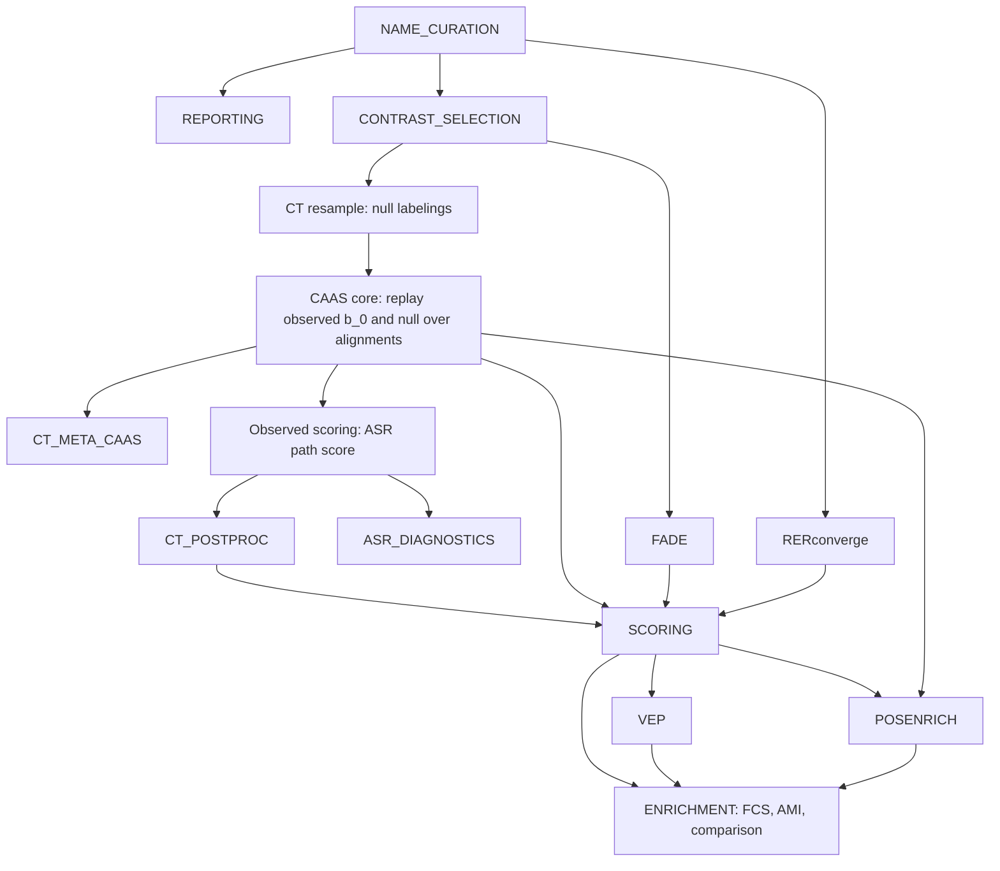

# PhyloPhere

PhyloPhere is a Nextflow (DSL2) pipeline for phylogenetic comparative genome-phenome analysis. Given per-gene protein alignments, a species tree and a phenotype, it asks which genes and which amino acid positions changed differently in the species at the extremes of that phenotype. It combines convergent amino acid substitutions (CAAS), relative evolutionary rate (RERconverge), directional selection (HyPhy FADE), variant annotation, composite scoring and enrichment, and it can be run from the command line, from a desktop GUI or with Seqera Platform monitoring.

- Repository: <https://github.com/nozerorma/PhyloPhere>
- License: GNU GPL v3 ([LICENSE](LICENSE))
- Requires: Nextflow 25.x, and the conda environment in [environment/](environment/phylophere.yml)
- Statistics, formulas and reading guide: [docs/WALKTHROUGH.md](docs/WALKTHROUGH.md)

## Contents

1. [Install](#install)
2. [Quick start](#quick-start)
3. [Workflow](#workflow)
4. [Modules and options](#modules-and-options)
5. [Resources](#resources)
6. [Desktop GUI](#desktop-gui)
7. [Seqera Platform](#seqera-platform)
8. [Outputs](#outputs)
9. [Contributions](#contributions)
10. [Acknowledgements](#acknowledgements)

---

## Install

```bash
# from the repository root; creates the "phylophere" environment (micromamba, mamba or conda)
./environment/install_env.sh environment/phylophere.yml
```

The script also installs the R packages that conda does not provide, including RERconverge at a pinned commit, so it needs network access and a compiler. `environment/phylophere.lock.yml` is a full export of a working solve.

```bash
micromamba activate phylophere      # or: conda activate phylophere
nextflow -version
```

Container profiles (`singularity`, `apptainer`) expect an image at `apptainer/miralnso-phylophere-latest.img`, which is not part of the repository. Use the conda environment unless you provide the image.

## Quick start

Inputs:

| Input | Flag | Format |
|---|---|---|
| Alignments | `--alignment` | Directory with one protein alignment per gene; file name = gene; FASTA headers = species |
| Species tree | `--tree` | Newick |
| Trait table | `--my_traits` | CSV or TSV with a header; species column (`--sp_colname`, default `species`) and phenotype column (`--traitname`) |

Minimal analysis, local machine, one phenotype:

```bash
nextflow run main.nf -profile local \
  --alignment alignments/ --tree species.nwk \
  --my_traits traits.csv --traitname my_phenotype \
  --contrast_selection --ct_tool discovery,resample \
  --scoring --enrichment \
  --outdir results/ -w work/
```

Rules that matter on a first run:

- One invocation analyzes one phenotype. To sweep several, loop over invocations; the GUI generates such a loop or a Slurm array.
- `--vep` is on by default and requires `--scoring`. A run without `--scoring` needs `--vep false`.
- `--ct_tool discovery` needs the labelings that `resample` produces, in the same run or through `--resample_from`.
- `--toy_mode --toy_n 50 --caas_full_perms 100` subsamples the alignments and the null for a smoke test. Its p-values are not interpretable.
- `nextflow run main.nf --help` prints the overview; add a module flag to print that module's options (`--help --scoring --fade`).
- Run Nextflow on a Slurm node (`sbatch`), not on a login node: `-profile slurm` submits each task as a job, but the head process itself still needs a node.
- Add `-resume` to continue an interrupted run.

Generate `--tax_id` and `--gene_ensembl_file` before launching, if you want them automatically (the GUI scripts do this for you):

```bash
eval "$(python3 bin/resolve_core_inputs.py --outdir results --tree species.nwk --alignment alignments/ --auto-generate-ensembl)"
```

---

## Workflow



Order of execution, as wired in `main.nf`:

| # | Stage | Flag | Needs |
|---|---|---|---|
| 1 | NAME_CURATION | automatic with `--tree` | tree, traits, alignments |
| 2 | REPORTING | `--reporting` (on) | traits, tree |
| 3 | CONTRAST_SELECTION | `--contrast_selection` | traits, tree |
| 4 | CT: resample, then discovery | `--ct_tool` (on) | contrasts or `--caas_config`, alignments |
| 5 | CT_META_CAAS | follows CT | discovery |
| 6 | Observed scoring and ASR | `--ct_disambiguation` (on) | discovery or `--discovery_from` |
| 7 | CT_POSTPROC and ASR_DIAGNOSTICS | `--ct_postproc` (on) | observed scoring |
| 8 | FADE | `--fade` | contrasts |
| 9 | RERconverge | `--rer_tool` | traits, gene trees |
| 10 | SCORING | `--scoring` | CT_POSTPROC; optional FADE, RER |
| 11 | VEP | `--vep` (on) | SCORING |
| 12 | POSENRICH | `--posenrich` | level 1: CT_POSTPROC; the rest: SCORING |
| 13 | ENRICHMENT | `--enrichment` | SCORING |

Any stage after CT can start from a file of an earlier run (see the "standalone" rows in each module table). ENRICHMENT and VEP always need `--scoring` in the same invocation, although SCORING itself may read precomputed inputs. When the run ends, `workflow_map.html` in the output directory shows which stages ran and links to every report.

---

## Modules and options

Options are `--name value` on the command line, or keys of a JSON file passed with `-params-file`. Defaults live in `conf/*.config`. Each table lists every option of the module; "standalone" options let the module start from a previous run.

### Core: `conf/common.config`

Inputs, module switches and metadata shared by all modules.

| Option | Default | Meaning |
|---|---|---|
| `outdir` | `$baseDir/out` | Output directory |
| `my_traits`, `traitname`, `sp_colname` | empty, empty, `species` | Trait table, phenotype column, species column |
| `alignment`, `ali_format` | empty, `fasta` | Alignment directory and format |
| `tree` | empty | Species tree (Newick) |
| `tax_id` | empty | Species-to-NCBI taxid map; built from the tree when blank |
| `gene_ensembl_file` | empty | Gene-to-Ensembl map; built from BioMart when blank |
| `ali_sp_names` | empty | Optional list of the species in the alignments (faster start) |
| `reporting`, `contrast_selection`, `ct_disambiguation`, `ct_postproc`, `fade`, `vep`, `scoring`, `enrichment` | true, false, true, true, false, true, false, false | Module switches |
| `rer_tool` | empty | RERconverge steps; empty = off |
| `trait_type` | auto | `continuous`, `ordinal`, `auto` |
| `pss_top_pct` | 0.05 | Fraction of continuous candidate pairs kept by the phenotype shift score |
| `pair_center_gate` | none | `median` or `mean`: members of a pair must straddle that trait centre |
| `max_contrasts`, `min_contrasts` | 0, 3 | Cap on selected pairs (0 = no cap); minimum pairs to proceed |
| `n_trait`, `c_trait` | empty | Count traits: sampled individuals and cases (Jeffreys intervals) |
| `secondary_trait`, `branch_trait` | empty | Extra trait shown in reports; trait colouring branches |
| `clade_name`, `clade_taxid`, `taxon_of_interest` | primates, 9443, family | Report metadata and taxonomic rank of interest |
| `ref_species_name`, `ref_species_taxid` | Homo_sapiens, 9606 | Reference species for annotations, STRING and BioMart |
| `prune_data`, `prune_list`, `prune_list_secondary` | empty | Manual species pruning |
| `toy_mode`, `toy_n` | false, 1000 | Subsample alignments for smoke tests |
| `seed` | 1998 | Random seed (also fixes Python hashing) |
| `remove_work` | false | Delete work, run and Nextflow-home directories after a successful run |
| `help` | false | Print help and exit |

### REPORTING and CONTRAST_SELECTION

REPORTING renders dataset and phenotype exploration reports (1 to 2) and, with `--prune_data`, the pruning report. CONTRAST_SELECTION prunes the data, selects foreground and background species pairs with the phenotype shift score and the Dunn criterion, and builds the permulation trait files (reports 3 and 4). It stops the CT stage when fewer than `min_contrasts` pairs exist. Options: `trait_type`, `pss_top_pct`, `pair_center_gate`, `max_contrasts`, `min_contrasts`, `n_trait`, `c_trait` and `prune_*` in the core table. Logic: [walkthrough, section 3](docs/WALKTHROUGH.md#3-contrast-selection).

### CT: `conf/ct.config`

Detects CAAS, columns where foreground and background species carry mostly disjoint residues, and builds the null by replaying simulated labelings through the same code. `resample` harvests the null labelings (it reads no alignments); `discovery` replays the observed labeling (`b_0`) and the null over the alignments.

| Option | Default | Meaning |
|---|---|---|
| `ct_tool` | `discovery,resample` | Stages to run |
| `patterns` | `1,2,3` | Residue patterns accepted (1: one residue per side; 2: one foreground, several background; 3: several foreground, one background; 4: several each) |
| `min_divergent_fraction` | 0.5 | Tolerance to conserved pairs; 1 = strict, lower values allow some species to keep the ancestral residue |
| `min_non_overlapping` | 2 | Species whose residue is absent from the other side, needed to call a CAAS |
| `multi_hypothesis` | true | Test all alternative contrast hypotheses |
| `max_fop` | 100 | Maximum hypotheses (H1 to Hn) per contrast |
| `max_bg_gaps_fraction`, `max_fg_gaps_fraction`, `max_gaps_fraction` | 0.0 | Gap tolerance per side and overall |
| `max_bg_miss_fraction`, `max_fg_miss_fraction`, `max_miss_fraction` | 0.0 | Missing-data tolerance per side and overall |
| `miss_pair` | true | Discard labelings whose two sides have gaps in different pairs |
| `strict_conservation_output` | true | With tolerance, also write observed tables and null of hypotheses without conserved pairs under `strict/` |
| `caas_full_perms` | 1000 | Null cycles harvested and replayed; 0 = observed only |
| `perm_strategy` | auto | Null trait model: `auto` (BM or OU by AICc), `BM`, `OU` |
| `perm_match_pss`, `perm_match_pss_tol` | true, 0.25 | Make null pairs follow the observed pair PSS within that relative tolerance |
| `max_tries` | 1000000 | Cap on simulation attempts while harvesting |
| `chunk_size` | 500 | Labelings per resample file |
| `resample_use_n` | true | Use sample sizes of count traits in null Jeffreys filtering |
| `caas_perms_postproc` | true | Apply the post-processing filters to the null (needs `gene_ensembl_file`) |
| `caas_config` | empty | CAAStools table of the contrasts when `--contrast_selection` is off |
| `ct_core_batch_size` | 20 | Genes per replay task |
| `caas_cycle_block_size` | 500 | Cycles per block; bounds task memory |
| `caas_export_single` | false | Also write the single `caas_perms.rds` export |
| `publish_intermediates` | false | Publish discovery, background and resample files |
| `discovery_from`, `resample_from` | empty | Standalone: `discovery.tab` or resample output of a previous run |

### CT_DISAMBIGUATION and ASR_DIAGNOSTICS: `conf/ct_disambiguation.config`

Reconstructs ancestral states with PAML codeml and scores each position by how likely the shared residue arose independently (the `asr_path_score`), labeling it `convergent`, `divergent`, `single` or `no_change`. ASR_DIAGNOSTICS renders report 9.

| Option | Default | Meaning |
|---|---|---|
| `ct_disambiguation` | true | Enable (core table) |
| `ct_disambig_asr_model` | lg | Substitution model |
| `ct_disambig_asr_cache_dir` | `projectDir/caches/.asr_cache` | ASR cache; genes found there are read, others computed and stored |
| `ct_disambig_hypotheses_pairs` | empty | `contrast_hypotheses_pairs.tsv` with domain weights; found automatically in standard runs |
| `ct_disambig_posterior_threshold` | 0.1 | Residues below this posterior are dropped from a node and charged as worst case |
| `ct_disambig_max_tasks_per_child` | 50 | Worker recycling cap |
| `asr_diagnostics` | true | Render report 9 |
| `meta_caas_from` | empty | Standalone: `meta_caas.tsv` of a previous run |

### CT_POSTPROC: `conf/ct_postproc.config`

Removes spatial clusters of CAAS and outlier genes, cleans the gene background and renders the characterization report (8).

| Option | Default | Meaning |
|---|---|---|
| `caas_postproc_mode` | filter | `filter` (single run) or `exploratory` (sweep) |
| `filter_minlen` | 3 | Minimum alignment length of a cluster |
| `filter_maxcaas` | 0.7 | Maximum CAAS density of a cluster window |
| `remove_caas_clusters` | true | Discard clusters from the filtered discovery |
| `gene_filter_mode` | dubious | Outlier genes to remove: `none`, `extreme`, `dubious`, `both` |
| `extreme_threshold` | 0.99 | Quantile defining extreme genes |
| `iqr_multiplier` | 3.0 | IQR multiplier defining dubious genes |
| `caas_map_dir` | `vep_map_dir` or empty | Per-gene MAP tables (alignment column to protein residue) from the [Ortholog Characterizator](https://github.com/nozerorma/ortholog_characterizator.git) |
| `minlen_values`, `maxcaas_values` | `2,3,4,10`; `0.6,0.7,0.8` | Sweep values in exploratory mode |
| `disambiguation_input`, `disambiguation_dir`, `background_input` | empty | Standalone inputs |

### RERconverge: `conf/rerconverge.config`

Correlates relative evolutionary rate of each gene with the trait and calibrates with permulated phenotypes (report 5). `--rer_tool` takes a comma-separated list of `build_trait`, `build_tree`, `build_matrix`, `continuous` and `binary`.

| Option | Default | Meaning |
|---|---|---|
| `rer_trait_mode` | auto | `auto`, `continuous`, `binary` |
| `rer_transform` | ha_logit | `auto`, `ha_logit`, `logit`, `arcsin`, `log10`, `none`; `ha_logit` needs `n_trait` and `c_trait` |
| `rer_minsp` | 15 | Minimum species per gene |
| `winsorizeRER`, `winsorizeTrait` | 3, 3 | Winsorization limits |
| `rer_perm_batches`, `rer_perms_per_batch` | 10, 100 | Null size is the product; 0 batches skips the null |
| `rer_batch_seed` | 1998 | Batch `i` uses seed + i - 1 |
| `rer_binary_clade` | all | Binary mode: foreground clade marking (`all`, `ancestral`, `terminal`) |
| `rer_min_pos` | 2 | Binary mode: minimum foreground lineages per gene |
| `rer_top_n_labels` | 20 | Genes labelled in plots |
| `gene_trees` | `Data/Gene_trees/geneTrees.txt` | Gene trees (must be provided) |
| `trait_out`, `trees_out`, `matrix_out` | `Data/RER/...` | Objects reused when the matching build step is skipped |
| `rer_perms_file`, `rer_continuous_file`, `rer_binary_file`, `rer_universe_file`, `rer_gene_scores` | empty | Standalone: null, results, tested genes and SCORING table of a previous run |

### FADE: `conf/fade.config`

HyPhy FADE tests directional substitution towards amino acids on the foreground branches and reports Bayes factors per site and gene (report 6).

| Option | Default | Meaning |
|---|---|---|
| `fade_model` | LG | `LG`, `WAG`, `JTT`, `Dayhoff` |
| `fade_bf_threshold` | 100 | Bayes factor for a significant site and gene |
| `fade_direction` | both | Foreground group: `top`, `bottom`, `both` |
| `fade_background_scope` | all | `all`: every other branch; `opposite`: prune to foreground plus opposite extreme |
| `fade_internal_nodes` | all_descendants | Label internal branches of foreground clades, or `none` |
| `fade_species_file` | empty | Your own groups (`species`, `group`, optional `pair`; 1 = top, 0 = bottom) |
| `fade_method` | Variational-Bayes | Or `Collapsed-Gibbs`, `Metropolis-Hastings` |
| `fade_grid`, `fade_concentration` | 20, 0.5 | Posterior grid and Dirichlet prior |
| `fade_chains`, `fade_chain_length`, `fade_burn_in`, `fade_samples` | 5, 2000000, 1000000, 1000 | MCMC settings, ignored by Variational-Bayes |
| `lg_dat_path` | derived | Path of the model file |
| `selection_prep_batch_size`, `fade_batch_size` | 500, 200 | Alignments per prep task; genes per FADE task |
| `fade_min_genes_for_heatmap` | 2 | Minimum genes for the heatmap |
| `fade_universe_file`, `fade_tables_dir_top`, `fade_tables_dir_bottom` | empty | Standalone: tested genes; `selection/fade/<direction>` of a previous run |

### SCORING: `conf/scoring.config`

Integrates CAAS, FADE and RERconverge into position and gene tables, calibrates CAAS against the null (empirical p, Benjamini-Hochberg q) and renders report 11 and the significance report 16.

| Option | Default | Meaning |
|---|---|---|
| `evidence_p_threshold` | 0.05 | Nominal empirical threshold for activity flags |
| `evidence_fdr_threshold` | 0.05 | Benjamini-Hochberg threshold for highlighting |
| `gene_stat` | max | Gene statistic; only `max` is supported |
| `caas_evidence_top_n` | 0 | Evidence table for the N best positions; 0 = off |
| `scoring_window_size_bp` | 1000000 | Genomic window for overlap tables |
| `scoring_ami`, `scoring_string` | true, true | AMI report in ENRICHMENT; `scoring_string` is read only when `scoring_ami` is unset |
| `scoring_compare_fdr`, `scoring_compare_top_n` | 0.15, 20 | Comparison report threshold and number of top genes |
| `auto_generate_ensembl`, `ensembl_dataset` | false, empty | BioMart generation of the Ensembl map and its dataset |
| `scoring_postproc_input`, `scoring_background_input`, `scoring_hypotheses_pairs` | empty | Standalone: filtered discovery, cleaned background, contrast pairs |
| `scoring_fade_summary_top/bottom`, `scoring_fade_site_top/bottom`, `scoring_rer_input` | empty | Standalone FADE and RER tables |
| `scoring_vep_primateai`, `scoring_vep_cosmic`, `scoring_vep_ensembl` | empty | Precomputed VEP tables for the comparison report |
| `caas_null_dir` | empty | `caas_permulation/` of a previous run, used as the null |
| `caas_perm_harvest_file`, `caas_perm_manifest_file`, `caas_evidence_discovery` | empty | Null harvest, design manifest and discovery table for reports |

### VEP: `conf/vep.config`

Annotates scored positions with PrimateAI-3D pathogenicity, COSMIC missense counts and Ensembl VEP consequences. Requires `--scoring` and `--caas_map_dir`. Annotations are descriptive and do not change scores. PrimateAI-3D and COSMIC tables are license-restricted and must be supplied.

| Option | Default | Meaning |
|---|---|---|
| `vep_primateai_db` | empty | PrimateAI-3D hg38 table |
| `cosmic_db` | empty | COSMIC Mutant Census GRCh38 table |
| `vep_ensembl` | false | Run Ensembl VEP (needs `gene_ensembl_file`) |
| `vep_cache_dir` | empty | Offline cache; blank uses `~/.cache/phylophere/vep/<species>_<assembly>` |
| `vep_species`, `vep_assembly` | homo_sapiens, GRCh38 | Ensembl species and assembly |
| `vep_mode` | auto | `auto`, `database` or `offline` |
| `vep_db_host`, `vep_db_port` | `ensembldb.ensembl.org`, 3306 | Database mode connection |

### ENRICHMENT: `conf/enrichment.config`

FCS ranks gene sets by Wilcoxon AUC against the CAAS and RER rankings (report 12); AMI finds DOMINO active modules on STRING networks (13); the comparison report (15) contrasts both sides. Requires `--scoring`; only the RER FCS report runs without it.

| Option | Default | Meaning |
|---|---|---|
| `fcs_enabled` | true | CAAS and RER FCS reports |
| `gmt_dir` | `subworkflows/ENRICHMENT/dat` | Directory of `.gmt` gene-set files |
| `auto_fetch_gmt` | false | GUI scripts only: add current GO and WikiPathways sets |
| `fcs_min_genes`, `fcs_max_genes` | 10, 0 | Set size limits; 0 = no upper cap |
| `fcs_fdr` | 0.15 | Benjamini-Hochberg threshold on the permulation p |
| `fcs_pperm_thr`, `fcs_analytic_levels` | 0.025, `0.05,0.1,0.15` | Analytic rule of Redlich et al.: raw permulation p cut and BH levels |
| `fcs_cluster_threshold` | 0.2 | Jaccard similarity to group leading edges |
| `fcs_top_n` | 20 | Sets shown per table |
| `fcs_batch_size`, `fcs_block_batch_genes` | 4, 1000 | GMT files per task; genes per null-calibration task |
| `caas_permulation_enrichment` | true | Run the CAAS null when ENRICHMENT needs it |
| `domino_network_score_thr` | 700 | STRING combined-score cut |
| `domino_slice_thr`, `domino_module_thr` | 0.3, 0.05 | DOMINO slice relevance and module significance |
| `ami_max_blocks`, `ami_block_threshold` | 8, 0.2 | Blocks shown; Jaccard to merge terms into a block |
| `ami_description_fdr` | 0.10 | FDR of the descriptive STRING labels |
| `string_species` | 9606 | Taxon for report 13 labels (the network is human) |
| `string_db_dir`, `string_cache_dir` | empty | Pre-downloaded STRING files; download cache |
| `publish_domino_intermediates` | false | Keep network and module files |

### POSENRICH: `conf/posenrich.config`

Describes how positive positions relate to genes and to sets of positions (Pfam domains and clans, ultraconserved regions, FUBAR and FADE sites, genomic windows, custom lists). Level 1 tests the share of detections per gene against the null; level 2 tests concentration inside genes; overlaps and proximity are descriptive (report 14). Level 1 needs `--ct_postproc`; the registry, level 2 and report need `--scoring`. See the [walkthrough](docs/WALKTHROUGH.md#12-posenrich) for the statistics and `--posenrich_holdout` for a calibration check.

| Option | Default | Meaning |
|---|---|---|
| `posenrich` | false | Enable |
| `accumulation_fdr` | 0.1 | q threshold marked in report 14 (does not change q) |
| `posenrich_domains`, `posenrich_ucr` | true, true | Include Pfam and UCR layers; generated from `--alignment` when their tables are blank |
| `domain_variability_file`, `ucr_positions_file` | empty | Precomputed Pfam and UCR tables (must have a `coordinate_space` column) |
| `domain_ref_species`, `pfam_cache_dir` | Homo_sapiens, `~/.cache/phylophere/pfam` | Species scanned with hmmscan; Pfam-A cache (about 1.5 GB) |
| `fubar_sites_file` | empty | FUBAR site table (not produced by this pipeline) |
| `posenrich_custom_file` | empty | Headerless TSV: gene, zero-based CAAS position, term, optional description |
| `posenrich_collections` | empty | Collections to test; blank = those informative within proteins |
| `posenrich_min_genes` | 2 | Genes a term needs in the universe to be tested |
| `posenrich_radios` | `0,5,10` | Proximity radii in residues |
| `posenrich_holdout` | 0 | Validation: null cycles that play the observed one |
| `position_registry_memory`, `position_module_memory`, `posenrich_within_gene_memory` | derived | Memory of the heavy steps |
| `accumulation_caas_input`, `accumulation_background_input`, `posenrich_background_file` | empty | Standalone: filtered discovery, cleaned background, tested positions |

---

## Resources

`conf/resources.config` sets one request per process label (`process_low`, `process_medium`, `process_reporting`, `process_discovery`, `process_resample` and others) and overrides the heaviest processes by name. A `withName` setting overrides the `withLabel` setting of the same process, so edit the name block when a process has one. Memory and time of most blocks grow linearly with the attempt number, and retries are limited to the exit codes of memory, time and queue-limit kills.

| Process group | Typical request | Notes |
|---|---|---|
| Reports | 2 to 12 cpus, 6 to 16 GB | Rendered with R Markdown |
| CAAS core (replay) | 4 cpus, 20 GB | Per gene batch and cycle block |
| RERconverge trees, matrix, correlation | 8 cpus, 32 GB | Whole gene-tree set in memory |
| FADE | 8 to 12 cpus, 16 GB | One task per gene batch |
| SCORING_COMPUTE | 2 cpus, 32 GB | Reads the null |
| POSENRICH registry and components | 8 to 64 GB | Chosen from input size |

Ceilings and executor behaviour:

| Setting | Default | Where |
|---|---|---|
| `max_cpus`, `max_memory`, `max_time` | 64, 64 GB, 5 days | `conf/resources.config` |
| Profile `local` | 32 cpus, 64 GB, 5 days | `nextflow.config` |
| Profile `slurm` | 128 cpus, 128 GB, 960 h | `nextflow.config` |
| `slurm_queue`, `slurm_queue_size`, `slurm_submit_rate_limit`, `slurm_exit_read_timeout` | empty, 8, 30/1min, 4h | `nextflow.config` |

The GUI Resources tab edits these ceilings and the Slurm executor settings. Use `execution_trace.txt` and `execution_report.html` in `<outdir>/pipeline_info/` to compare requests with measured peaks before raising limits.

---

## Desktop GUI

The GUI builds a project (a JSON file), validates it and generates the launch scripts. It does not run the pipeline itself.

```bash
./run_gui.sh                   # starts the GUI inside the phylophere environment
./install_gui_launcher.sh      # optional: adds a desktop entry
```

Tabs, left to right:

| Tab | Content |
|---|---|
| General | Project name, repository directory, plugin directory, seed, remote host |
| Runtime | Local or Slurm, work and results directories, input files, Seqera token, toy mode, cleanup |
| CAAS, Disambiguation, RERconverge, FADE, VEP, Scoring, Enrichment, POSENRICH | One tab per module, with an enable switch and one field per option of its `conf/*.config` |
| Precomputed Run | Standalone inputs that replace upstream modules |
| Resources | CPU, memory and time ceilings and Slurm executor settings |
| About | Version, credits, links to this README and the walkthrough |

Reading a module tab:

- Required fields have a red label with an asterisk; fields with a scientific effect show a "recommended default" tooltip; all others are optional.
- Under each field a grey line states what the option does and what to enter. The same text appears as a tooltip.
- "Advanced parameters" is collapsed by default and holds the options most runs leave unchanged.
- A disabled module shows what the downstream modules need instead, and where to supply it (Precomputed Run).
- The box at the bottom of each tab accepts raw Nextflow flags that are appended verbatim.

File menu: New, Open, Save Project As, Load Template (ready-made projects in `gui/templates/` for the validation datasets and example phenotypes), Validate Paths, **Generate Scripts** and Regenerate HTML Reports. Generated scripts cover a single run, a local loop over phenotypes and a Slurm array job. Scripts write a `params.json`, resolve the taxid and Ensembl maps and call `nextflow run main.nf -params-file params.json`. Fill the phenotype table of the Runtime tab with one row per phenotype.

Typical session: load a template or start a project, set the three inputs and the work and results directories in Runtime, enable modules, run Validate Paths, Generate Scripts, copy the scripts to the machine that will run them and launch them there (with `sbatch` on a cluster).

---

## Seqera Platform

[Seqera Platform](https://cloud.seqera.io) shows a live dashboard of a run: tasks, status, requested and used resources, logs and timeline. PhyloPhere does not need a Seqera account to run.

1. Create an access token in Seqera Platform (user menu, "Your tokens").
2. Give the token to the pipeline in one of two ways:

```bash
# option A: file in the repository root (git-ignored)
echo "YOUR_TOKEN" > token.tk && chmod 600 token.tk

# option B: environment variable
export TOWER_ACCESS_TOKEN="YOUR_TOKEN"
```

3. Launch with `-with-tower` (the GUI scripts add it when "Use Seqera Platform" is checked in the Runtime tab). For a shared workspace also set `TOWER_WORKSPACE_ID`.
4. Open the run in Seqera Platform and follow it.

Notes:

- `conf/common.config` enables the `tower` scope whenever `token.tk` exists or `TOWER_ACCESS_TOKEN` is set, independently of the `-with-tower` flag. Remove the file or unset the variable to run without monitoring.
- The Runtime tab has an access-token field and a "Save to token.tk" button. The token is never stored in the project file or in generated scripts.
- Seqera receives the command line, parameters (which include your input paths), configuration, task scripts, resource usage and status. See the [data privacy overview](https://docs.seqera.io/platform-cloud/data-privacy/overview) before monitoring runs on sensitive data.
- On a cluster, use the same token on the compute node that runs the Nextflow head process.

---

## Outputs

Under `--outdir`:

| Directory | Content |
|---|---|
| `html_reports/` | All reports, numbered by pipeline order (see the [report map](docs/WALKTHROUGH.md#14-report-map)) |
| `workflow_map.html` | Which stages ran, with links to every report and result directory |
| `data_exploration/` | Trait, pruning and contrast-selection tables and figures |
| `caastools/`, `caas_permulation/` | Discovery tables and the null (blocks, roster, metadata) |
| `meta_caas/`, `ct_disambiguation/`, `postproc/`, `asr_diagnostics/` | CAAS tables, ASR scores, filtered discovery, diagnostics |
| `rerconverge/`, `selection/fade/` | RER objects and tables; FADE tables per direction |
| `scoring/` | `position_scores.tsv`, `gene_scores.tsv`, `fcs_stats*.tsv`, gene and position lists |
| `vep/`, `posenrich/`, `fcs/`, `ami/`, `compare/` | Annotations, POSENRICH tables, enrichment results |
| `pipeline_info/` | Nextflow timeline, report, trace and DAG |

To reuse a null, keep the whole `caas_permulation/` directory and pass it with `--caas_null_dir`.

---

## Contributions

Issues and pull requests are welcome at <https://github.com/nozerorma/PhyloPhere>. Please name the module involved and attach the `workflow_map.html` and `pipeline_info/execution_report.html` of the failing run.

| Contributor | Role |
|---|---|
| Miguel Ramón (miguel.ramon@upf.edu) | PhyloPhere pipeline, GUI and reports |
| Fabio Barteri (fabio.barteri@upf.edu) | CAAStools author |
| Alejandro Valenzuela (alejandro.valenzuela@upf.edu) | Contributor |
| Xavier Farré (xfarrer@igtp.cat) | Contributor |
| David de Juan (david.juan@upf.edu) | Contributor |
| Maria Sanchez Bermudez | Phenotype datasets and test scenarios |

Institute of Evolutionary Biology (IBE), UPF-CSIC. Released under the GNU GPL v3.

## Acknowledgements

PhyloPhere builds on these methods and resources:

- [CAAStools](https://github.com/linudz/caastools): convergent amino acid substitution discovery (Barteri et al. 2022).
- [Amino acid groupings](https://doi.org/10.1111/1755-0998.70052): Chen and Zou 2025, *Mol Ecol Resour*.
- [RERconverge](https://github.com/nclark-lab/RERconverge): relative evolutionary rates (Kowalczyk et al. 2019, *Bioinformatics*).
- [HyPhy FADE](https://www.hyphy.org): directional selection (Kosakovsky Pond et al. 2021).
- [PAML](http://abacus.gene.ucl.ac.uk/software/paml.html): ancestral state reconstruction.
- [PrimateAI-3D](https://www.science.org/doi/10.1126/science.abn7829): variant pathogenicity (Gao et al. 2023, *Science*).
- [COSMIC](https://cancer.sanger.ac.uk/cosmic): somatic mutation census (Tate et al. 2019).
- [Ensembl VEP](https://www.ensembl.org/info/docs/tools/vep/index.html): variant consequences.
- [DOMINO](https://github.com/Shamir-Lab/DOMINO): active module identification (Levi et al. 2021).
- [STRING](https://string-db.org): protein interaction networks (Szklarczyk et al. 2023).
- [Ortholog Characterizator](https://github.com/nozerorma/ortholog_characterizator.git): orthologs and the position-level tables used by VEP and POSENRICH (per-gene MAP, FUBAR sites, UCR, domain variability).
- [Nextflow](https://www.nextflow.io) and [Seqera Platform](https://seqera.io): workflow engine and monitoring.
