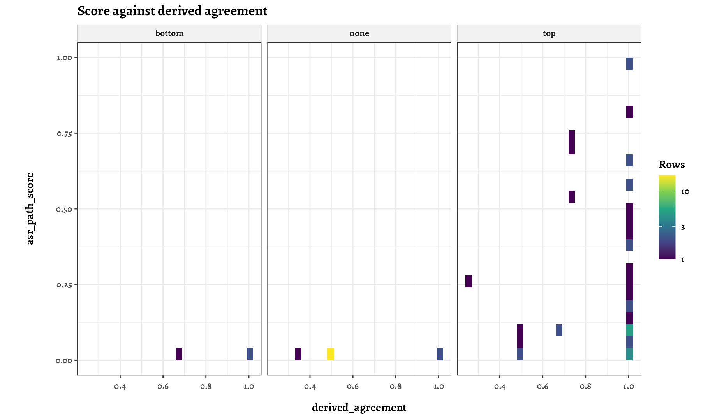

# PhyloPhere walkthrough

This document explains what each stage of PhyloPhere computes, which statistic it reports and how to read it. The [README](../README.md) covers installation, flags and execution. Here the focus is the logic: definitions, formulas, nulls and the limits of each inference.

Notation: $K$ is the number of canonical contrast pairs of a trait, $N$ the number of null cycles, $D(x,y)$ the patristic distance between two species and "domain" one of the $K$ Voronoi cells of the canonical pairs. Source files are given as `path:line` so each statement can be checked against the code.

**Contents**

1. [Question and design](#1-question-and-design)
2. [Inputs and species curation](#2-inputs-and-species-curation)
3. [Contrast selection](#3-contrast-selection)
4. [The permulation null](#4-the-permulation-null)
5. [CAAS discovery](#5-caas-discovery)
6. [Ancestral reconstruction and the path score](#6-ancestral-reconstruction-and-the-path-score)
7. [Position scores, gene scores and p-values](#7-position-scores-gene-scores-and-p-values)
8. [RERconverge](#8-rerconverge)
9. [FADE](#9-fade)
10. [Functional class scoring (FCS)](#10-functional-class-scoring-fcs)
11. [Active modules (AMI)](#11-active-modules-ami)
12. [POSENRICH](#12-posenrich)
13. [VEP annotation](#13-vep-annotation)
14. [Report map](#14-report-map)
15. [Limits of inference](#15-limits-of-inference)

---

## 1. Question and design

PhyloPhere asks which genes and which amino acid positions changed differently in the species at the extremes of a phenotype. Three independent evidence lines answer it, and they are never merged into a single score:

| Line | Unit | Question | Null |
|---|---|---|---|
| CAAS (convergent amino acid substitutions) | position, then gene | Do the extreme species share residues that the rest of the tree does not? | Permulated labelings replayed through the same code |
| RERconverge | gene | Does the gene evolve faster or slower in proportion to the trait? | Permulated phenotypes |
| FADE | site, then gene | Is there directional bias towards a residue on the extreme branches? | Model-based Bayes factor, no null |

CAAS carries most of the machinery because its null is built by replaying the observed pipeline on simulated labelings. That keeps the observed statistic and the null comparable by construction: whatever the selection of contrasts, the conservation filters and the reconstruction do to the observed data, they do to every null cycle.

Per-element significance is bounded by the resolution of the null. With $N$ cycles the smallest empirical p is $1/(N+1)$, so the pipeline treats results as a calibrated ranking with transparent FDR, plus enrichment over the ranking, and not as a list of individually proven sites.

## 2. Inputs and species curation

| Input | Flag | Notes |
|---|---|---|
| Alignments | `--alignment` | One protein alignment per gene in a directory; the gene name is the file name; FASTA headers are species names |
| Species tree | `--tree` | Newick |
| Trait table | `--my_traits` | Header row; species column `--sp_colname`; phenotype column `--traitname` |

`NAME_CURATION` runs whenever a tree is given. It matches tree tips, trait rows and alignment headers through NCBI taxonomy identifiers (`--tax_id`, generated from the tree when blank), prunes unmatched tips and writes one curated tree and one curated trait table. Every later stage reads the curated files, so a species spelled differently in the three inputs is still one species. The step that creates the identifier map and the gene-to-Ensembl map (`bin/resolve_core_inputs.py`) runs before Nextflow starts and cannot be run from inside `main.nf`.

## 3. Contrast selection

Convergence is meaningful only across independent lineages. Contrast selection chooses pairs of species, one with a high trait value and one with a low value, whose evolutionary paths do not overlap.

**Candidate pairs.** A candidate is an ordered pair $(i, j)$ with $x_i > x_j$. The gate depends on the trait type (`--trait_type`; `auto` codes a trait as ordinal when it has 2 to 5 distinct integer values, so a 0/1 trait takes the ordinal gate):

- Continuous: the top `pss_top_pct` fraction of positive-difference pairs ranked by PSS (default 0.05).
- Count (`--n_trait`, `--c_trait`): the Jeffreys intervals of the two proportions must not overlap, $\mathrm{lb}(i) > \mathrm{ub}(j)$, with the Beta(0.5, 0.5) posterior at 95%.
- Ordinal and binary: $i$ must carry the maximum observed level and $j$ the minimum.

**Phenotype shift score (PSS).** For a pair with trait difference $\delta = |x_i - x_j|$ and variance $V_{ij} = V_{ii} + V_{jj} - 2C_{ij}$ taken from the covariance of the fitted model (Brownian motion, or Ornstein-Uhlenbeck when $\mathrm{AIC}_{OU} + 2 < \mathrm{AIC}_{BM}$):

$$S = 1 - 2\,P\!\left(Z > \frac{\delta}{\sqrt{V_{ij}}}\right), \qquad \text{FinalScore} = S \cdot \frac{\delta/\max\delta}{d/\max d}$$

with $d$ the patristic distance. A pair scores high when the trait difference is large given the phylogenetic variance, and when the species are close, which favors pairs where few other changes intervene.

**Canonical set (H1).** Pairs are added greedily in PSS order. A pair is accepted if the overall modified Dunn index stays at or above 1:

$$\text{mod\_dunn}_k = \frac{\min_{j \ne k}\min_{x \in C_k,\, y \in C_j} D(x,y)}{\max_{x,y \in C_k} D(x,y)}, \qquad \text{Dunn} = \min_k \text{mod\_dunn}_k \ge 1$$

so the distance between any two pairs is at least the distance spanned inside a pair. The number of accepted pairs is $K$. Selection stops when no candidate qualifies or at `--max_contrasts` (0 = no cap). If fewer than `--min_contrasts` pairs exist (default 3) the CT stage is skipped.

**Domains and alternative hypotheses.** Each species is assigned to the canonical pair at the smallest distance, which gives $K$ Voronoi domains. For every domain, alternative pairs lying inside it are drawn and combined into hypotheses H2 to Hn, each with one pair per domain, kept when Dunn is still at least 1 and ranked by minimum PSS, mean PSS and Dunn (`--max_fop`, default 100 including H1). The multi-hypothesis design lets the score average over the choice of representative species and reduces the dependence on one fortunate pair.

Code: `subworkflows/CT/local/scripts/lean_contrast_selector.R:20-37, 187-250, 271-353`; `pss_core.R:202-262`.

## 4. The permulation null

The null is a set of labelings with the same structure as the observed one, generated without the phenotype.

1. **Simulate.** A Brownian trait is simulated on the species tree with the rate estimated from the data (`geiger::ratematrix`, `geiger::sim.char`; the tree is first rescaled when the selected model is OU).
2. **Rank-match.** The observed trait values are reassigned to species by the rank of the simulated values. The marginal distribution of the trait is preserved exactly, and the phylogenetic covariance is inherited from the simulation.
3. **Select contrasts.** The same contrast selector runs on the permulated trait with $K$ fixed to the observed value. When `--perm_match_pss` is on (default, not applied to count traits) each null pair must lie within a relative tolerance `--perm_match_pss_tol` (0.25) of the PSS of the corresponding observed pair; with multiple hypotheses a cycle must also reach the observed number of hypotheses. The matching makes the null selection comparable to the observed one, which matters because pairs chosen for high PSS are closer than random pairs.
4. **Pool.** The first `--caas_full_perms` accepted draws (default 1000) form the null. A draw budget escalates when acceptance is low.

The observed labeling is written as the cycle `b_0` and replayed through exactly the same code as the null cycles, so the observed statistic is the $b_0$ slice of the replay. Cycles are processed in blocks (`--caas_cycle_block_size`, 500) against batches of genes (`--ct_core_batch_size`, 20), which keeps task memory independent of the number of cycles.

Code: `subworkflows/CT/local/scripts/permulations.R:69-74, 328-353, 412-575`; `build_b0_labelings.py:41-49`; `subworkflows/CT/caas_permulation.nf`.

## 5. CAAS discovery

A CAAS is a column where the foreground and background species carry mostly disjoint residues. For a labeling with foreground species $F$ and background species $B$, let $F_u$ and $B_u$ be their sets of standard amino acids and $S = F_u \cap B_u$:

- overlap $= \min\big(\#\{f \in F: f \in S\},\ \#\{b \in B: b \in S\}\big)$
- nonoverlap on a side = number of species of that side whose residue is absent from the other side

A column is accepted when overlap $\le$ `max_conserved` and at least `--min_non_overlapping` species (default 2) on either side are non-overlapping. `max_conserved` $= \lfloor n_{\text{pairs}} (1 - f) \rfloor$, where $f$ is `--min_divergent_fraction`.

| $f$ | Mode | Meaning |
|---|---|---|
| 1 | Strict | No residue may occur on both sides |
| < 1 (default 0.5) | Tolerance | A few species may keep the ancestral residue on the derived side |

With tolerance and `--strict_conservation_output true`, the same replay also writes the null and the observed rows restricted to hypotheses without conserved pairs under `strict/`, so both interpretations come from one run.

Columns are classified by pattern from the number of distinct residues: 1 (one residue on each side), 2 (one foreground, several background), 3 (several foreground, one background), 4 (several on both sides). Patterns 1 to 3 are admitted by default (`--patterns`). Gaps and missing data are capped by `--max_*_gaps_fraction` and `--max_*_miss_fraction`, converted to counts (default 0, no gaps allowed).

Code: `subworkflows/CT/local/modules/caas_id.py:237-304`; `perm_replay.py:78-89`.

## 6. Ancestral reconstruction and the path score

A shared residue can arise by convergence or by inheritance. PhyloPhere reconstructs ancestral states with PAML codeml (marginal reconstruction, eight gamma categories with estimated shape, `--ct_disambig_asr_model`, default `lg`) and scores how well the observed residues fit independent changes.

For each domain the ancestral residue $a_d$ is the mode of the posterior at the most recent common ancestor of the domain. A domain is *changed* on a side when its tip residue differs from $a_d$. Two changed domains on the same side with the same derived residue form a contrast, scored with the posterior at the lowest common ancestor of their two ancestors:

$$\text{contrib}_{ab} = 1 - P_{\text{LCA}}(\{r_a, r_b\})$$

This is the probability that the two domains did not simply inherit the residue from a shared ancestor. The score of a domain is a noisy-OR over its partners:

$$S_d = 1 - \prod_b (1 - \text{contrib}_{db})$$

Across hypotheses, species representing a domain are weighted by the mean PSS of their pairs:

$$S_d^{\text{pool}} = \frac{\sum_x w_x s_x}{\sum_x w_x}, \qquad \text{asr\_path\_score} = \min\Big(1,\ \max\big(0,\ \tfrac{1}{K}\sum_d S_d^{\text{pool}}\big)\Big)$$

The score lies in $(0,1]$; a side with score 0 is not reported. A position gets one score per side (`top` or `bottom` extreme).

The label of a position comes from the number of changed domains (`agree_den`) and the size of the largest group sharing one derived residue (`agree_num`):

| Label | Rule |
|---|---|
| `convergent` | `agree_den` $\ge 2$ and `agree_num` $\ge 2$ |
| `divergent` | `agree_den` $\ge 2$ and `agree_num` $< 2$ |
| `single` | `agree_den` $= 1$ |
| `no_change` | `agree_den` $= 0$ |

`derived_agreement` is `agree_num` / `agree_den`.

*Report 9 (`9.ASR_diagnostics`), PEPC C4 validation run: each tile counts positions by `asr_path_score` and `derived_agreement`, split by the side carrying the signal. High agreement with a low score marks positions whose reconstruction leaves the convergent origin uncertain.*

Code: `subworkflows/CT_DISAMBIGUATION/local/src/convergence/path_scores.py:165-260`; `fop_pool.py:85-207`; `src/core/scores.py:58-72`.

## 7. Position scores, gene scores and p-values

**Position score.** `CAAS_score` is the `asr_path_score` of the best side. Four amino acid groupings (GS1 to GS4: polarity and volume, dipole, side-chain family, functional bins) describe whether the derived residues share one class that differs from the ancestral class (`biochem_groupings`, `is_biochem`). They annotate the position and do not enter the score.

**Gene score.** The largest positive position score of the gene, globally and per side (`gene_caas_score`, `_top`, `_bottom`). `max` is the only supported `--gene_stat`. No size correction is applied, so genes with more tested positions have more opportunities to score high, and the null is computed gene by gene to account for that.

**Position p-value.** For each position the observed best-side score $T_{\text{obs}}$ is compared with the same position in each null cycle:

$$p_{\text{emp}} = \frac{1 + \#\{c : \text{detected and } T_c \ge T_{\text{obs}}\}}{N + 1}$$

with tolerance $10^{-12}$ on ties; a position whose observed score is zero has $p_{\text{emp}} = 1$. `p.adj_bh` is the Benjamini-Hochberg adjustment over one family: positions the null scored in the tested set plus observed positions; null-only positions enter at $p = 1$. Position p-values describe how unusual a score is for that position, given how often the position is detectable at all; they are not evidence about the gene.

**Gene p-value.** The observed gene maximum against the null maxima of the same gene,

$$p_g = \frac{1 + \#\{k : S_{gk} \ge \text{obs}_g\}}{n_{\text{valid},g} + 1},$$

with leave-one-out for null cycles when a null cycle is itself calibrated. `p.gen` is written as `caas_p.gen`; its Benjamini-Hochberg adjustment runs over the complete cleaned gene universe. Nominal flags use `--evidence_p_threshold` and the adjusted flags use `--evidence_fdr_threshold` (both 0.05 by default).

The hypergeometric p-value of CAAStools (`pvalue`) is kept as a descriptive column and does not enter the score.

Code: `subworkflows/SCORING/local/src/scoring_compute.R:174-347`; `null_position_p.R:19-57`; `subworkflows/ENRICHMENT/local/src/gene_p.R:5-34`; `scoring_evidence.R:63-80`.

## 8. RERconverge

RERconverge measures the evolutionary rate of each gene on each branch relative to the rest of the genome (relative evolutionary rate, RER), and correlates it with the trait across species. A gene accelerated in lineages with the phenotype has a positive association.

| Trait mode | Statistic |
|---|---|
| Continuous | Pearson correlation of winsorized RER and winsorized trait (limit 3 for both) |
| Binary | Unweighted Kendall, or weighted Pearson when foreground paths are fractional |

Continuous traits pass through `--rer_transform` first (`ha_logit`, `logit`, `arcsin`, `log10`, `none`, or `auto`: logit for proportions, log10 when Shapiro-Wilk rejects normality). `ha_logit` is $\log\big((c+0.5)/(n-c+0.5)\big)$ and needs the `n_trait` and `c_trait` columns. Genes with fewer than `--rer_minsp` species (15) are skipped.

**Permulations.** Continuous: rank-matched Brownian phenotypes. Binary: stochastic histories under an equal-rates Mk model. Each null gives a statistic per gene. The permulation p follows `permpvalcor`, which centers on the null median $m$: if $\rho_{\text{obs}} \ge m$, $p = (\#\{\text{null} \ge \rho_{\text{obs}}\} + 1)/(\#\{\text{null} \ge m\} + 1)$, mirrored otherwise; Benjamini-Hochberg runs over genes. The default null is 10 batches of 100 permulations.

**Ranking for enrichment.** The gene statistic is $\operatorname{sign}(\rho) \cdot (-\log_{10} P)$, with $P$ the parametric p; the null of this ranking is the same statistic computed on every permulated phenotype.

Code: `subworkflows/RERCONVERGE/local/continuous_rer.R`, `binary_rer.R`, `rer_permulations.R:24-73`, `rer_batches.R:3-47`. The formulas above were read from the RERconverge version installed by `environment/install_env.sh` (commit `2bd328f`).

## 9. FADE

FADE (HyPhy) tests, for each site and each amino acid, whether foreground branches substitute towards that residue more than expected. The posterior over the bias parameter on a 20-point grid (variational Bayes by default) is converted to a Bayes factor against the prior mass of positive bias. A site-residue pair is significant at BF $\ge$ `--fade_bf_threshold` (100). The gene summary is the maximum BF over sites and residues, and a gene is flagged when that maximum reaches the threshold.

Three controls define the comparison:

| Option | Values | Effect |
|---|---|---|
| `--fade_direction` | `top`, `bottom`, `both` | Which extreme group is the foreground |
| `--fade_background_scope` | `all`, `opposite` | `all`: every other branch is background; `opposite`: tree and alignment are pruned to the foreground plus the opposite extreme, giving a two-group test |
| `--fade_species_file` | path | User-defined groups; bypasses contrast selection for FADE |

FADE has no permulation null. Its evidence enters SCORING as the maximum BF and the significance flag, next to the CAAS and RER columns, not inside the CAAS score.

Code: `subworkflows/FADE/local/src/FADE_phylophere.bf:721-783`; `fade_json_to_tables.py:52-90`.

## 10. Functional class scoring (FCS)

FCS asks whether the genes of a set (GO, Reactome, KEGG, MSigDB, HPO and others in `--gmt_dir`) sit higher in a gene ranking than the rest of the background.

**Rankings.** CAAS: the gene scores `gene_caas_score`, `_top` and `_bottom`, floored at 0 for tested genes without a CAAS. RER: the signed statistic of [section 8](#8-rerconverge). The background is the tested universe of the module.

**Statistic.** For a set with $n_1$ members and $n_2$ remaining background genes, the Wilcoxon area under the curve (computed with the enrichment functions of RERconverge, Kowalczyk et al. 2019), reported as $\text{stat} = \text{AUC} - 0.5 = U/(n_1 n_2) - 0.5$. Sets are evaluated only when the background minus the set has more than two genes, and only with `--fcs_min_genes` to `--fcs_max_genes` members.

**Analytic p.** For the non-negative CAAS ranking, a one-sided normal approximation with tie correction,
$\sigma^2 = \tfrac{n_1 n_2}{12}\Big((N+1) - \tfrac{\sum (t^3 - t)}{N(N-1)}\Big)$, where $t$ are the sizes of tied groups. This matters because most genes tie at 0. RER is two-sided.

**Permulation p.** The same statistic is computed on every null cycle: $p_{\text{perm}} = (\#\{j : \text{stat}_j \ge \text{stat}_{\text{obs}}\} + 1)/(N_{\text{valid}} + 1)$ (absolute values for two-sided). `q.perm` is the Benjamini-Hochberg adjustment within each ranking and database; a set is significant (`sig_perm`) when `q.perm` is below `--fcs_fdr` (0.15 by default). The analytic rule of Redlich et al. is reported independently (`redlich_level`): the smallest level in `--fcs_analytic_levels` at which the analytic BH-adjusted p is below it among sets with $p_{\text{perm}}$ below `--fcs_pperm_thr`.

Significant sets are grouped by the Jaccard similarity of their leading edges (`--fcs_cluster_threshold`, 0.2) so that overlapping terms read as one block.

Code: `subworkflows/ENRICHMENT/local/src/fcs_enrich.R:127-513`; `subworkflows/SCORING/local/src/scoring_compute.R:728-771`.

## 11. Active modules (AMI)

AMI looks for connected subnetworks. DOMINO builds a STRING network on the background genes (edges with combined score above `--domino_network_score_thr`, 700), slices it, and reports modules whose gene lists are enriched in the analysis genes (`--domino_module_thr`, 0.05). Each module is labeled with STRING enrichment terms (`--ami_description_fdr`); labels are descriptive and carry their own FDR. One run is made per evidence line present: CAAS, FADE, RER. The network is built for human proteins (taxon 9606); `--string_species` changes only the labels of report 13.

## 12. POSENRICH

POSENRICH describes how the positive positions relate to genes and to sets of positions: Pfam domains and clans, ultraconserved regions (UCR), FUBAR and FADE sites, genomic windows and user lists. It has two inferential levels and one descriptive layer, calibrated with the CAAS null.

**Universe $U$.** Positions tested by CAAStools in the genes of the cleaned background that score above zero in at least one null cycle, plus the observed positives. Positions outside $U$ are not negatives. The null shows how unevenly detectable positions are across $U$, which is why a uniform reference would be wrong.

**Level 1: accumulation (gene level).** The share of a gene is $c_g / K$, with $c_g$ its positives and $K$ the total of positives in $U$. The share in null cycle $b$ is $c_g(b)/K_b$, using the total of that cycle:

$$p_g = \frac{1 + \#\{b : c_g(b)/K_b \ge c_g/K\}}{N + 1}$$

Only genes with at least one observed positive are tested; BH runs over them. Dividing by each cycle's total removes the global excess of observed over null detections, so the test asks where the excess is concentrated. The null keeps the best side only, so the test covers either side and the top and bottom counts are descriptive.

**Level 2: concentration within genes.** For a term $S$ (a domain, a clan, a region, a site list) and a gene $g$ with $n_g$ positions in $U$, $m_g$ of them in $S$ and $k_g$ positives:

$$r_g = (\text{positives of } g \text{ in } S) - k_g\, m_g / n_g, \qquad T_S = \sum_{g\ \text{eligible}} r_g$$

Eligible genes have members and non-members of $S$ in $U$, so the test conditions on the gene and does not recount the signal of level 1. The p is one-sided from the null cycles, $(1 + \#\{b: T_S(b) \ge T_S\})/(N+1)$, with BH per collection. A term is tested when it has members in at least `--posenrich_min_genes` genes (2). Frequency and intensity differences are reported as descriptive effect sizes.

**Overlaps and proximity.** Positives that coincide with, or lie within `--posenrich_radios` (0, 5, 10 residues) of, a member of a term, per gene and detection, without p-values.

`--posenrich_holdout K` lets $K$ null cycles play the observed one and writes the false-positive rate per term and collection (`holdout_fpr.tsv`), which checks the calibration of level 2 at the null size and term sets of your own run.

Code: `subworkflows/POSENRICH/local/src/accumulation_test.py`, `posenrich_within_gene.py`.

## 13. VEP annotation

After SCORING, positions are annotated with PrimateAI-3D pathogenicity, COSMIC somatic missense counts at the same codon and Ensembl VEP consequences. Alignment columns are projected onto the reference protein through the per-gene MAP files made by the [Ortholog Characterizator](https://github.com/nozerorma/ortholog_characterizator.git). These annotations describe the positions; they do not modify any score or p-value.

## 14. Report map

Numbers follow the order of the pipeline; number 10 is unused.

| # | Report | Module | Reads |
|---|---|---|---|
| 0 | Data pruning | contrast selection | trait table, tree |
| 1 | Dataset exploration | reporting | trait table, tree |
| 2 | Phenotype exploration (complete, pruned) | reporting | trait table |
| 3 | CI composition | contrast selection | trait table |
| 4 | Independent contrasts | contrast selection | traits, tree |
| 5 | RERconverge | RER | RER objects |
| 6 | FADE (top, bottom) | FADE | FADE tables |
| 7 | CAAS pattern annotation | CT_META_CAAS | discovery |
| 8 | Characterization | CT_POSTPROC | filtered discovery |
| 9 | ASR diagnostics | CT_POSTPROC | disambiguation |
| 11 | Scoring | SCORING | scores, null |
| 12 | FCS (CAAS, RER) | ENRICHMENT | rankings, null |
| 13 | AMI | ENRICHMENT | gene lists |
| 14 | POSENRICH | POSENRICH | universe, registry |
| 15 | Comparison | ENRICHMENT | FCS, AMI, VEP |
| 16 | CAAS significance | CT_META_CAAS | scores, p.emp |

`workflow_map.html` in the output directory links every report and result directory of the run.

## 15. Limits of inference

- **Resolution floor.** All empirical p-values satisfy $p \ge 1/(N+1)$. With 1000 cycles, a position, gene or term at the floor is as significant as the null can show, not more.
- **Selection of contrasts.** The observed pairs are chosen for a high PSS from the same data that are tested. The null reproduces the selection (`perm_match_pss`, fixed $K$), which protects against the circularity only to the extent that the rank-matched Brownian phenotype is a good model of the trait.
- **Brownian null.** The CAAS and continuous RER nulls simulate Brownian traits with the rate estimated from the data. Strongly non-Brownian traits (selection, bounded or binary traits with clade structure) are only approximated by rank matching.
- **Reconstruction uncertainty.** The path score uses posteriors of one substitution model (default LG, eight gamma categories). A different model changes scores; the ASR diagnostics report shows the posterior behind each position.
- **Gene scores are maxima.** Genes with many testable positions have more chances to score high. The gene p-value corrects for this against the gene's own null, but `gene_caas_score` alone is not comparable across genes.
- **Enrichment depends on the null.** FCS inherits the CAAS null; a set at the permulation floor is bounded by $N$.
- **FADE** reports a Bayes factor from HyPhy's grid posterior with no null; its threshold of 100 is a convention.
- **Annotations are not evidence.** VEP, UCR, Pfam and COSMIC layers describe the positions and carry no p-value in the position score.
