# PhyloPhere walkthrough

This document explains what each stage of PhyloPhere computes, which statistic it reports and how to read it. The [README](../README.md) covers installation, flags and execution. Here the focus is the logic: definitions, formulas, nulls and the limits of each inference.

Notation: $K$ is the number of canonical contrast pairs of a trait, $N$ the number of null cycles, $D(x,y)$ the patristic distance between two species and "domain" one of the $K$ Voronoi cells of the canonical pairs. Source files are given as `path:line` so each statement can be checked against the code. Figures come from one real run (malignant prevalence in primates, 10,000 null cycles) and use the styles of the HTML reports.

**Contents**

1. [Question and design](#1-question-and-design)
2. [Inputs and species curation](#2-inputs-and-species-curation)
3. [Contrast selection](#3-contrast-selection)
4. [The permulation null](#4-the-permulation-null)
5. [CAAS discovery](#5-caas-discovery)
6. [Ancestral reconstruction and the path score](#6-ancestral-reconstruction-and-the-path-score)
7. [Position scores, gene scores and p-values](#7-position-scores-gene-scores-and-p-values)
8. [RERconverge](#8-rerconverge)
9. [FADE](#9-fade)
10. [Functional class scoring (FCS)](#10-functional-class-scoring-fcs)
11. [Active modules (AMI)](#11-active-modules-ami)
12. [POSENRICH](#12-posenrich)
13. [VEP annotation](#13-vep-annotation)
14. [Report map](#14-report-map)
15. [Limits of inference](#15-limits-of-inference)

---

## 1. Question and design

PhyloPhere asks which genes and which amino acid positions changed differently in the species at the extremes of a phenotype. Three separate evidence lines answer it. They are joined in the same tables and never merged into a single score:

| Line | Unit | Question | Null |
|---|---|---|---|
| CAAS (convergent amino acid substitutions) | position, then gene | Do the extreme species share residues that the rest of the tree does not? | Permulated labelings replayed through the same code |
| RERconverge | gene | Does the gene evolve faster or slower in proportion to the trait? | Permulated phenotypes |
| FADE | site, then gene | Is there directional bias towards a residue on the extreme branches? | Model-based Bayes factor, no null |

CAAS carries most of the machinery because its null is built by replaying the observed pipeline on simulated labelings. That keeps the observed statistic and the null comparable: whatever the selection of contrasts, the conservation filters and the reconstruction do to the observed data, they do to every null cycle, within the limits listed in section 15.

Per-element significance is bounded by the resolution of the null. With $N$ cycles the smallest empirical p is $1/(N+1)$, so the pipeline treats results as a ranking scored against the null, with BH q-values and enrichment over the ranking, and not as a list of individually proven sites.

## 2. Inputs and species curation

| Input | Flag | Notes |
|---|---|---|
| Alignments | `--alignment` | One protein alignment per gene in a directory; the gene name is the file name; FASTA headers are species names |
| Species tree | `--tree` | Newick |
| Trait table | `--my_traits` | Header row; species column `--sp_colname`; phenotype column `--traitname` |

`NAME_CURATION` runs whenever a tree is given. It takes the species names of the alignments as reference and renames tree tips and trait rows to them through NCBI taxonomy identifiers (`--tax_id`); without a map it matches exact names only. Unmatched tips and rows are removed, ambiguous matches are errors, and every later stage reads the curated tree, trait table and taxid map (also published in `name_curation/`). The step that creates the identifier map and the gene-to-Ensembl map (`bin/resolve_core_inputs.py`) runs before Nextflow starts and cannot be run from inside `main.nf`.

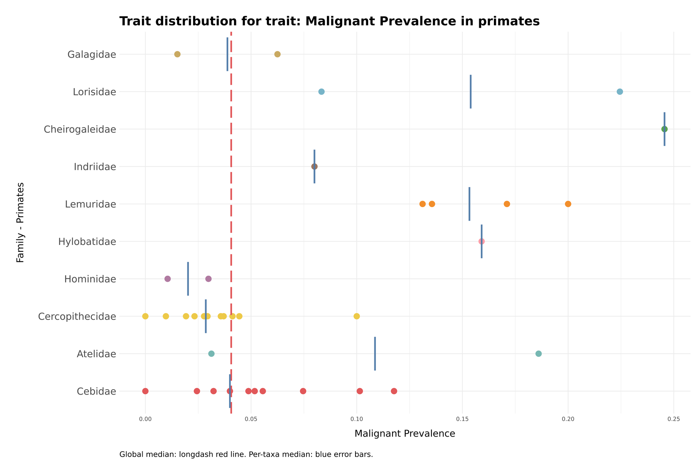

*Trait values of the species by family, with the global median (dashed) and the per-family median (bars). Malignant prevalence in primates.*

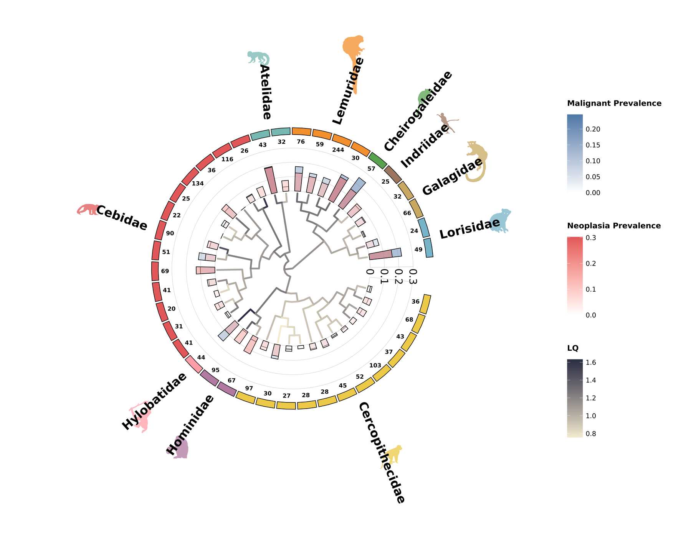

*Species tree with the trait as bars around the tips, grouped by family. Report 2.*

## 3. Contrast selection

Convergence is meaningful only across independent lineages. Contrast selection chooses pairs of species, one with a high trait value and one with a low value, whose evolutionary paths do not overlap.

**Candidate pairs.** A candidate is an ordered pair $(i, j)$ with $x_i > x_j$. The gate depends on the trait type (`--trait_type`; `auto` codes a trait as ordinal when it has 2 to 5 distinct integer values, so a 0/1 trait takes the ordinal gate):

- Continuous: the top `pss_top_pct` fraction of positive-difference pairs ranked by PSS (default 0.05). Zero disables the percentile filter; 1 retains all pairs. Other values outside [0, 1] are rejected; exact score ties are settled by species names.
- Count (`--n_trait`, `--c_trait`): the Jeffreys intervals of the two proportions must not overlap, $\mathrm{lb}(i) > \mathrm{ub}(j)$, with the Beta(0.5, 0.5) posterior at 95%.
- Ordinal and binary: $i$ must carry the maximum observed level and $j$ the minimum.

A count trait overrides `--trait_type ordinal`. With `--pair_center_gate median|mean`, candidates must in addition have their members on opposite sides of that centre (higher member $\ge$ centre $\ge$ lower member); the gate acts after the type and PSS filters, so it can empty the pool, and the null uses the same centre.

**Phenotype shift score (PSS).** For a pair with trait difference $\delta = |x_i - x_j|$ and variance $V_{ij} = V_{ii} + V_{jj} - 2C_{ij}$ taken from the covariance of the fitted model (Brownian motion, or Ornstein-Uhlenbeck when $\mathrm{AIC}_{OU} + 2 < \mathrm{AIC}_{BM}$, unless `--perm_strategy BM` or `OU` forces one):

$$S = 1 - 2\,P\!\left(Z > \frac{\delta}{\sqrt{V_{ij}}}\right), \qquad \text{FinalScore} = S \cdot \frac{\delta/\max\delta}{d/\max d}$$

with $d$ the patristic distance. A pair scores high when the trait difference is large given the phylogenetic variance, and when the species are close, which favors pairs where few other changes intervene.

**Canonical set (H1).** The first pair has the highest PSS candidate rank. Subsequent additions prioritize the largest minimum distance to the selected pairs, then the highest Dunn index, then candidate rank. A pair is accepted if the overall modified Dunn index stays at or above 1:

$$\text{mod\_dunn}_k = \frac{\min_{j \ne k}\min_{x \in C_k,\, y \in C_j} D(x,y)}{\max_{x,y \in C_k} D(x,y)}, \qquad \text{Dunn} = \min_k \text{mod\_dunn}_k \ge 1$$

so the distance between any two pairs is at least the distance spanned inside a pair. The number of accepted pairs is $K$. Selection stops when no candidate qualifies or at `--max_contrasts` (0 = no cap). If fewer than `--min_contrasts` pairs exist (default 3), the whole run ends with exit status 0 and `low_contrasts.skip` records the trait, the pair count and the minimum.

Composition and selection share one prepared tree, model fit and candidate table through `observed_selection.rds`, with provenance checked against the current inputs and settings. Fewer than three usable species or an invariant phenotype produce a zero-pair result and reach the minimum gate. A model-fitting failure on otherwise usable data remains an error. Count inputs must be integer totals/cases with `n > 0` and `0 <= c <= n`; separated intervals may not reverse the phenotype ordering.

The minimum gate validates complete pairs and emits only active hypothesis metadata. With `--multi_hypothesis false`, only H1 contributes to downstream weighting. The published `low_contrasts.skip` is reconciled before consumers run, including on resume, so a previous skip cannot persist after a passing result.

FADE uses global groups, distinct from pair-local high/low roles: species above or below the median (count and continuous traits) or at the highest or lowest coded level (ordinal traits), restricted to members of at least one eligible candidate pair before Dunn selection. Median and intermediate species are excluded, and `candidate_species_audit.tsv` records membership and exclusion reasons. Without `--fade_species_file`, FADE stops when the minimum-contrast gate is not met.

**Domains and alternative hypotheses.** Each species is assigned to the canonical pair at the smallest distance, which gives $K$ Voronoi domains. For every domain, alternative pairs lying inside it are drawn and combined into hypotheses H2 to Hn, each with one pair per domain, kept when Dunn is still at least 1 and ranked by minimum PSS, mean PSS and Dunn (`--max_fop`, default 100 including H1). Hypotheses are enumerated exhaustively when the number of combinations is at most $20 \times$ `max_fop`; otherwise that many combinations are drawn with the pipeline seed. Pairs come from the gated candidate pool, and if a domain holds no candidate pair only H1 is kept. The multi-hypothesis design lets the score average over the choice of representative species and reduces the dependence on one fortunate pair.

Code: `subworkflows/CT/local/scripts/lean_contrast_selector.R:20-37, 165-173, 188-257, 275-359, 443-582`; `pss_core.R:202-262`.

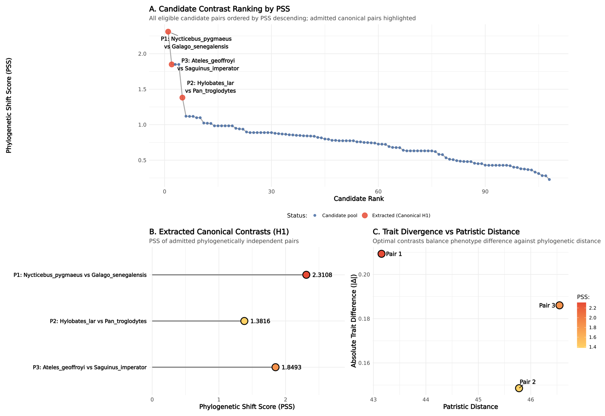

*Candidate pairs ordered by phenotype shift score (A), PSS of the extracted canonical pairs (B) and trait difference against patristic distance (C). Report 4.*

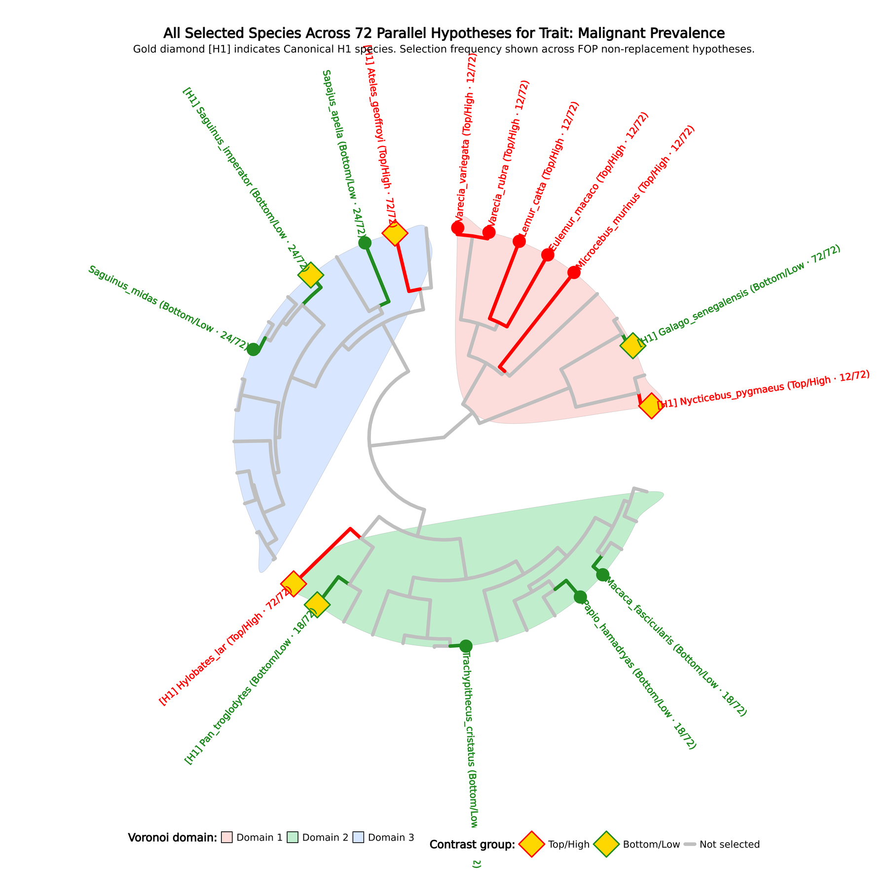

*Species used across the 72 alternative hypotheses on the tree. Shaded areas are the three Voronoi domains; gold diamonds are the canonical pairs.*

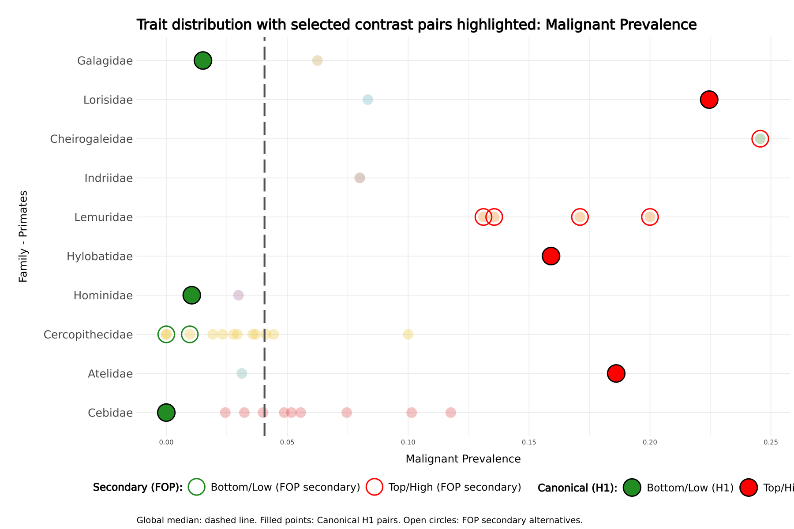

*Trait values by family; filled points are members of the canonical pairs (H1) and open circles members of alternative hypotheses.*

## 4. The permulation null

The null is a set of labelings with the same structure as the observed one, generated without the phenotype.

1. **Simulate.** A Brownian trait is simulated on the species tree with the rate estimated from the data (`geiger::ratematrix`, `geiger::sim.char`; the tree is first rescaled when the selected model is OU).
2. **Rank-match.** The observed trait values are reassigned to species by the rank of the simulated values. The marginal distribution of the trait is preserved exactly, and the phylogenetic covariance is inherited from the simulation.
3. **Select contrasts.** The contrast selector runs on the permulated trait with $K$ fixed to the observed value. With `--perm_match_pss` (default; count traits additionally require `--perm_match_pss_ci true`) the $K$ pairs are chosen one by one in the order of the observed pairs, each as the Dunn-independent candidate whose PSS is closest on the log scale to that of its observed counterpart, and the draw is accepted if every ratio $\mathrm{PSS}_{\text{null}}/\mathrm{PSS}_{\text{obs}}$ lies within $[1/(1+t), 1+t]$ with $t$ = `--perm_match_pss_tol` (0.25). Without matching, the $K$ best pairs by PSS are taken and graded by Dunn index (Tier 1: all independent; Tier 2: one pair below 1, admitted only under `--ct_allow_relaxed_null`). With multiple hypotheses, `--perm_match_fop true` (default) requires a cycle to reach the observed number and truncates it to that number. With `--perm_match_fop false`, each cycle instead keeps its available hypotheses up to the same `max_fop` search limit; K and the CI gate remain fixed. Reused free-count harvests must record this policy in their provenance (or explicitly opt into relaxed reuse). The matching makes the null selection comparable to the observed one, which matters because pairs chosen for high PSS are closer than random pairs.
4. **Pool.** The first `--caas_full_perms` accepted draws (default 1000) form the null. The draw budget escalates as described under `--max_tries` in the README: extension toward the projected need (at least 1.25-fold) while Tier 1 acceptance is at least 5%, otherwise 1.5-fold up to three times, always capped at max(`max_tries`, 50 $N$). When the cap is reached and Tier 1 is short, strict runs fail and relaxed runs fill with Tier 2. Matching is strict by default: missing requested PSS profiles, insufficient FOP hypotheses and Tier-2 shortfalls fail instead of silently broadening the null. `--ct_allow_relaxed_null true` explicitly restores those fallbacks. `permulation_provenance.json` records the applied matching switches, the selected model, the observed canonical-design signature and every relaxation; preparation carries that provenance forward, refuses a harvest generated for a different observed design and refuses a known relaxed harvest without the opt-in.

Integrated resampling reuses `observed_selection.rds` from the active design, checking the prepared tree, values, count intervals and selection settings before using the observed fit and covariances. Standalone trait tables require a header; CSV, TSV and headered `.tab` inputs preserve configured column names, including spaces. Explicitly requested missing columns are errors. Direct harvest CLI runs require a fresh output directory, so stale chunks cannot mix with a new run. `auto` and `best_model` select the same automatic BM/OU rule.

Reused labelings must contain at least the requested number of distinct cycles with complete pairs and matching hypothesis weights; the first $N$ in cycle order are used. With `--multi_hypothesis false`, only H1 and its weights are retained. `ct_preparation.json` records the active hypotheses, source provenance and relaxations. Labelings without `permulation_provenance.json` are accepted, and `ct_preparation.json` then records `harvest_provenance_available: false`. With `--caas_full_perms 0` the harvest holds only `permulation_provenance.json`, `caastools/resample.tab` is empty and the preparation writes b_0 alone (`blocks/b0`, `resample_perms.tab`); no phenotype simulation runs, and resampling alone needs no alignment directory.

The observed labeling is written as the cycle `b_0` and replayed through exactly the same code as the null cycles, so the observed statistic is the $b_0$ slice of the replay. Cycles are processed in blocks (`--caas_cycle_block_size`, 500) against batches of genes (`--ct_core_batch_size`, 20), so that replay and merge tasks hold one block of cycles and one batch of genes at a time; b_0 is replayed and merged as its own block.

Code: `subworkflows/CT/local/scripts/permulations.R:73-77` (BM simulation), `:360-367` (OU rescaling), `:374-410` (PSS profile), `:470-482, 527, 598-626` (budget and escalation), `:540` (rank matching), `:978-985` (provenance); `prepare_labelings.py` (selection, blocks, `ct_preparation.json`); `build_b0_labelings.py:25-36`; `subworkflows/CT/caas_permulation.nf`.

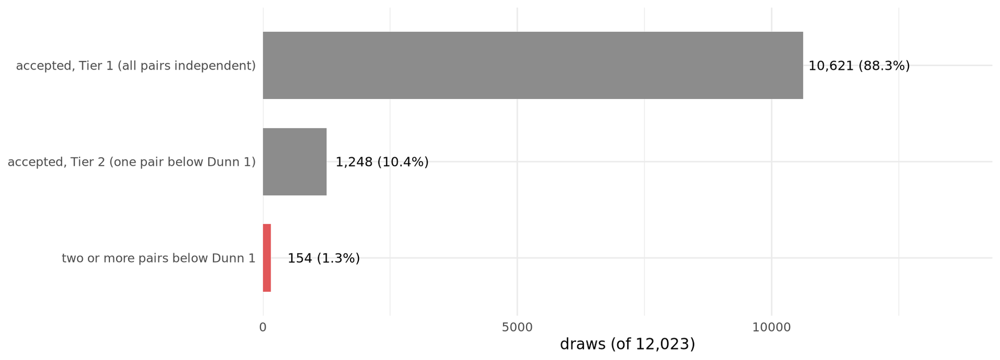

*Outcome of the null draws: Tier 1 (all pairs independent), Tier 2 (one pair below Dunn 1) and rejected draws. Report 10.*

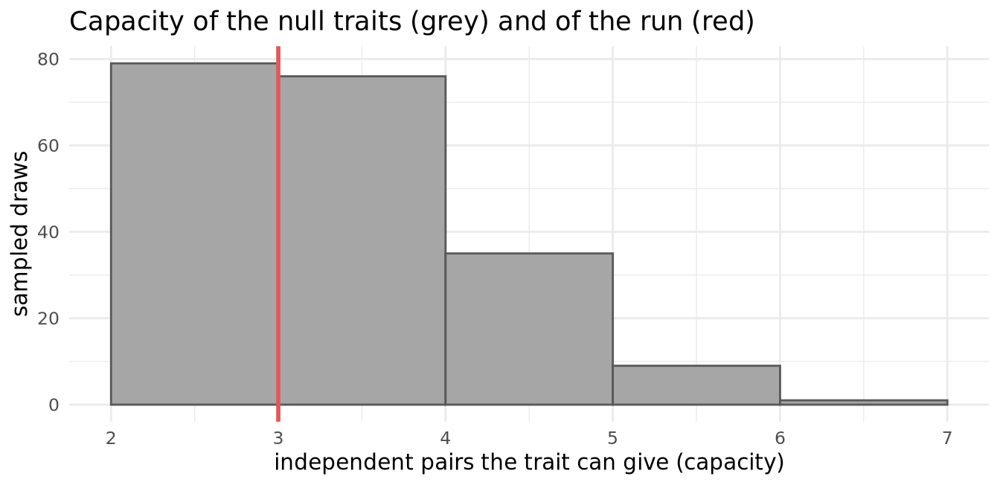

*Independent pairs that each sampled null trait can give. The red line marks the number of pairs of the observed run.*

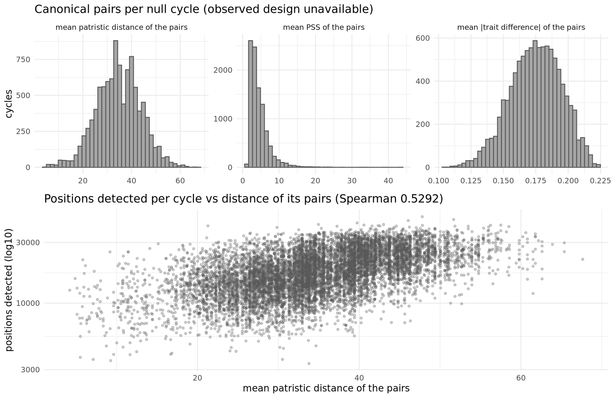

*Mean patristic distance, PSS and trait difference of the canonical pairs of each null cycle (top), and positions detected per cycle against the distance of its pairs (bottom). Cycles with more distant pairs detect more, which is why the null is matched to the observed design.*

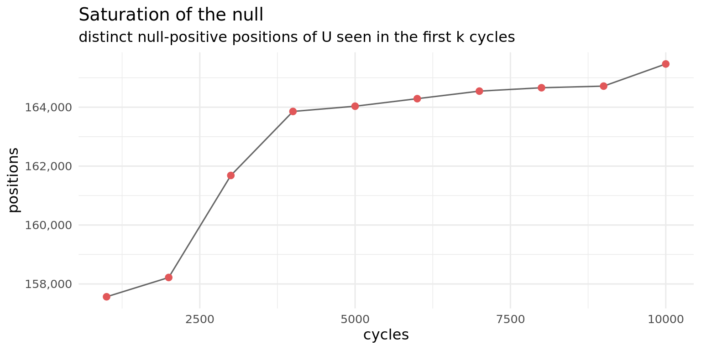

*Distinct null-positive positions of the universe seen as cycles accumulate.*

## 5. CAAS discovery

A CAAS is a column where the foreground and background species carry mostly disjoint residues. For a labeling with foreground species $F$ and background species $B$, let $F_u$ and $B_u$ be their sets of standard amino acids and $S = F_u \cap B_u$:

- overlap $= \min\big(\#\{f \in F: f \in S\},\ \#\{b \in B: b \in S\}\big)$
- nonoverlap on a side = number of species of that side whose residue is absent from the other side

A column is accepted when overlap $\le$ `max_conserved` and at least `--min_non_overlapping` species (default 2) on either side are non-overlapping. `max_conserved` $= \lfloor n_{\text{pairs}} (1 - f) \rfloor$, where $f$ is `--min_divergent_fraction`.

| $f$ | Mode | Meaning |
|---|---|---|
| 1 | Strict | No residue may occur on both sides |
| < 1 (default 0.5) | Tolerance | Up to `max_conserved` species on the less-shared side may carry a residue also found on the other side |

With tolerance and `--strict_conservation_output true`, the same replay also writes, under `strict/`, the null and the observed rows in which the two sides share no residue type (position-hypothesis rows with overlap 0); the positional universe is judged with `max_conserved = 0`. Both interpretations come from one run.

Columns are classified by pattern from the number of distinct residues: 1 (one residue on each side), 2 (one foreground, several background), 3 (several foreground, one background), 4 (several on both sides). Patterns 1 to 3 are admitted by default (`--patterns`). Gaps and missing data are capped by `--max_*_gaps_fraction` and `--max_*_miss_fraction`, converted to counts (default 0, no gaps allowed). Each limit equals $\lfloor n_{\text{pairs}} \cdot \text{fraction} \rfloor$ for the foreground side, the background side and the two sides together (the overall limit is not scaled to $2 n_{\text{pairs}}$). Gap symbols are `-`, `X`, `B`, `Z`, `J`, `U`, `O`, `*`, `?` and `.`, and a species absent from the alignment counts as missing. With `--miss_pair`, a labeling is discarded when both sides have gapped species in different pairs; the check applies only when the foreground and background limits are equal.

Code: `subworkflows/CT/local/modules/caas_id.py:230-235, 241-322`; `perm_replay.py:77-87, 201-205, 292-298, 392-411`.

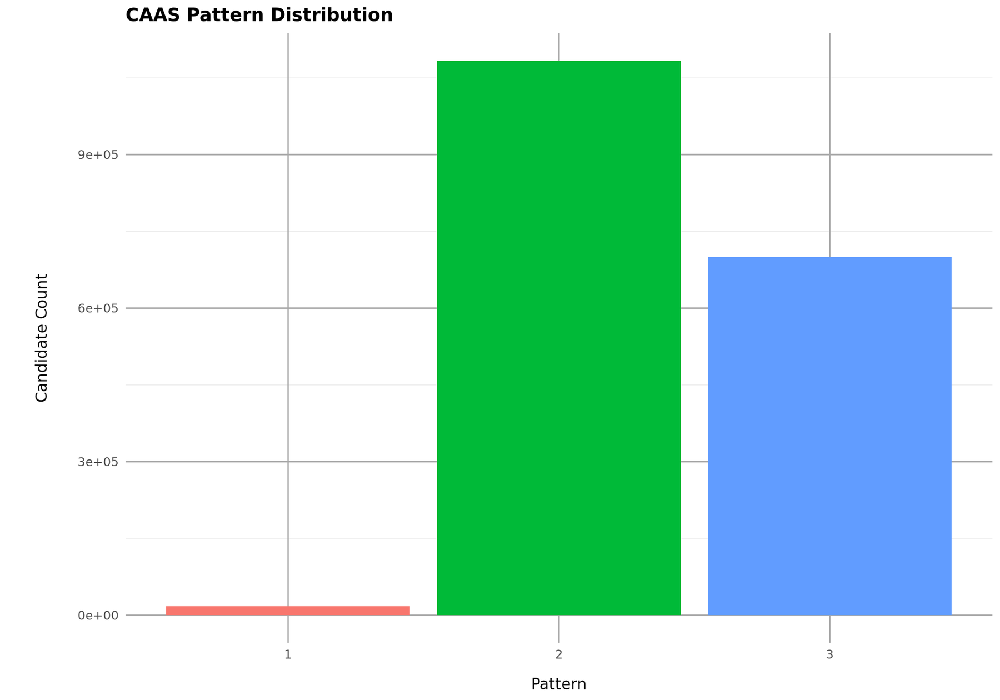

*Candidate CAAS by pattern class in the observed discovery. Report 7.*

CT normalizes residue case and applies the same ambiguity/gap policy in the kernel and exports. Gene IDs follow the manifest or the alignment filename with its final extension removed, preserving embedded dots. Repeated species, gene IDs, labeling tags or pair assignments are rejected.

For relaxed discovery, `conserved_pair` contains the **actual within-pair count and IDs**, joined by domain ID even after asymmetric gaps. The separate `shared_residue_count` is the overlap defined above (species counted on the side with fewer sharing species) and is the quantity used for eligibility. `is_conserved_meta` is true when that overlap is above 0, which is also the rule of the strict output.

## 6. Ancestral reconstruction and the path score

A shared residue can arise by convergence or by inheritance. PhyloPhere reconstructs ancestral states with PAML codeml (marginal reconstruction, eight gamma categories with estimated shape, `--ct_disambig_asr_model`, default `lg`) and scores how well the observed residues fit independent changes.

For each domain the ancestral residue $a_d$ is the mode of the posterior at the most recent common ancestor of the domain. A domain is *changed* on a side when its tip residue differs from $a_d$. Two changed domains on the same side with the same derived residue form a contrast, scored with the posterior at the lowest common ancestor of their two ancestors:

$$\text{contrib}_{ab} = 1 - P_{\text{LCA}}(r)$$

with $r$ the shared derived residue. This is the posterior mass that the two domains did not inherit $r$ from a shared ancestor. If $r$ was pruned from the node by `--ct_disambig_posterior_threshold` (default 0.1; the most probable residue of a node is always kept), $P_{\text{LCA}}(r)$ is the whole unrecorded mass, which is the worst case, so a higher threshold can only lower scores. The score of a domain is a noisy-OR over its partners:

$$S_d = 1 - \prod_b (1 - \text{contrib}_{db})$$

Across hypotheses, species representing a domain are weighted by the mean PSS of their pairs:

$$S_d^{\text{pool}} = \frac{\sum_x w_x s_x}{\sum_x w_x}, \qquad \text{asr\_path\_score} = \min\Big(1,\ \max\big(0,\ \tfrac{1}{K}\sum_d S_d^{\text{pool}}\big)\Big)$$

Here $s_x$ is the mean domain score over all design hypotheses in which species $x$ represents the domain (0 where the hypothesis did not detect the position) and $w_x$ the mean PSS of those pairs; weights are equal when no PSS is available. The score lies in $(0,1]$; a side with score 0 is not reported. A position gets one score per side (`top` or `bottom` extreme). The score is a heuristic summary of posterior mass, not a calibrated probability of independent origin; the noisy-OR treats the pairs of a domain as independent although they share ancestors.

codeml uses LG exchangeabilities with frequencies estimated from the alignment and the branch lengths of the input tree.

The label of a position comes from the number of changed domains (`agree_den`) and the size of the largest group sharing one derived residue (`agree_num`):

| Label | Rule |
|---|---|
| `convergent` | `agree_den` $\ge 2$ and `agree_num` $\ge 2$ |
| `divergent` | `agree_den` $\ge 2$ and `agree_num` $< 2$ |
| `single` | `agree_den` $= 1$ |
| `no_change` | `agree_den` $= 0$ |

`derived_agreement` is `agree_num` / `agree_den`. After pooling, a domain counts as changed if it changed in at least one hypothesis, and its derived residue is the modal one (ties are broken alphabetically and flagged `agreement_tie`).

**Quality filters.** Positions inside a dense run of candidates (an interval spanning at least `filter_minlen` columns with density at least `filter_maxcaas`) are flagged as clusters and, with `remove_caas_clusters`, removed. A gene is removed when its number of candidate positions exceeds the far fence of its length stratum (Extreme), or the near fence while carrying a cluster (Dubious). A fence is $Q_3 + k \cdot \max(\mathrm{IQR}_{\text{stratum}}, \mathrm{IQR}_{\text{pool}})$. The same code runs on the observed labeling and on every null cycle, each within its own pool of genes, so the filters do not bias the comparison, and the run stops if the genes removed from $b_0$ differ from those removed from the observed table. Options and re-run rules are in the README.

Code: `subworkflows/CT_DISAMBIGUATION/local/src/convergence/path_scores.py:165-260`; `fop_pool.py:85-207`; `src/core/scores.py:58-72`.

## 7. Position scores, gene scores and p-values

**Position score.** The `CAAS_score` of a (gene, position, side) row is its `asr_path_score` (section 6): the mean over the $K$ domains of the PSS-weighted mean over the species that represent each domain, bounded to [0, 1]. Only scores above 0 are kept, and a position detected on both sides has two rows. The empirical p-value and its BH q use the best side and are written identically on both rows. Four amino acid groupings (GS1 to GS4: polarity and volume, dipole, side-chain family, functional bins) describe whether the derived residues share one class that differs from the ancestral class (`biochem_groupings`, `is_biochem`). They annotate the position and do not enter the score.

**Gene score.** The largest positive position score of the gene, globally and per side (`gene_caas_score`, `_top`, `_bottom`). `max` is the only supported `--gene_stat`. No size correction is applied, so genes with more tested positions have more opportunities to score high, and the null is computed gene by gene to account for that.

**Position p-value.** For each position the observed best-side score $T_{\text{obs}}$ is compared with the same position in each null cycle:

$$p_{\text{emp}} = \frac{1 + \#\{c : \text{detected and } T_c \ge T_{\text{obs}}\}}{N + 1}$$

with tolerance $10^{-12}$ on ties and $N$ the number of null cycles, silent cycles included. `p.adj_bh` is the Benjamini-Hochberg adjustment over a fixed family: every position tested by CAAS (`background.output`) in the genes of the cleaned background. Positions without a positive observed score enter at $p = 1$, and positions outside the family are excluded. A position that the null never scores keeps $p = 1/(N+1)$ and is flagged `null_unseen`. Position p-values describe how unusual a score is for that position, given how often the position is detectable at all; they are not evidence about the gene.

**Gene p-value.** The observed gene maximum against the null maxima of the same gene,

$$p_g = \frac{1 + \#\{k : S_{gk} \ge \text{obs}_g\}}{n_{\text{valid},g} + 1},$$

A gene without a positive score has $p_g = 1$. The same rule applied to each null cycle against the remaining cycles (leave-one-out) gives the null p-values that FCS uses. `p.gen` is written as `caas_p.gen`.

Gene q-values are computed separately for the global, top and bottom rankings, each over every gene of the cleaned background. Position q-values form one family pooled over sides, so the top and bottom views reuse them and are not additional families.

**Evidence flags.** `caas_nominal` is true when p is below `--evidence_p_threshold` (0.05). `caas_bh_class` takes the strictest level of `--evidence_fdr_levels` (default 0.05, 0.1, 0.15) that the q-value passes (`<0.05`, `<0.1`, `<0.15`), `ns` above the loosest level and NA when the q-value is missing. Genes carry `caas_p.gen`, `caas_p.gen.adj`, `caas_nominal`, `caas_bh_class` and `caas_available` (with `_top` and `_bottom` variants); positions carry `p.emp`, `p.adj_bh`, `nd` (null cycles that score the position), `null_unseen`, `caas_available`, `caas_nominal` and `caas_bh_class`. Without a null, all p and q are NA and `caas_available` is false; missing evidence is never coded as p = 1.

The hypergeometric p-value of CAAStools (`pvalue`) is kept as a descriptive column and does not enter the score.

Code: `subworkflows/SCORING/local/src/scoring_compute.R:283-340`; `null_position_p.R:12-39`; `subworkflows/ENRICHMENT/local/src/gene_p.R:13-34`; `scoring_evidence.R:66-96`; `subworkflows/CT_DISAMBIGUATION/local/src/core/scores.py:58-72`; `convergence/fop_pool.py:85-110,165`.

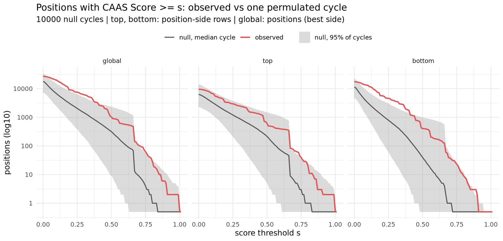

*Positions with a CAAS score of at least s, for the observed labeling (red) and the permulated cycles (median line and 95% band), globally and per side.*

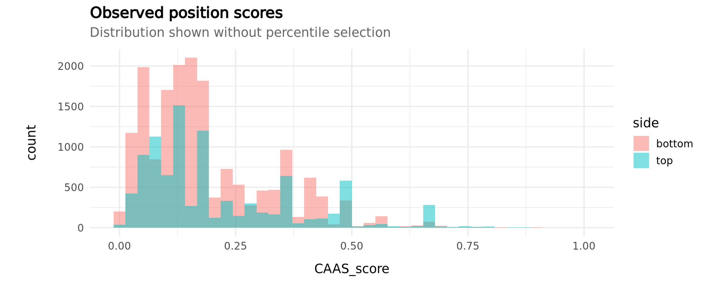

*Distribution of the observed CAAS scores of the positions, per side.*

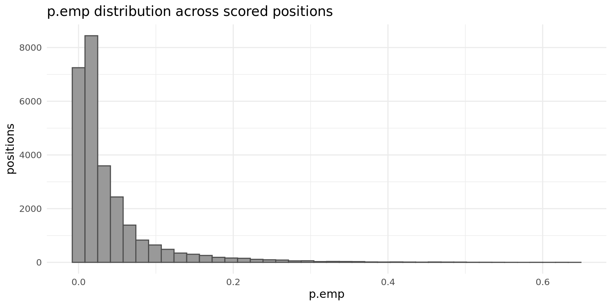

*Distribution of the empirical p-values of the scored positions.*

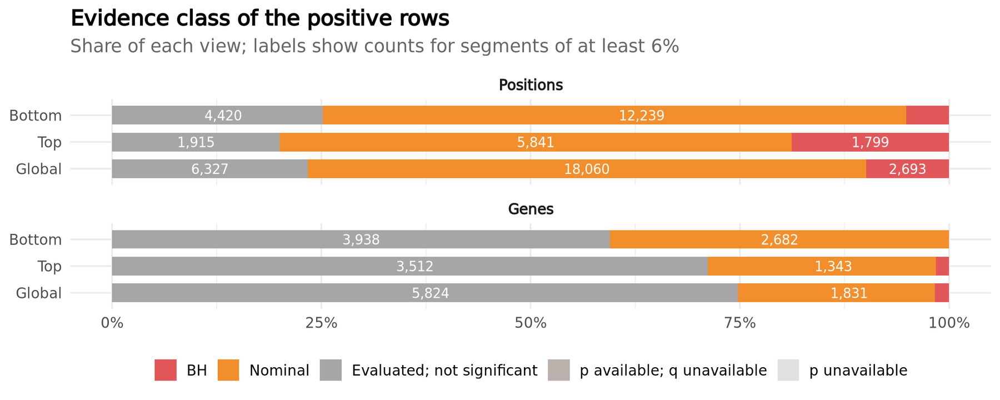

*Share of positions and genes in each evidence class: one class per BH level, nominal, evaluated but not significant. Report 15.*

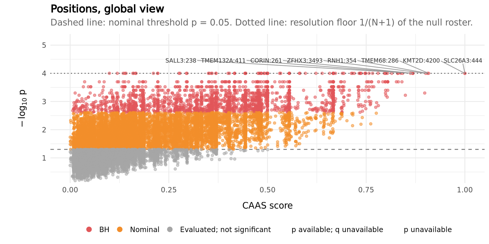

*CAAS score against -log10 p.emp for every scored position. The dotted line is the resolution floor 1/(N+1) of the null.*

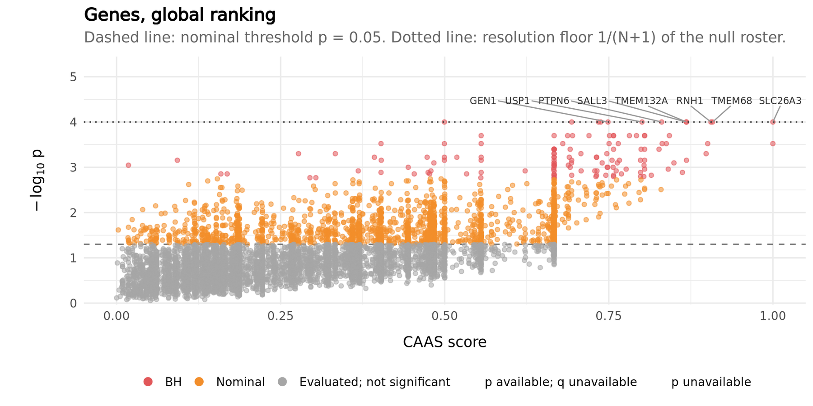

*Gene score (largest position score) against -log10 of the gene permulation p, with the same floor.*

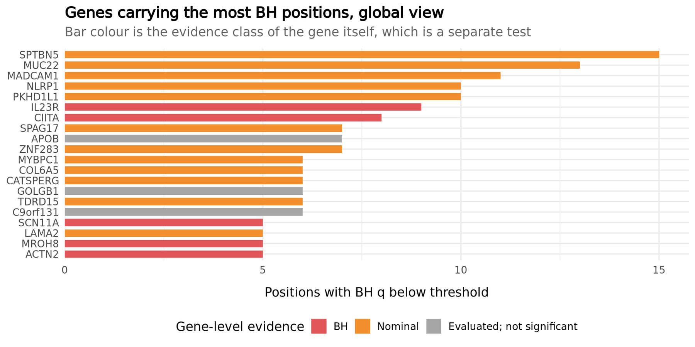

*Genes with the most positions below the BH threshold; the bar color is the evidence class of the gene itself, a separate test.*

## 8. RERconverge

RERconverge measures the evolutionary rate of each gene on each branch relative to the rest of the genome (relative evolutionary rate, RER), and correlates it with the trait across species. A gene accelerated in lineages with the phenotype has a positive association.

| Trait mode | Statistic |
|---|---|
| Continuous | Pearson correlation of winsorized RER and winsorized trait (limit 3 for both) |
| Binary | Unweighted Kendall, or weighted Pearson when foreground paths are fractional |

Continuous traits pass through `--rer_transform` first (`ha_logit`, `logit`, `arcsin`, `log10`, `none`, or `auto`: logit for proportions, log10 when Shapiro-Wilk rejects normality, otherwise none; `auto` never picks `ha_logit`). `ha_logit` is $\log\big((c+0.5)/(n-c+0.5)\big)$ and needs the `n_trait` and `c_trait` columns. A gene enters the matrix with at least `--rer_minsp` species (15) and is tested only if at least that many branches have both an RER and a trait value. A 3 to 5-level ordinal trait runs as continuous.

**Permulations.** Continuous: rank-matched Brownian phenotypes, simulated on the master tree pruned to the trait species (midpoint-rooted if unrooted, polytomies resolved arbitrarily, zero-length edges set to $10^{-8}$). Binary: stochastic histories under an equal-rates Mk model. The observed run and every null cycle use the same winsorization, `min.sp` and clade settings. Each null gives a statistic per gene. The permulation p follows `permpvalcor`, which centers on the null median $m$: if $\rho_{\text{obs}} \ge m$, $p = (\#\{\text{null} \ge \rho_{\text{obs}}\} + 1)/(\#\{\text{null} \ge m\} + 1)$, mirrored otherwise; Benjamini-Hochberg runs over genes. The default null is 10 batches of 100 permulations.

**Ranking for enrichment.** The gene statistic is $\operatorname{sign}(\rho) \cdot (-\log_{10} P)$, with $P$ the parametric p; the null of this ranking is the same statistic computed on every permulated phenotype.

Code: `subworkflows/RERCONVERGE/local/continuous_rer.R`, `binary_rer.R`, `rer_permulations.R:9-73`, `rer_batches.R:6-65`. The formulas above were read from the RERconverge version installed by `environment/install_env.sh` (commit `2bd328f`).

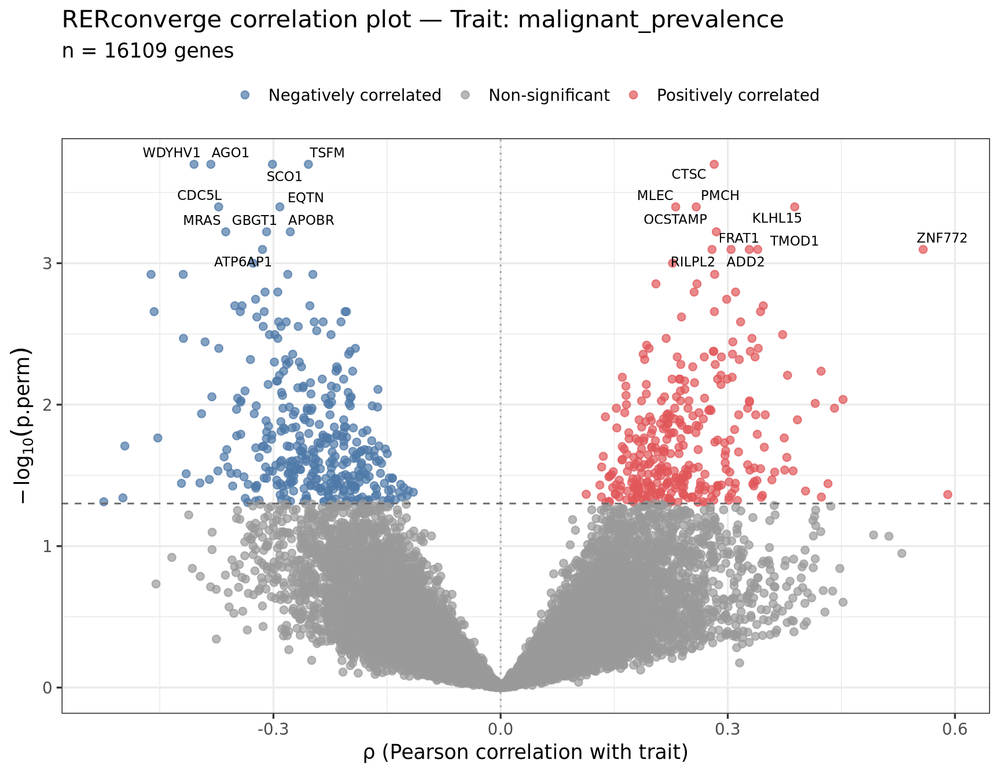

*Correlation of RER with the trait against the permulation p, per gene. Report 5.*

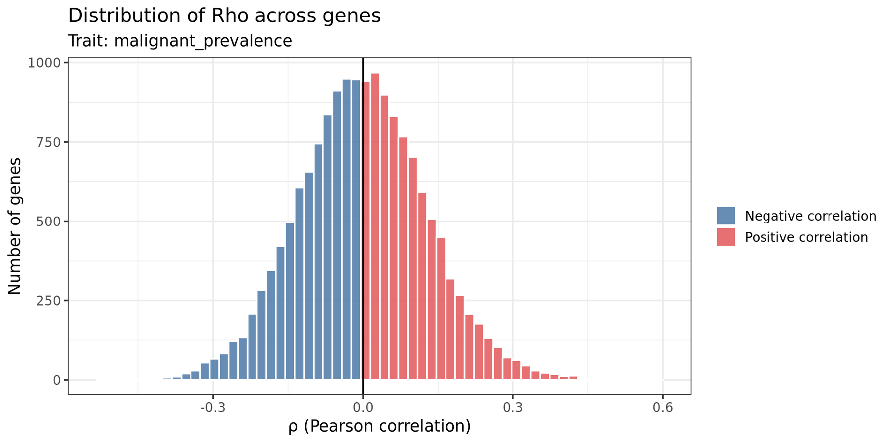

*Distribution of the correlation coefficient across genes.*

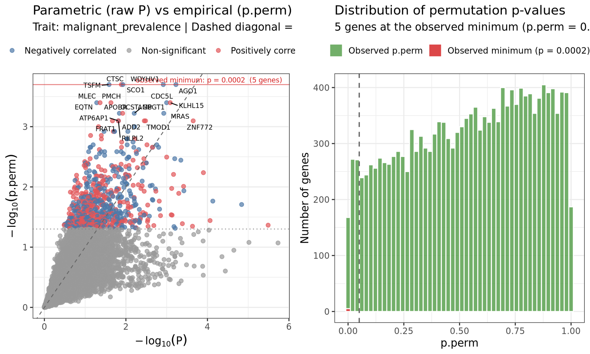

*Parametric p against the permulation p of each gene (left) and distribution of the permulation p (right). The red line marks the minimum the null can give.*

## 9. FADE

FADE (HyPhy) tests, for each site and each amino acid, whether foreground branches substitute towards that residue more than expected. The posterior over the bias parameter on a grid of `--fade_grid` points (20; variational Bayes by default) is converted to a Bayes factor against the prior mass of positive bias. A site-residue pair is significant at BF $\ge$ `--fade_bf_threshold` (100). The gene summary is the maximum BF over sites and residues, and a gene is flagged when that maximum reaches the threshold.

Three controls define the comparison:

| Option | Values | Effect |
|---|---|---|
| `--fade_direction` | `top`, `bottom`, `both` | Which extreme group is the foreground |
| `--fade_background_scope` | `all`, `opposite` | `all`: every other branch is background; `opposite`: tree and alignment are pruned to the foreground plus the opposite extreme, giving a two-group test |
| `--fade_species_file` | path | User-defined groups; bypasses contrast selection for FADE |

FADE has no permulation null. Its evidence enters SCORING as the maximum BF and the significance flag, next to the CAAS and RER columns, not inside the CAAS score.

Code: `subworkflows/FADE/local/src/FADE_phylophere.bf:721-783`; `fade_json_to_tables.py:24-66`.

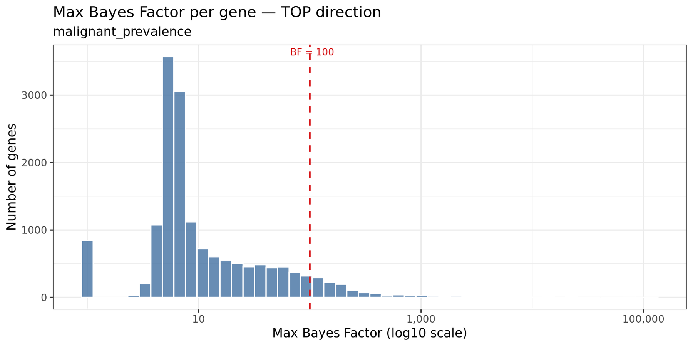

*Distribution of the maximum Bayes factor per gene for the top direction; the dashed line is the threshold of 100. Report 6.*

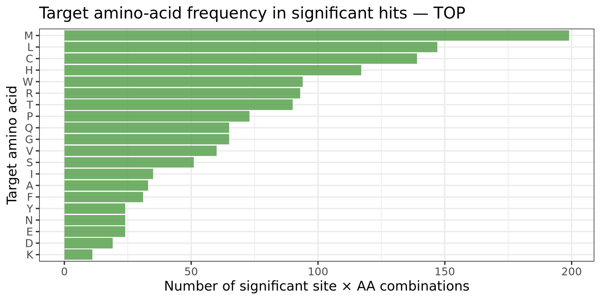

*Number of significant site and amino acid combinations per target amino acid, top direction.*

## 10. Functional class scoring (FCS)

FCS asks whether the genes of a set (GO, Reactome, KEGG, MSigDB, HPO and others in `--gmt_dir`) sit higher in a gene ranking than the rest of the background.

**Rankings.** CAAS: $-\log_{10}$ of the gene-level permulation p (global, top, bottom) of SCORING, with 0 for genes without a p. RER: the signed statistic $\mathrm{sign}(\rho) \times -\log_{10} P$ of [section 8](#8-rerconverge), over genes with a value. For each set, the comparison group is the other genes of the same GMT file that are in the ranking. The CAAS FCS needs a usable null (at least two cycles); without one the CAAS FCS report is skipped, while AMI and the comparison report still run.

**Statistic.** For a set with $n_1$ members and $n_2$ remaining background genes, the Wilcoxon area under the curve (computed with the enrichment functions of RERconverge, Kowalczyk et al. 2019), reported as $\text{stat} = \text{AUC} - 0.5 = U/(n_1 n_2) - 0.5$. Sets are evaluated only when the background minus the set has more than two genes, and only with `--fcs_min_genes` to `--fcs_max_genes` members.

**Analytic p.** For the non-negative CAAS ranking, a one-sided normal approximation with tie correction,
$\sigma^2 = \tfrac{n_1 n_2}{12}\Big((N+1) - \tfrac{\sum (t^3 - t)}{N(N-1)}\Big)$, where $t$ are the sizes of tied groups. This matters because most genes tie at 0. RER is two-sided.

**Permulation p.** The same statistic is computed on every null cycle: $p_{\text{perm}} = (\#\{j : \text{stat}_j \ge \text{stat}_{\text{obs}}\} + 1)/(N_{\text{valid}} + 1)$ (absolute values for two-sided). `q.perm` is the Benjamini-Hochberg adjustment within each ranking and database; a set is significant (`sig_perm`) when `q.perm` is below `--fcs_fdr` (0.15 by default). The analytic rule of Redlich et al. is reported independently (`redlich_level`): the smallest level in `--fcs_analytic_levels` at which the analytic p, BH-adjusted over all sets of the database, is below it among sets with $p_{\text{perm}}$ below `--fcs_pperm_thr`. Report 11 displays the rule at the fixed levels 0.05, 0.10 and 0.15, and a ranking without a null has no $p_{\text{perm}}$ and so no significant sets.

Sets that pass `q.perm` below `--fcs_fdr` or the Redlich rule at any level are grouped, within each ranking and effect sign, by complete linkage on the Jaccard similarity of their full gene sets, so every pair in a group has similarity of at least `--fcs_cluster_threshold` (0.2). The leading edge describes what drives a term and does not define the groups.

Code: `subworkflows/ENRICHMENT/local/src/fcs_enrich.R` (`fcs_run_ranking`, `fcs_null_enrichstat_vectorized`, `fcs_classify_significance`), `gene_p.R`, `fcs_selection.R`, `term_blocks.R`.

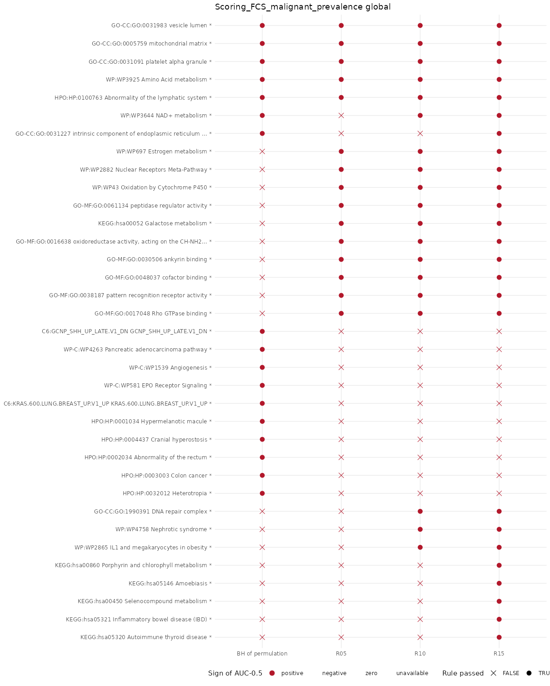

*Representative gene sets of the global CAAS ranking. Columns: BH of the permulation p, and the analytic rule at levels 0.05, 0.10 and 0.15 (R05, R10, R15). A dot means the rule is passed and a cross that it is not; the color gives the sign of AUC - 0.5. Report 11.*

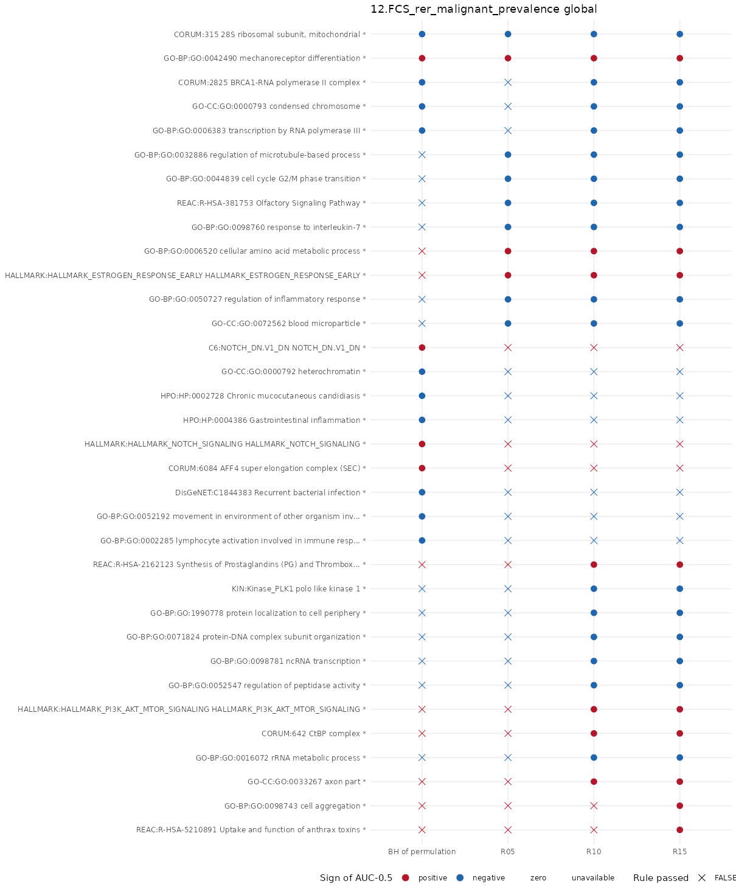

*The same display for the RER ranking.*

## 11. Active modules (AMI)

AMI looks for connected subnetworks. DOMINO builds a STRING network of taxon `--string_species` (default `ref_species_taxid` or 9606) restricted to the background genes, keeping edges with combined score of at least `--domino_network_score_thr` (700), and slices it. A module is kept when the tail-inclusive hypergeometric p of its active genes is at most `--domino_module_thr` divided by the number of putative modules (0.05 by default, a Bonferroni bound). The active genes are the nominal and BH-class lists of CAAS, FADE and RER, and each distinct list is run separately. Each module is labeled with STRING enrichment terms (`--ami_description_fdr`); labels are descriptive and carry their own FDR.

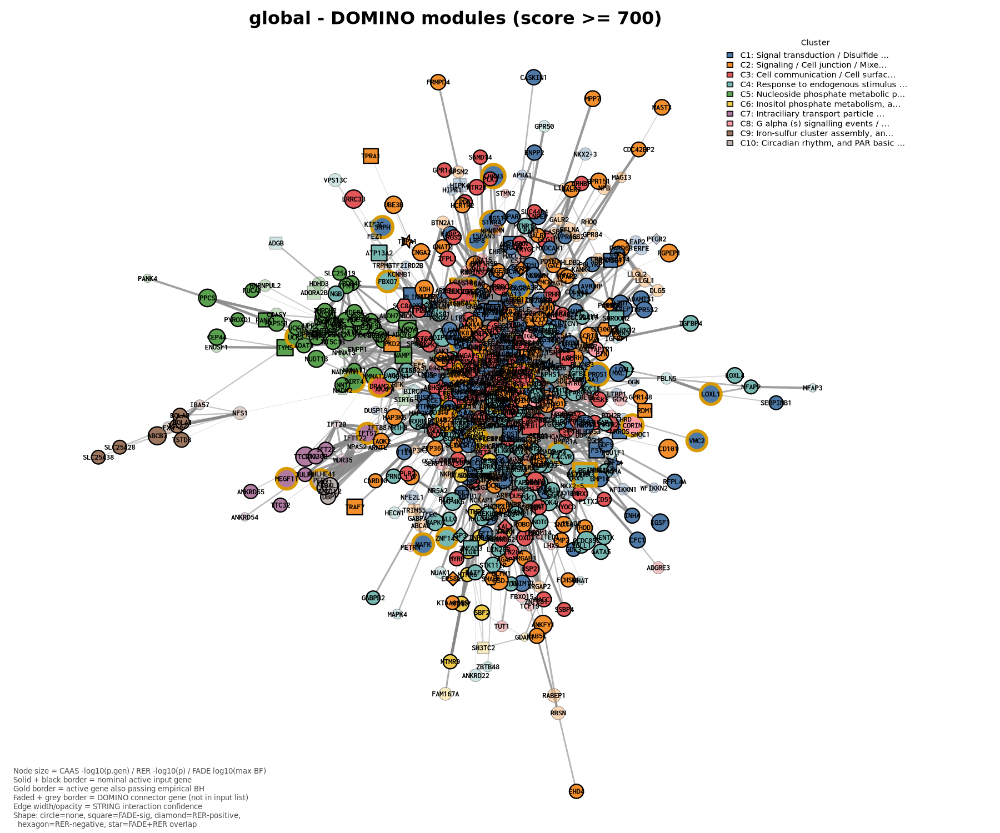

*DOMINO modules of the global CAAS gene list on the STRING network (score of at least 700). Node size scales with -log10 of the gene p, colors are modules labeled with their enriched terms, and the border color gives the BH class of an active gene. Report 12.*

## 12. POSENRICH

POSENRICH describes how the positive positions relate to genes and to sets of positions: Pfam domains and clans, ultraconserved regions (UCR), FUBAR and FADE sites, genomic windows and user lists. It has two inferential levels and one descriptive layer, calibrated with the CAAS null.

**Universe $U$.** The positions that CAAStools tested (`background.output`) in the genes of the cleaned background. Neither observed positives nor null detections select its members; each position carries `nd`, the number of null cycles that score it. Positions outside $U$ are not negatives. `nd` varies by orders of magnitude across $U$, which is why a uniform reference would be wrong for the empirical test.

**Level 1: accumulation (gene level).** For each gene, $c_g$ is the number of distinct positive positions, $n_g$ its positions in $U$, $M = |U|$ and $K$ the observed total of positives. The headline test is empirical,

$$p_g = \frac{1 + \#\{b : c_g(b) \ge c_g\}}{N + 1},$$

with the count of every null cycle taken as it comes, so the total and the gene filter may vary by cycle. The reference test is the upper hypergeometric tail of $c_g$ given $K$, $n_g$ and $M$ under a uniform allocation of positives over $U$, and uses no null. Each direction (top, bottom, all) is a separate family that contains every gene with positions in $U$; genes with no observed positive have $p = 1$. BH is applied within each family and model, and the q-values of the two models are not combined. Neither test establishes selection.

**Level 2: concentration within genes.** For a term $S$ (a domain, a clan, a region, a site list) and a gene $g$ with $n_g$ positions in $U$, $m_g$ of them in $S$ and $k_g$ positives:

$$r_g = (\text{positives of } g \text{ in } S) - k_g\, m_g / n_g, \qquad T_S = \sum_{g\ \text{eligible}} r_g$$

Eligible genes have members and non-members of $S$ in the covered part of $U$, so the test conditions on the gene and does not recount the signal of level 1. The p is one-sided from the null cycles, $(1 + \#\{b: T_S(b) \ge T_S\})/(N+1)$, with BH per collection. A term is tested when at least `--posenrich_min_genes` (2) genes carry both members and non-members of it within the covered positions of $U$; the other terms are listed with the reason and carry no p. Frequency and intensity differences are reported as descriptive effect sizes.

**Overlaps and proximity.** Positives that coincide with, or lie within `--posenrich_radios` (0, 5, 10 residues) of, a member of a term, per gene and detection, without p-values. Genomic windows (size `--scoring_window_size_bp`, 1 Mb) are descriptive too; genomic proximity is measured in nucleotides on the same chromosome. Level 2 collections are the Pfam domains and clans, UCR core and flank, FUBAR positive and purifying sites, FADE top and bottom sites and the custom list; a source without a verified coverage contract stays descriptive. Reports show q classes at `--evidence_fdr_levels`.

`--posenrich_holdout K` lets $K$ null cycles play the observed one. Only `holdout_fpr.tsv` is written: the fraction of (term, held-out cycle) pairs with p at or below each nominal level, by collection. The held cycles leave the calibration denominator, so the table checks level 2 at the null size and term sets of your own run.

Code: `subworkflows/POSENRICH/local/src/accumulation_test.py`, `posenrich_within_gene.py`.

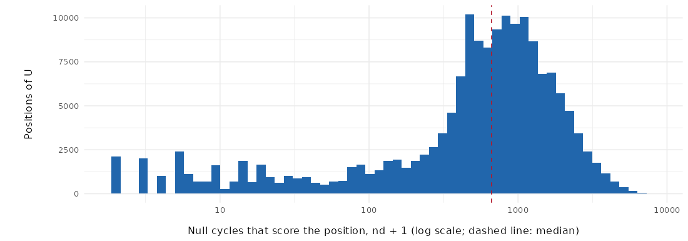

*Number of null cycles that score each position of the universe (log scale); the dashed line is the median.*

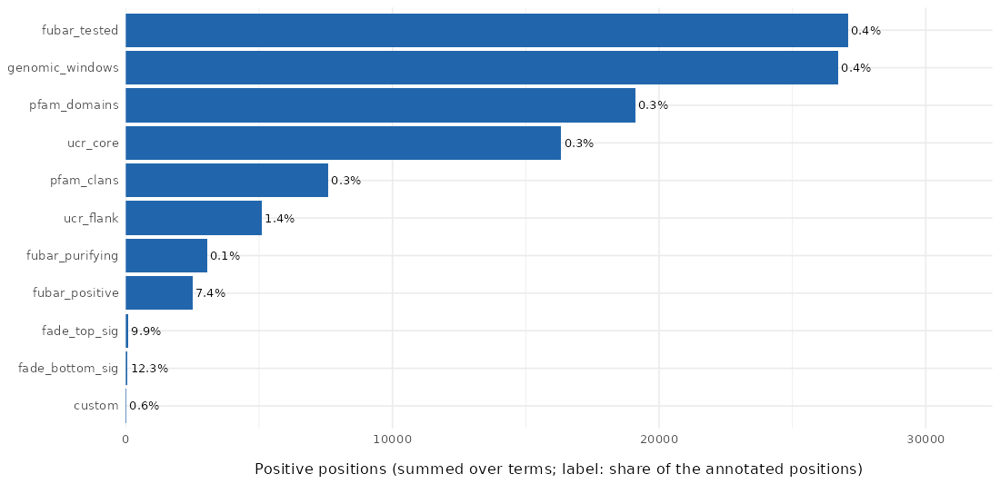

*Positive positions per annotation layer, with the share of the annotated positions that are positive. Report 13.*

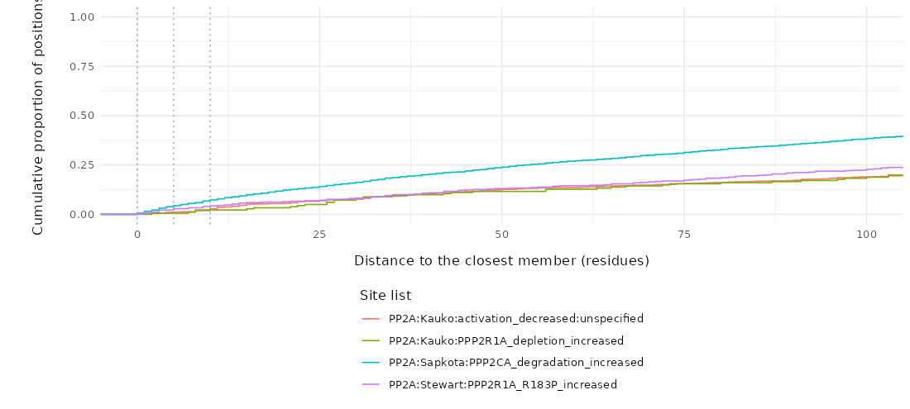

*Cumulative proportion of the positives by distance, in residues, to the closest member of each site list.*

## 13. VEP annotation

After SCORING, positions are annotated with PrimateAI-3D scores, COSMIC records and Ensembl VEP consequences of the human single-nucleotide changes that would turn a residue of the ancestral set into one of the derived set, or the reverse, at the same protein residue. These are human reference candidates, not events observed in other species, and a position with no match is reported as unannotated, which is not evidence of benignity. Alignment columns are projected onto the reference protein through the per-gene MAP files made by the [Ortholog Characterizator](https://github.com/nozerorma/ortholog_characterizator.git). These annotations describe the positions; they do not modify any score or p-value.

## 14. Report map

Numbers group the reports by module (0 to 9 before scoring, 10 to 15 after); report 15 is rendered after SCORING.

| # | Report | Module | Reads |
|---|---|---|---|
| 0 | Data pruning (file `2.Phenotype_exploration_pruned.html`) | REPORTING or CONTRAST_SELECTION, with `--prune_data` | trait table, tree |
| 1 | Dataset exploration | reporting | trait table, tree |
| 2 | Phenotype exploration (file `2.Phenotype_exploration_complete.html`) | REPORTING | trait table |
| 3 | CI composition | contrast selection | trait table |
| 4 | Independent contrasts | contrast selection | traits, tree |
| 5 | RERconverge | RER | RER objects |
| 6 | FADE (top, bottom) | FADE | FADE tables |
| 7 | CAAS pattern annotation | CT_META_CAAS | discovery |
| 8 | Characterization | CT_POSTPROC | filtered discovery |
| 9 | ASR diagnostics | ASR_DIAGNOSTICS | disambiguation tables |
| 10 | Scoring | SCORING | scores, null |
| 11 | FCS (CAAS, RER) | ENRICHMENT | rankings, null |
| 12 | AMI | ENRICHMENT | gene lists |
| 13 | POSENRICH | POSENRICH | universe, registry |
| 14 | Comparison | ENRICHMENT | FCS, AMI, VEP, position characterization |
| 15 | CAAS significance | CT_META_CAAS | scores, p.emp |

`workflow_map.html` in the output directory links every report and result directory of the run.

## 15. Limits of inference

- **Resolution floor.** All CAAS, FCS and POSENRICH empirical p-values satisfy $p \ge 1/(N+1)$. With 1000 cycles, a position, gene or term at the floor is as significant as the null can show, not more. RER permulation p-values come from RERconverge and have a floor of about $2/(N+2)$.
- **Selection of contrasts.** The observed pairs are chosen for a high PSS from the same data that are tested. The null reproduces the selection (`perm_match_pss`, fixed $K$), which protects against the circularity only to the extent that the rank-matched Brownian (or OU-rescaled) phenotype is a good model of the trait.
- **Brownian null.** The CAAS null simulates the trait under Brownian motion on the species tree, rescaled to the fitted Ornstein-Uhlenbeck model when AIC selects it, and maps ranks back to the observed values. The continuous RER null is Brownian, and the binary RER null is an equal-rates Mk history. Strongly non-Brownian traits (selection, bounded traits with clade structure) are only approximated.
- **Reconstruction uncertainty.** The path score uses posteriors of one substitution model (default LG, eight gamma categories). A different model changes scores; the ASR diagnostics report shows the distribution of the path score and of derived agreement and the posterior threshold used; the posteriors behind individual positions are in the evidence table (`--caas_evidence_top_n`).
- **Gene scores are maxima.** Genes with many testable positions have more chances to score high. The gene p-value corrects for this against the gene's own null, but `gene_caas_score` alone is not comparable across genes.
- **Position q-values.** The BH family is every position tested in the genes of the cleaned background, so q depends on how many positions were tested. Positions within a gene are not independent and BH does not model that dependence.
- **Enrichment depends on the null.** FCS inherits the CAAS null; a set at the permulation floor is bounded by $N$.
- **FADE** reports a Bayes factor from HyPhy's grid posterior with no null; its threshold of 100 is a convention.
- **Annotations are not evidence.** VEP, UCR, Pfam and COSMIC layers describe the positions and carry no p-value in the position score.
