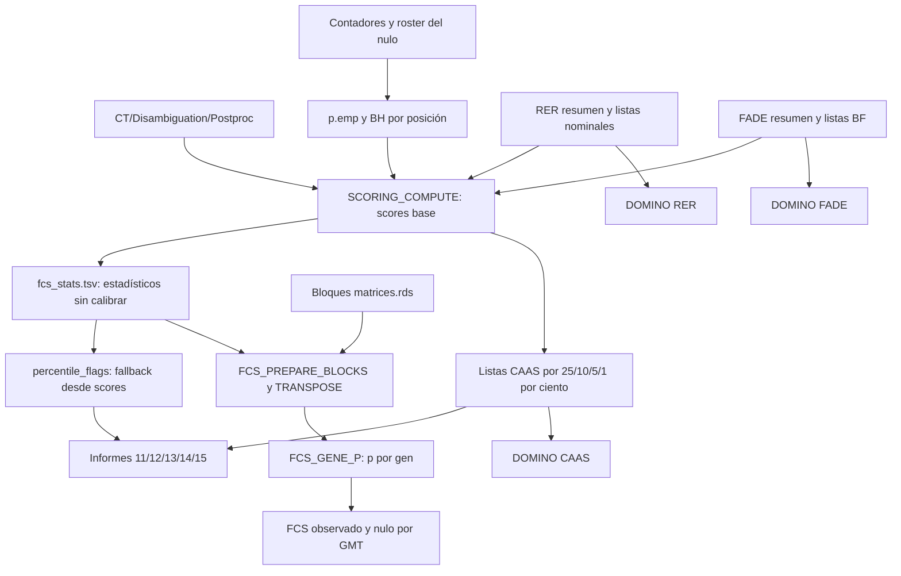
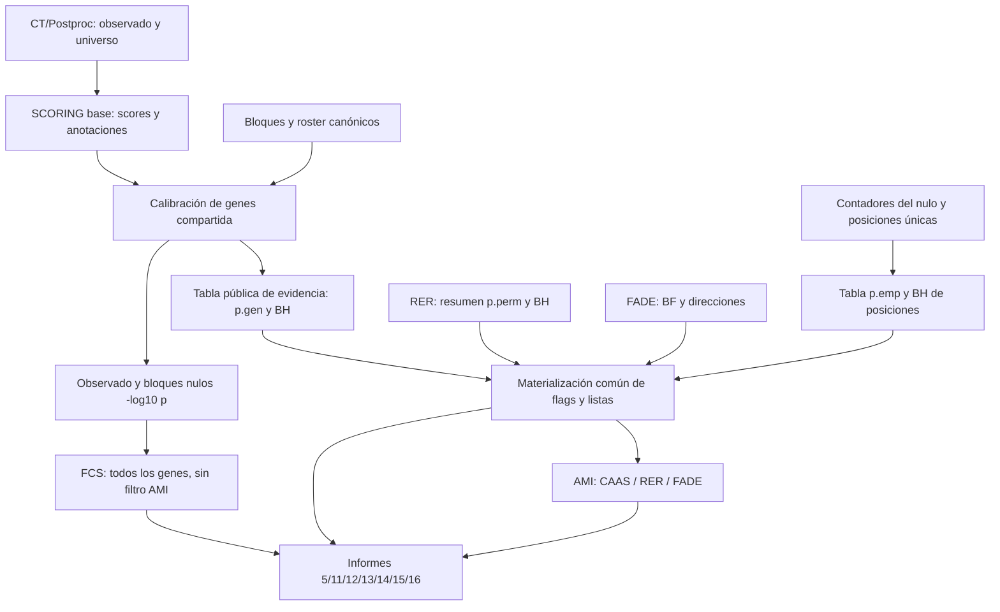

# Mapa de migración: percentiles → evidencia empírica

Auditoría estática del 23 de octubre de 2026. Primera fase de la implementación autorizada. Este documento mapea el código actual y fija las fronteras de la migración; no acredita todavía una implementación ni ejecución integrada.

## Resultado acordado

Tres familias AMI: CAAS, RER y FADE. Una actividad nominal por método/dirección, con el subconjunto BH resaltado en esa misma ejecución. CAAS usa p.gen < 0,05 y resalta p.gen.adj < 0,05; RER usa p.perm < 0,05 y resalta p.perm.adj < 0,05; FADE usa BF >= el umbral configurado (100 por defecto). Se conservan global/top/bottom de CAAS y las direcciones RER/FADE que correspondan: tres familias no significa tres únicas tareas Nextflow.

Genes: retirar completamente selecciones/anotaciones y ponderaciones por percentiles. Posiciones: hacer la misma sustitución con p.emp y resaltar p.adj_bh. El estadístico CAAS de origen se conserva. FCS conserva el ranking continuo de todos los genes y su estadística actual, sin usar como filtro las listas AMI.

No generar ejecuciones RER.adj ni CAAS.adj adicionales. Una tabla filtrada por BH describe un subconjunto de una red nominal; no se presentará como resultado de recalcular DOMINO con semillas ajustadas.

## Alcance y recuentos

Se ha buscado incluso en archivos ignorados de los árboles de código, pruebas y plantillas indicados. El inventario distingue coincidencias candidatas de cambios efectivos; una aparición literal no implica por sí sola que haya que modificarla. El registro de dependencias incluye archivos que no mencionan percentiles pero transportan sus tablas/canales.

HEAD de referencia: `6e13ba236ad2fe911f028ac4eea1a5d0db2601c5`. El árbol tenía cambios locales, incluidos cambios concurrentes de anotaciones posicionales. El TSV de dependencias guarda SHA-256 por archivo para detectar modificaciones posteriores.

| Grupo de búsqueda | Archivos con coincidencias | Referencias candidatas |
|---|---:|---:|
| codigo_actual | 22 | 258 |
| diseno_fenotipo_protegido | 4 | 22 |
| documentacion | 3 | 8 |
| otros_revisar | 1 | 3 |
| proyectos_json | 17 | 34 |
| pruebas | 7 | 8 |
| validacion_operativa | 5 | 5 |

El registro explícito contiene **65 archivos**. Los **17 proyectos/fixtures JSON** con cortes se enumeran por separado más abajo.

## Flujo actual

El p.gen de CAAS se calcula actualmente como parte de FCS_GENE_P. Se escribe por batch como gene/nlog10_obs y no existe aún una tabla pública común p.gen/p.gen.adj que puedan consumir por igual SCORING, AMI y el informe comparado. El resto del pipeline no debe deducir ese p a partir de los percentiles del score.

## Flujo objetivo y orden de dependencia

La calibración se ejecutará independientemente de GMT, fcs_enabled o ami_enabled cuando se necesite evidencia genómica. Se evita el ciclo SCORING → ENRICHMENT → informe SCORING. La implementación debe separar el cómputo base de la materialización/reporting final, reutilizando una sola calibración.

## Contratos de datos y consumidores

| Artefacto actual | Productor | Consumidores | Sustitución/frontera |
|---|---|---|---|
| gene_scores.tsv | scoring_compute.R | Informe 11, informe 15, anotaciones | Mantener tabla pública enriquecida con p.gen/BH; separar tabla base interna si hace falta para el DAG. |
| fcs_stats.tsv | scoring_compute.R | FCS CAAS, reportes FCS/AMI/comparado | Conservar score_global/top/bottom como estadístico de origen; añadir o asociar evidencia por ID y ranking. Nunca sobrecargar una columna con significado nuevo. |
| obs_<ranking>_<batch>.tsv y *_gp_*.rds | FCS_GENE_P | FCS_OBSERVED y FCS_NULL_BLOCK | Convertirlos en productos compartidos; reunir p observados y ajustar BH por universo completo. |
| gene_lists/slice_*.tsv | scoring_compute.R | DOMINO, informes 12/13/15 y helper de percentiles | Retirar 12 listas; reemplazar por listas nominales identificadas y tabla de anotaciones nominal/BH. |
| position_lists/slice_*.tsv | scoring_compute.R | POSENRICH/reportes 14/15 | Retirar 12 listas; listas por p.emp y anotación BH. |
| position_scores.tsv | scoring_compute.R + null_position_p.R | Informes 11/14/15/16, VEP, explicación de posiciones, anotaciones | Mantener p.emp/p.adj_bh y diagnósticos; añadir flags coherentes. No filtrar la tabla de evidencia completa. |
| gene_threshold_enrichment.tsv | scoring_compute.R | Informe 11 | Retirar barrido de seis percentiles; si se conserva solapamiento, usar las llamadas explícitas con su universo común. |
| pos_threshold_enrichment.tsv | scoring_compute.R | Informe 11 | Mismo cambio por p.emp/BH; no aplicar p.gen a posiciones. |
| rer_significant/accelerating/decelerating.txt | RER_GENE_LISTS | DOMINO RER, reportes, comparación | Actividad nominal fija, dirección Rho y anotación BH; eliminar divergencia con SCORING. |
| fade_*_significant.txt | FADE_GENE_LISTS | DOMINO FADE y reportes | Conservar criterio BF configurado y sincronizar flags de SCORING actualmente hardcodeados a 100. |
| background.txt / cleaned_background | Cada método | FCS, red DOMINO, solapamientos | Preservar universos propios; BH antes de mapeo STRING o selección de hits. |

Tabla pública nueva de genes: una fila por gene/ranking, statistic, gene_stat, p.gen, p.gen.adj, nominal, adjusted, N_roster, N_valid, family_id y versión del contrato. Publicar también metadatos de universo, umbrales, inputs y estado del nulo para regenerar informes con work eliminado. Las tablas de anotaciones de otros métodos se unen por ID, sin exigir CAAS positivo.

Tabla posicional: una prueba por (Gene, Position). El p.emp actual es del máximo entre lados y se copia a las filas de lado; sus duplicados no deben volver a contar en BH ni en conteos globales. Los cortes por lado no justifican inventar un p direccional. Mantener p.emp_fact como diagnóstico distinto.

## Hallazgos que condicionan la implementación

1. **Dependencia oculta de FCS.** Ahora AMI no dispone de p.gen fuera de FCS_GENE_P. La extracción compartida es el primer cambio funcional.
2. **Fallback de percentiles.** percentile_flags.R reconstruye flags desde score_top/score_bottom si no hay listas; eliminar listas sin retirar ese fallback dejaría activa la selección antigua.
3. **Cortes adicionales de RER.** El informe 5 genera is_top_10/5/1_acc/dec con .dir_top, aunque AMI reciba listas nominales. Deben desaparecer del contrato/presentación.
4. **Tres definiciones de llamada RER.** RER_GENE_LISTS usa rer_pval_column y umbral configurable; SCORING prioriza p.perm y usa <=0.05; el informe 5 usa <pval_threshold. Unificar fuente, umbrales y frontera estricta (<), incluidos p exactamente 0.05 y NA. Si no hay permulaciones, los valores paramétricos pueden mostrarse etiquetados pero no hacerse pasar por p empíricos.
5. **BF de FADE.** Listas FADE respetan fade_bf_threshold, mientras SCORING compara con >=100. El resaltado/actividad debe coincidir para valores configurados distintos de 100.
6. **Peso compuesto.** El informe 15 usa .pct_tier_score y cuenta los cuatro percentiles en N criteria. Retirar esas contribuciones y su narrativa; no reemplazar por otra suma arbitraria ni contar nominal y BH como votos independientes.
7. **Anotaciones duplicadas.** Flags pct_* se recalculan en 12, 13 y 15 y posiciones en 14/15; la tabla canónica debe ser su única fuente. Comprobar también que global/top/bottom se interpretan igual en AMI y comparación: hay comentarios heredados que ya no describen las listas globales presentes.
8. **Listas .txt y staging.** DOMINO copia ficheros .txt del task. El nuevo contrato debe declarar listas de actividad y no incorporar backgrounds u otros .txt como datasets activos.
9. **Reuso.** complete/strict, inputs precomputados y regeneración de HTML deben resolver la misma evidencia del run correcto, con gene_stat/universo/roster compatibles. No depender de ficheros temporales de una tarea antigua.
10. **Posiciones ya tienen p.emp.** La omisión de POSENRICH no significa que falten p-valores individuales. La selección de posiciones es posible desde contadores; el enriquecimiento de conjuntos por permulaciones es otro contrato.
11. **Concurrencia.** position_annotations.nf, build_position_gmt.py, modelos, generación y workflows/enrichment.nf están modificándose. Los hashes del mapa son referencia, no licencia para restaurar versiones anteriores.

## Fronteras de alcance

Se retiran completamente los percentiles de selección/priorización de genes y posiciones, sus flags, listas, porcentajes de pertenencia en módulos, barridos y ponderaciones. Las distribuciones de scores se pueden seguir mostrando sin marcar cortes de selección. Un límite top_n de filas/etiquetas es presentación y debe identificarse como tal.

Se preservan pss_top_pct y los controles del diseño de contrastes/fenotipo: tienen otra función científica. Se preserva domino_slice_thr: «slice» designa la partición de la red, no un percentil de CAAS. Se preservan la ECDF F y max/fmax/size_adj_max: forman el estadístico que se calibra. No sustituirlos por p.emp de posiciones para reconstruir genes.

Los umbrales nominal/BH se migran explícitamente. Un proyecto antiguo con top_pct=0.10 no se convierte en p=0.10. Leerlo debe retirar el campo y avisar. Los HTML históricos no se editan; los reportes regenerados deben verificar disponibilidad de la nueva evidencia y no recuperar percentiles.

## Orden de implementación

1. Productor compartido de calibración por gen, tabla pública y reutilización de bloques calibrados.
2. Materialización de evidencia/listas desde p.gen y p.emp, sincronización RER/FADE y estados no disponibles.
3. Orquestación AMI de tres métodos/direcciones y sus resaltados BH.
4. Informes 5/11/12/13/14/15/16 y exportaciones, incluidos helpers e invocaciones independientes.
5. GUI, CLI, serialización, generadores, proyectos/fixtures y ayuda.
6. Retirada de funciones/importaciones antiguas, búsqueda residual clasificada y aceptación integrada pequeña.

Cada paso mantendrá explícitas las entradas y salidas antes de retirar el productor anterior; no generar dos calibraciones ni conservar silenciosamente una segunda selección por percentiles.

## Matriz mínima de aceptación

| Caso | Qué debe probar |
|---|---|
| FCS apagado, AMI encendido | p.gen, BH y listas existen sin GMT ni ejecución FCS. |
| FCS encendido | Ranking calibrado y resultados numéricos idénticos para entradas idénticas. |
| Dos tamaños de batch | p.gen y BH iguales; BH después de reunir familia completa. |
| global/top/bottom | Familias declaradas, IDs/universos correctos, sin reutilizar flags del global como direccionales. |
| Mismo sitio en dos lados | Un único test BH y conteo global; mismo p.emp en ambas filas. |
| Nominales sin ajustados | AMI corre con nominales, resaltado BH vacío y recuentos correctos. |
| Cero nominales / cero aristas | Salidas vacías válidas, sin inventar actividad ni fallar HTML. |
| Nulo ausente / incompatible | Evidencia no disponible o error diagnóstico; ningún fallback a percentiles. |
| p exactamente 0.05 / NA / BF exactamente umbral | Fronteras idénticas en listas, flags e informes. |
| complete/strict y work eliminado | Resolver artefactos publicados correctos; ninguna dependencia temporal oculta. |
| Proyecto antiguo y render de todas las plantillas | Aviso de migración, sin campos de percentiles ni cambio accidental de semillas/gene_stat. |
| RER binario/continuo y FADE no-default | Misma definición de evidencia y direcciones en tabla, red y reporte. |
| Regeneración independiente de informes | Evidencia/flags reproducibles desde publicaciones, sin recomputar ciclos. |

Los tests actuales que importan percentile_flags.R se migran conservando sus oráculos numéricos. Se añaden pruebas del contrato anterior; no se cambian los resultados esperados de AUC/permulación para acomodar una regresión.

## Registro de archivos y punto de entrada

La línea es un ancla de lectura del archivo al mapear, no un rango de modificación. El TSV conserva el hash y la acción completa. Prioridades P0: datos/DAG; P1: consumidores/contratos; P2: migración/documentación/pruebas.

| Prioridad | Archivo y ancla | Función | Acción |
|---|---|---|---|
| P0 | `main.nf:801` | Integración | Conectar evidencia canónica de genes/posiciones con todos los consumidores; preservar entradas vivas y precomputadas. |
| P0 | `workflows/scoring.nf:20` | Orquestación SCORING | Separar cómputo base, calibración compartida, materialización de evidencia y reportes; evitar dependencia circular con ENRICHMENT. |
| P0 | `subworkflows/ENRICHMENT/fcs_inputs.nf:25` | Resolución del nulo | Reutilizar resolver canónico en etapa compartida; cubrir bloques vivos, directorio guardado y RDS compatible. |
| P0 | `subworkflows/ENRICHMENT/fcs_blocks.nf:38` | Calibración gene-p | Extraer TRANSPOSE/GENE_P de la ejecución dependiente de GMT/FCS; compartir observados y nulos calibrados. |
| P0 | `subworkflows/ENRICHMENT/local/src/gene_p.R:13` | Matemática de genes | Conservar fórmula, LOO y tolerancia; exponer p observado y metadatos de N. |
| P0 | `subworkflows/ENRICHMENT/local/src/caas_blocks.R:42` | Cálculo por bloques | Mantener memoria por batch y orden de genes/ciclos; exponer información suficiente para tabla canónica. |
| P0 | `subworkflows/ENRICHMENT/local/src/fcs_blocks.R:102` | CLI por bloques | Separar comandos compartidos de consumidores FCS; reunir universo completo antes de BH. |
| P0 | `subworkflows/ENRICHMENT/local/src/fcs_prepare_blocks.R:3` | Compatibilidad | Comprobar nulo compatible y rechazo de gene_stat distinto; compartir resolución sin reconstruir ciclos. |
| P0 | `subworkflows/SCORING/local/src/caas_block_contract.R:6` | Contrato del almacén | Conservar validación de partes/IDs/stat y roster; referencia de no regresión. |
| P0 | `subworkflows/SCORING/local/src/scoring_compute.R:903` | Productor de tablas y listas | Retirar 24 listas por cortes y dos barridos Fisher; preservar estadísticos, p.emp y anotaciones RER/FADE; producir tablas base antes de calibración. |
| P0 | `subworkflows/SCORING/scoring_compute.nf:36` | Wrapper del productor | Cambiar outputs/argumentos, hashes y sentinelas; retirar argumentos top* y conectar nuevas tablas/listas. |
| P0 | `subworkflows/SCORING/local/src/null_position_p.R:36` | p.emp y BH de posiciones | Reutilizar valores actuales y familia de posición única; top/bottom no son tests independientes. |
| P0 | `subworkflows/SCORING/local/src/null_position_stats.py:64` | Contadores de posiciones | Verificar contrato de counters/N/universo; no alterar cálculo para reemplazar presentación. |
| P0 | `subworkflows/SCORING/scoring_null_positions.nf:23` | Orquestación posicional | Mantener productor desde contadores y nulo reutilizado; metadatos suficientes para evidencia pública. |
| P0 | `workflows/enrichment.nf:121` | Orquestación FCS/AMI | Recibir evidencia y listas; AMI independiente de fcs_enabled; tres métodos con direcciones pertinentes. |
| P0 | `subworkflows/ENRICHMENT/domino.nf:82` | AMI entradas | Retirar dependencia slice_*.tsv y copiar solo listas de actividad declaradas, excluyendo backgrounds. |
| P0 | `subworkflows/ENRICHMENT/local/src/run_domino_modules.py:39` | AMI ejecución | Verificar nombres nuevos, conjuntos vacíos y outputs; no segunda ejecución BH. |
| P0 | `subworkflows/RERCONVERGE/rer_gene_lists.nf:28` | Listas RER | Nominal como actividad, BH como flag de resaltado, umbrales coherentes; sin selector que cambie solo un consumidor. |
| P0 | `subworkflows/FADE/fade_gene_lists.nf:20` | Listas FADE | Coherencia BF configurado con SCORING y reportes; direcciones y background propios. |
| P1 | `subworkflows/ENRICHMENT/local/src/percentile_flags.R:35` | Helper retirado | Eliminar helper y reconstrucción automática de percentiles tras migrar imports. |
| P1 | `subworkflows/ENRICHMENT/local/src/fcs_enrich.R:42` | Helper FCS | Retirar importación; consumir evidencia para anotación sin modificar estadística FCS. |
| P1 | `subworkflows/ENRICHMENT/local/src/fcs_compute.R:94` | CLI FCS histórica | Preservar compatibilidad estadística y actualizar staging de helpers. |
| P1 | `subworkflows/ENRICHMENT/fcs.nf:33` | Wrappers FCS | Pasar tabla canónica y listas nuevas a informes y hashes/staging. |
| P1 | `subworkflows/ENRICHMENT/scoring_enrichment.nf:123` | Wrappers informes 13/15 | Sustituir staging de listas CAAS; pasar flags y tablas publicadas para todos los métodos. |
| P1 | `subworkflows/SCORING/scoring_report.nf:65` | Wrapper informe 11 | Eliminar params de percentiles; recibir evidencia calibrada de genes además de posiciones. |
| P1 | `subworkflows/RERCONVERGE/local/5.RERconverge_report.Rmd:204` | Informe 5 | Retirar is_top_10/5/1_acc/dec; mostrar llamadas nominal/BH, conservar estadístico RER nativo. |
| P1 | `subworkflows/RERCONVERGE/rer_report.nf:20` | Wrapper RER | Comprobar ruta real de render y parámetros; propagar contrato nominal/BH. |
| P1 | `subworkflows/SCORING/local/11.Scoring_report.Rmd:1540` | Informe 11 | Retirar cortes de score, barras y seis niveles de composición; usar conjuntos p.emp/p.gen con resaltado BH. |
| P1 | `subworkflows/ENRICHMENT/local/12.FCS_general_report.Rmd:307` | Informe 12 | Cambiar leading-edge pct_* por p/BH; preservar todos los genes del ranking FCS. |
| P1 | `subworkflows/ENRICHMENT/local/13.AMI_analysis.Rmd:1536` | Informe 13 | Tres familias; listas nominales, nodos semilla/semilla BH/conectores, tablas de módulos sin top10/5/1. |
| P1 | `subworkflows/ENRICHMENT/local/14.Position_enrichment_report.Rmd:1091` | Informe 14 | Sustituir percentiles/solapamientos/selecciones por gen por p.emp; coordinar porte concurrente. |
| P1 | `subworkflows/ENRICHMENT/local/15.Comparison_report.Rmd:1010` | Informe 15 | Eliminar tiers/ponderación de percentiles; conservar evidencia y resultados por método; evitar nominal+BH como doble voto. |
| P1 | `subworkflows/CT_META_CAAS/local/16.CAAS_significance_report.Rmd:63` | Informe 16 | Verificar joins y flags mismos p.emp/BH; no recalcular ajuste tras filtrar patrones. |
| P1 | `subworkflows/CT_META_CAAS/ctpp_meta_caas.nf:11` | Wrapper informe 16 | Mantener tabla posicional canónica y sincronizar resultados publicados. |
| P1 | `subworkflows/ENRICHMENT/posenrich.nf:20` | POSENRICH contrato | Preparar listas de posiciones por p.emp; no reactivar módulo sin decisión científica propia. |
| P1 | `subworkflows/ENRICHMENT/position_annotations.nf:3` | Anotaciones concurrentes | Consumidor/contrato protegido: coordinar entrada canónica, no sobrescribir trabajo en curso. |
| P1 | `subworkflows/ENRICHMENT/local/src/build_position_gmt.py:34` | Anotaciones concurrentes | Mantener anotaciones de colecciones separadas de llamadas estadísticas de posiciones. |
| P1 | `conf/scoring.config:8` | Defaults | Retirar parámetros de cortes; introducir umbral nominal/ajustado de alcance explícito. |
| P1 | `conf/rerconverge.config:8` | Defaults RER | Migrar selector a contrato de actividad nominal y resaltado BH; no alterar FCS RER nativo. |
| P1 | `gui/models/modules.py:261` | Modelo GUI | Retirar campos de percentiles y definir controles de p nominal/BH con alcance claro. |
| P1 | `gui/models/serialization.py:135` | Migración proyectos | Descartar parámetros retirados con aviso; nunca reinterpretar 0.10 percentil como p=0.10. |
| P1 | `gui/widgets/tabs/scoring_tab.py:33` | GUI SCORING | Reemplazar entradas de percentiles por controles p y explicación de BH. |
| P1 | `gui/widgets/tabs/rerconverge_tab.py:65` | GUI RER | Explicar y configurar contrato común; nominal/BH visibles a la vez. |
| P1 | `gui/generation/context.py:57` | Contexto Jinja | Revisar defaults y serialización de nuevos campos; cambios concurrentes presentes. |
| P1 | `gui/generation/templates/run_single.sh.j2:602` | Runner | Retirar JSON/env de cortes; propagar valores nuevos en todas las pasadas. |
| P1 | `gui/generation/templates/sbatch_array.sh.j2:248` | SBATCH | Retirar exports de cortes y conservar controles nuevos por proyecto. |
| P1 | `gui/generation/report_registry.py:316` | Regeneración informes | Actualizar firmas, manifiestos e invocaciones independientes de informes y tablas nuevas. |
| P1 | `gui/generation/validate.py:28` | Validación GUI | Validar rango de umbrales y entradas; no exigir GMT/FCS para AMI. |
| P2 | `gui/i18n.py:1498` | Traducciones | Retirar textos obsoletos y traducir nominal/BH/actividad. |
| P2 | `workflows/help.nf:330` | Ayuda CLI | Retirar argumentos de cortes; documentar reemplazos y familia de ajuste. |
| P1 | `subworkflows/ENRICHMENT/fcs_rer_blocks.nf:16` | FCS RER hashes | Retirar dependencia del helper de percentiles de hashes/staging sin alterar ranking RER. |
| P1 | `workflows/rerconverge.nf:42` | Orquestación RER | Mantener resumen/listas/precomputados coherentes; distribuir tabla y flags a SCORING/AMI. |
| P2 | `README.md:246` | Documentación raíz | Actualizar ejemplos de controles y contrato de reportes. |
| P2 | `validation/tier1/scripts/render_tier1_scripts.py:22` | Renderer aceptación | Regenerar proyectos sin cortes y preservar semilla/gene_stat y recursos. |
| P2 | `validation/tier1/scripts/compare_pepc_runs.py:23` | Comparación validación | Revisar expectativas de tablas y columnas exportadas tras retirar cortes. |
| P2 | `tests/test_fcs_auc_contract.R:3` | Oráculo FCS | Cambiar import de helper preservando oráculo AUC y criterios numéricos. |
| P2 | `tests/test_fcs_rules.R:4` | Oráculo reglas FCS | Actualizar imports sin modificar reglas de significación de pathways. |
| P2 | `tests/test_fcs_rer_missing.R:5` | Regresión datos ausentes | Actualizar staging/import y preservar comportamiento de RER ausente. |
| P2 | `tests/test_wp6_blocks.R:3` | Oráculo bloques | Adaptar imports; verificar calibración independiente del batch. |
| P2 | `tests/test_wp6_fcs_cli.R:6` | CLI FCS | Actualizar staging para nueva frontera calibración/FCS. |
| P2 | `tests/test_wp6_rer_cli.R:4` | CLI RER | Actualizar imports y preservar ranking nativo. |
| P2 | `tests/test_wp9.R:4` | Control estadísticos genes | Mantener comparación max/fmax/size_adj_max con contrato nuevo. |
| P2 | `tests/test_wp8.py:26` | Plantillas y regresión | Añadir migración de campos retirados y compatibilidad de generadores. |
| P2 | `tests/test_runner_reuse.py:13` | Complete y strict | Cubrir reuso de tabla p.gen/listas y ausencia de nulo. |
| P2 | `tests/test_position_collections.py:12` | Contrato concurrente de posiciones | Asegurar que anotaciones siguen usando IDs compatibles al sustituir cortes. |

## Proyectos y fixtures con parámetros retirados

- `gui/templates/LQ_fabio.json`
- `gui/templates/cancer_def.json`
- `gui/templates/cancer_no_prune_multi_toy.json`
- `gui/templates/cancer_report.json`
- `gui/templates/carn.json`
- `gui/templates/carn_toy.json`
- `gui/templates/diet_reports.json`
- `gui/templates/log_LQ_fabio.json`
- `gui/templates/malignant_def.json`
- `gui/templates/neoplasia_def.json`
- `gui/templates/tier1_pepc_c4.json`
- `gui/templates/tier1_pepc_c4_nocons.json`
- `gui/templates/tier2_marine.json`
- `gui/templates/tier2_marine_toy.json`
- `validation/tier1/templates/tier1_pepc_c4.json`
- `validation/tier2/templates/tier2_marine.json`
- `validation/tier2/templates/tier2_marine_toy.json`

## Referencias operativas adicionales

- `adhoc_scripts/fcs_calibrated_ranking_control.sbatch`: revisar staging/importaciones o expectativas históricas antes de migrar; no cambiar controles científicos de referencia sin justificarlo.
- `adhoc_scripts/fcs_null_as_observed.sbatch`: revisar staging/importaciones o expectativas históricas antes de migrar; no cambiar controles científicos de referencia sin justificarlo.
- `adhoc_scripts/fcs_rawmax_ranking_control.sbatch`: revisar staging/importaciones o expectativas históricas antes de migrar; no cambiar controles científicos de referencia sin justificarlo.
- `adhoc_scripts/fcs_scaling.sbatch`: revisar staging/importaciones o expectativas históricas antes de migrar; no cambiar controles científicos de referencia sin justificarlo.
- `adhoc_scripts/wp9_gene_stat_control.R`: revisar staging/importaciones o expectativas históricas antes de migrar; no cambiar controles científicos de referencia sin justificarlo.

## Entregables del mapa

- `Mapa_productores_consumidores_p_emp.tsv`: registro explícito, acción, prioridad, ancla y hash de 65 archivos.
- `Inventario_referencias_percentiles.tsv`: coincidencias de búsqueda con archivo/línea, separando código, diseño protegido, pruebas, fixtures y referencias históricas.
- `Mapa_p_emp_recuento.json`: recuentos reproducibles de la búsqueda.

No se han ejecutado tests funcionales nuevos en esta fase: se ha auditado estáticamente el código y se han verificado los paths del registro. Las pruebas de aceptación se ejecutarán al implementar las fronteras respectivas.
